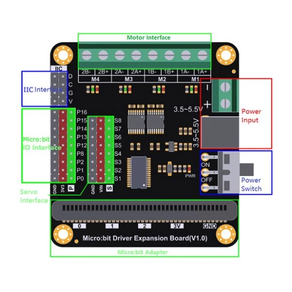
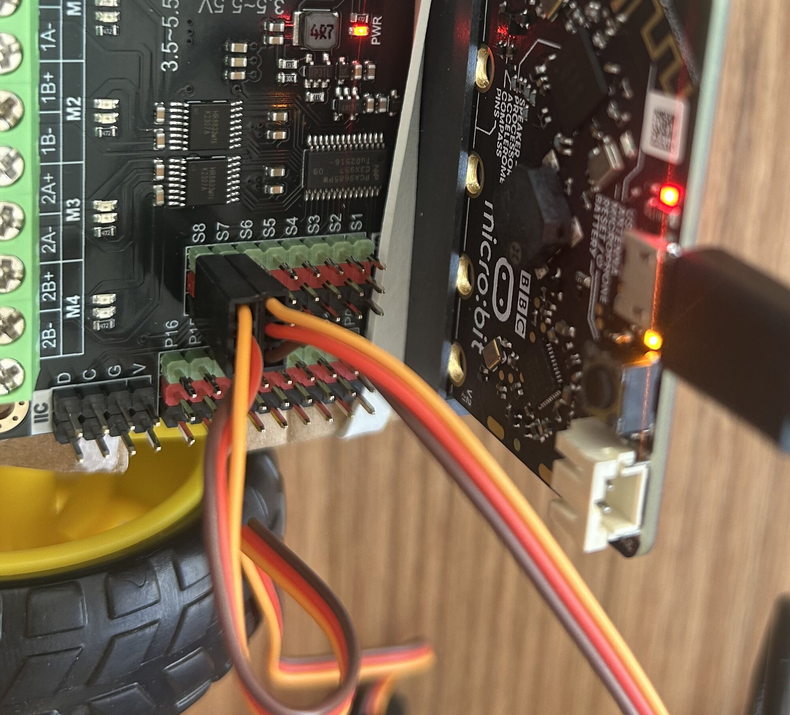
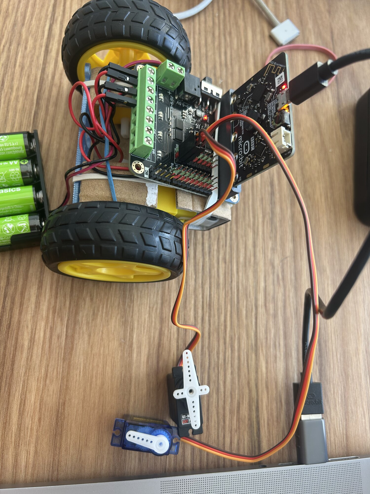

# La carte DFR0548 et ses blocs

C'est la carte sur laquelle s'enfiche ton micro:bit. Son nom complet est *Micro:bit Driver Expansion Board*. Elle fait le lien entre un micro:bit qui décide et des moteurs qui consomment.

<figure markdown>

<figcaption>Les repères sont ceux du fabricant, en anglais.</figcaption>
</figure>

| Sur le schéma | Ce que c'est |
|---|---|
| **Motor Interface** | Les borniers `M1` à `M4` |
| **Power Input** | L'entrée des accus, `3.5~5.5V` |
| **Power Switch** | L'interrupteur `ON` / `OFF` des moteurs |
| **Micro:bit Adapter** | Le connecteur du micro:bit |
| **Servo Interface** | Les broches à servomoteurs `S1` à `S8` |
| **IIC Interface** | Le bus entre la carte et le micro:bit |
| **Micro:bit IO Interface** | Les broches `P0` à `P16` ressorties |

## Pourquoi elle existe

> [!NOTE] Trois choses qu'une broche ne peut pas faire
> **Fournir assez de courant.** Une broche de micro:bit délivre quelques milliampères, de quoi allumer une LED. Un moteur à courant continu en réclame plusieurs centaines. Branché en direct, le moteur ne tourne pas, et la broche risque de lâcher.
>
> **Inverser le sens.** Une broche envoie du courant ou n'en envoie pas. Pour faire tourner un moteur dans l'autre sens, il faut inverser la polarité à ses bornes, ce qu'aucune broche ne peut faire seule.
>
> **Doser la vitesse.** Il faut découper l'alimentation en impulsions très rapides et régler leur durée. La carte s'en charge, en continu, sans que le micro:bit ait à s'en occuper.

Le partage des rôles est donc :

| Qui | Fait quoi |
|---|---|
| **Le micro:bit** | décide : quel moteur, quel sens, quelle vitesse |
| **La carte** | exécute : elle commute la puissance et découpe le courant |
| **Les accus** | fournissent l'énergie |

## D'où vient l'énergie

Le pack d'accus, branché sur la carte, alimente les moteurs **et** le micro:bit : c'est pour ça que le rover roule USB débranché. L'USB, lui, n'alimente que le micro:bit.

Conséquence pratique : câble USB branché, ton programme peut tourner parfaitement (écran allumé, animations, sons) pendant que les moteurs restent immobiles, simplement parce que le pack est débranché ou l'interrupteur sur *off*. C'est la panne numéro un.

→ [Déboguer](deboguer.md)

## Les branchements

Avant de câbler quoi que ce soit : **interrupteur de la carte sur *off***. On ne visse jamais un fil sur un circuit sous tension.

**Le micro:bit** s'enfiche dans le connecteur de la carte, **écran vers l'extérieur**, boutons A et B accessibles. Le connecteur entre dans les deux sens : vérifie l'écran avant d'allumer.

<figure markdown>

<figcaption>Écran vers l'extérieur : le connecteur entre aussi à l'envers.</figcaption>
</figure>

**Les moteurs** se vissent sur les borniers verts repérés `M1`, `M2`, `M3`, `M4`. Sur le rover, on utilise `M1` et `M2`.

Chaque moteur sort deux fils : desserre la vis, glisse la partie dénudée, resserre. Puis **tire doucement sur le fil** : s'il ressort, il n'était pas serré, et il ressortira tout seul à la première secousse.

<figure markdown>

<figcaption>Desserrer, glisser le fil dénudé, resserrer, puis tirer dessus pour vérifier.</figcaption>
</figure>

L'ordre des deux fils d'un moteur détermine son sens de rotation. Il n'y a pas de bon ou de mauvais branchement : si un moteur tourne à l'envers, tu peux soit inverser ses deux fils, soit changer `CW` en `CCW` dans le code.

**Les servomoteurs** s'enfichent sur les broches `S1` à `S8`, trois broches par servomoteur. Le connecteur a un sens : **fil orange côté rangée verte, rouge sur la rouge, marron côté rangée noire.** Le bloc `Servo` de DF-Driver prend le même numéro de broche.

<figure markdown>

</figure>

**Le pack d'accus** se visse sur le bornier d'alimentation, le petit connecteur vert à deux vis, marqué `3.5~5.5V`, à l'écart du bornier des moteurs. Fil rouge sur `+`, fil noir sur `−`. La carte accepte de 3,5 à 5,5 V ; un pack de quatre accus NiMH fournit environ 4,8 V.

> [!CAUTION] La polarité ne se rattrape pas
> Inverser le `+` et le `−` peut détruire la carte. C'est le seul geste du montage qui abîme du matériel pour de bon. Vérifie deux fois avant de basculer l'interrupteur, et fais contrôler si tu as le moindre doute.

**L'interrupteur** de la carte coupe l'alimentation des moteurs. Prends l'habitude de le laisser sur *off* pendant que tu manipules le rover.

## Les dangers

> [!CAUTION] Un moteur alimenté part tout seul
> Un moteur branché part à pleine vitesse, entraîne ce à quoi il est fixé, et le fait tomber de la table. Avec une roue montée, un rover traverse un bureau en une seconde.
>
> **Tout essai de moteur se fait dans la boîte en carton de test.** Le rover y reste tant qu'il n'est pas sur la piste.

Attention aussi aux cheveux longs, aux cordons de sweat et aux manches larges près d'un axe qui tourne : ça s'enroule très vite. Et avant de brancher, vérifie qu'aucun doigt n'est entre une roue et le châssis.

> [!CAUTION] Les accus
> Les accus NiMH ne prennent pas feu, mais ils délivrent beaucoup de courant d'un coup si on les met en court-circuit.
>
> - Respecte le `+` et le `−` en vissant les fils au bornier.
> - Ne laisse pas deux fils dénudés se toucher.
> - Si un pack chauffe, débranche-le et préviens.
> - En fin de séance, les packs vont en charge, pas dans le bac.

## Comment le micro:bit lui parle

Le micro:bit et la carte communiquent par deux fils, selon un dialogue appelé **I2C**. Chaque appareil branché sur ces fils a une adresse : le micro:bit dit à qui il parle, et seul l'appareil concerné répond.

Tu n'as rien à programmer de tout ça : les blocs de l'extension s'en occupent.

## L'extension DF-Driver

MakeCode ne fournit pas les blocs de cette carte. Ils sont publiés à part, dans une extension écrite par DFRobot.

### L'installer

Dans la palette, ouvre **Extensions**, et colle cette adresse dans la barre de recherche :

```
https://github.com/DFRobot/pxt-motor
```

<figure class="screenshot" markdown>

<figcaption>Clique sur la carte « motor » pour l'ajouter au projet.</figcaption>
</figure>

> [!NOTE] Ce qu'est une extension
> Une extension est une bibliothèque de blocs écrite par quelqu'un d'autre, que tu ajoutes à ton éditeur. Personne ne réécrit depuis zéro le code qui pilote un composant : on part de ce que le fabricant a publié.
>
> MakeCode prévient que l'extension est « fournie par l'utilisateur, non approuvée par Microsoft ». C'est normal : Microsoft ne vérifie que ses propres extensions. Celle-ci vient de DFRobot, qui fabrique la carte.
>
> L'extension est attachée **au projet**, pas à l'ordinateur. Un nouveau projet repartira sans elle.

Une catégorie orange, **DF-Driver**, apparaît alors dans la palette.

<figure class="screenshot" markdown>

<figcaption>Les blocs de l'extension sont en anglais : elle n'est pas traduite en français.</figcaption>
</figure>

### Les blocs

#### Faire tourner un moteur

```blocks
motor.MotorRun(motor.Motors.M1, motor.Dir.CW, 100)
```

| Champ | Valeurs | Ce que c'est |
|---|---|---|
| Premier menu | `M1` `M2` `M3` `M4` | Quel bornier de la carte. Sur le rover : `M1` et `M2`. |
| `dir` | `CW` `CCW` | Le sens. `CW` pour *clockwise*, dans le sens des aiguilles d'une montre ; `CCW` dans l'autre. |
| `speed` | `0` à `255` | La vitesse. `0` arrête, `255` est le maximum. |

Le bloc **lance** le moteur et rend la main aussitôt. Le moteur continue de tourner jusqu'à ce qu'on lui dise d'arrêter : c'est pour ça qu'un programme moteur a toujours une pause puis un arrêt derrière.

#### Arrêter

```blocks
motor.motorStop(motor.Motors.M1)
motor.motorStopAll()
```

Le premier arrête un seul moteur, le second tous.

Sur le rover, `Motor Stop All` est presque toujours le bon choix : il ne laisse rien tourner par oubli.

> [!TIP] Un moteur qui tourne à l'envers
> Ce n'est pas une erreur, c'est l'ordre des deux fils dans le bornier. Deux solutions, aussi valables l'une que l'autre : inverse les fils dans le bornier, ou change `CW` en `CCW` dans le bloc.

#### Le servomoteur

Le moteur des roues tourne sans s'arrêter. Le **servomoteur**, lui, va à l'angle qu'on lui donne, entre 0 et 180°, et s'y tient. Pour une pince, un bras, une trappe.

<figure markdown>

</figure>

Il se branche sur les broches `S1` à `S8`, fil orange côté rangée verte (voir « Les branchements »). Dans **DF-Driver**, `Servo` prend une broche et un angle :

```blocks
motor.servo(motor.Servos.S8, 90)
```

Le bloc arrive de la palette réglé sur `S1` : choisis la broche où tu l'as branché.

**Pour l'essayer** : au bouton `A`, le bras va à 0°, attend une seconde, va à 180°, attend une seconde, quatre fois. Puis essaie d'autres angles : où le bras s'arrête-t-il vraiment ?

> [!CAUTION] Le bras d'un servomoteur
> Branche et débranche accus coupés. Ne force pas le bras d'un servomoteur alimenté : ses engrenages sont en plastique et cassent.

#### Les autres blocs

La catégorie contient aussi plusieurs blocs `Stepper`, pour les moteurs pas à pas.

### Ce que veut dire `speed`

`speed` n'est pas une vitesse en tours par minute, c'est une **puissance envoyée au moteur**. La vitesse réelle dépend de ce que le rover a à pousser.

> [!NOTE] Le seuil de démarrage
> En dessous d'une certaine valeur, le moteur ne démarre pas du tout : il bourdonne sans tourner. Il faut plus de puissance pour vaincre le frottement de départ que pour entretenir le mouvement une fois lancé.
>
> Et ce seuil n'est pas fixe : un rover chargé démarre plus tard qu'un rover à vide. C'est une chose que tu constateras toi-même en équipant ton rover.

→ [Rouler droit et tourner](rouler-droit.md) · [Déboguer](deboguer.md)
