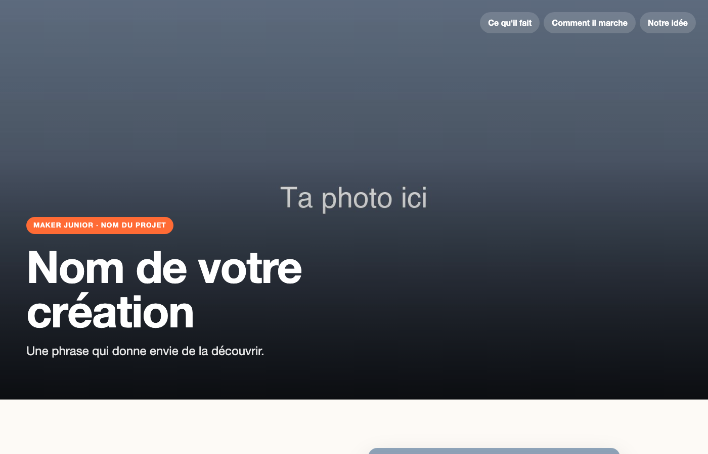

# Faire une page web

Une page web est un fichier texte. Le navigateur le lit et l'affiche. On part d'un gabarit, et on remplace ce qu'il contient.

## Ouvrir le gabarit

→ [Télécharger le gabarit](../assets/gabarit-page.zip) · [Le voir en ligne](../assets/gabarit-page/index.html)

Décompresse-le. Tu trouves `index.html`, `style.css` et un dossier `images`.

<figure class="screenshot" markdown>

</figure>

Ouvre `index.html` deux fois : dans l'éditeur, et dans le navigateur.

## Lire une balise

Le texte se place entre une balise ouvrante et une balise fermante.

```html
<h1>Nom de votre création</h1>
<p class="sous-titre">Une phrase qui donne envie de la découvrir.</p>
```

`<h1>` est le titre, `<p>` un paragraphe. La balise fermante a une barre : `</p>`.

Remplace le titre par le nom de votre création. Enregistre, recharge le navigateur.

## Changer les photos

Mets vos photos dans le dossier `images`. Puis écris leur nom dans `src` :

```html

```

`alt` décrit l'image pour qui ne la voit pas.

> [!TIP] L'image ne s'affiche pas ?
> Vérifie le nom du fichier, lettre par lettre, extension comprise.

## Choisir ses couleurs

Ouvre `style.css`. Tout en haut, **TES RÉGLAGES** :

```css
--couleur-principale: #ff6b35;
```

Change le code couleur, enregistre, recharge : l'étiquette, les sous-titres et le menu changent ensemble.

## Ajouter une section

1. Copie une section entière, du commentaire jusqu'à `</section>` compris :

```html
  <!-- Section 3 -->
  <section class="fonction" id="fonction-3">
    ...
  </section>
```

2. Colle-la juste avant `<!-- Le bas de la page -->`.

3. Change son `id` : un mot à toi, sans espace ni accent. Deux sections ne peuvent pas avoir le même.

```html
  <!-- Section 4 -->
  <section class="fonction" id="tag">
```

4. Ajoute son lien dans le menu, en haut de la page. Le `#` suivi de l'`id` :

```html
    <nav class="menu">
      <a href="#fonction-1">Ce qu'il fait</a>
      <a href="#fonction-2">Comment il marche</a>
      <a href="#fonction-3">Notre idée</a>
      <a href="#tag">Le tag</a>
    </nav>
```

5. Remplace les textes et la photo : `images/fonction-4.jpg`, par exemple.

La photo se place toute seule du bon côté.
