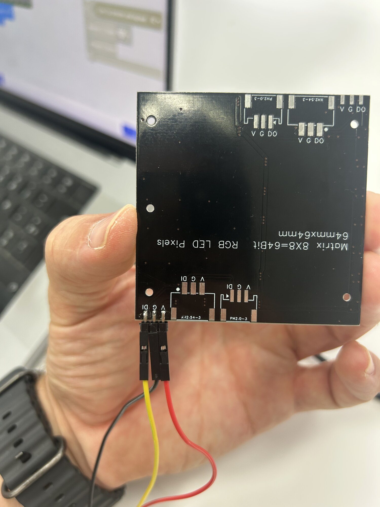
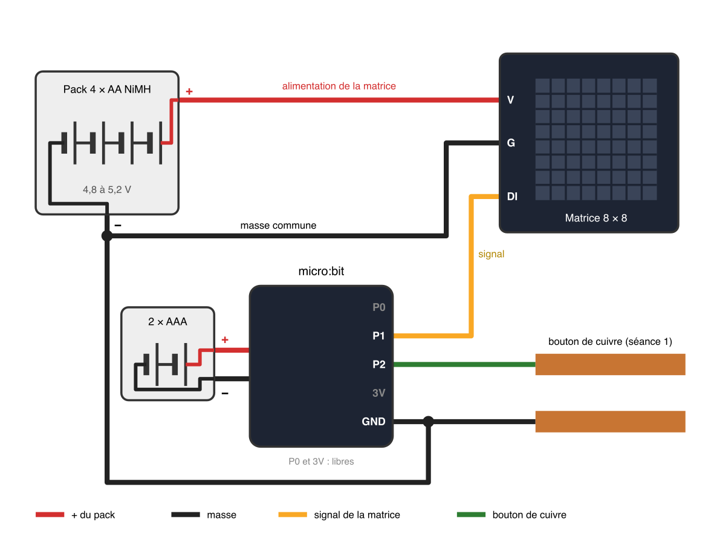

# La matrice de LED RGB

64 LED de couleur sur une carte de 8 × 8, pilotées par un seul fil de données. Chacune porte un numéro, et chacune peut prendre n'importe quelle couleur.

## Les trois broches

<figure markdown>

</figure>

| Broche | Va sur |
|---|---|
| `V` | Le `+` du pack d'accus |
| `G` | Le `−` du pack d'accus, **et** le `GND` du micro:bit |
| `DI` | Une broche du micro:bit, `P1` sur la lampe |

La matrice prend son énergie au pack. Le micro:bit ne lui envoie que le signal.

<figure class="plan" markdown>

</figure>

> [!CAUTION] Lis le dos de la carte
> L'ordre des broches change d'un modèle à l'autre. Le signal entre par `DI`. Par `DO`, la matrice ne s'allume pas.

→ [Câbler un circuit : la masse commune](cabler-un-circuit.md#la-masse-commune)

## L'extension

MakeCode → **Extensions** → colle l'adresse `https://github.com/arbona-robin/pxt-neopixel-matrix-extension` → clique sur la carte **neopixel-extended**.

Une catégorie **neopixel-extended** apparaît. Ses blocs sont en anglais : cherche-les tels qu'ils sont écrits.

Le premier bloc, dans `au démarrage`, dit où est branchée la matrice et combien elle a de LED : `NeoPixel strip at pin P1 with 64 Neopixel as RGB (GRB format)`.

## La luminosité

> [!CAUTION] Règle-la en premier
> 64 LED en blanc à fond tirent près de 4 ampères. Les accus ne suivent pas : la carte redémarre, les couleurs deviennent fausses. `set brightness` à **50** sur 255, dans `au démarrage`, avant toute couleur.

À 50, la lumière est aussi plus douce, et c'est ce qu'on veut d'une lampe.

Des couleurs fausses ou un scintillement en fin de séance : les accus faiblissent.

## Dessiner une image

`set NeoPixel 8x8` est une grille de 8 × 8 : une case par LED, une couleur par case, choisie dans une palette. Une case grise s'allume en gris : pour l'éteindre, choisis le noir.

```blocks
strip.setMatrix64(
    neopixelExtended.rowOf8(0x000000, 0x000000, 0xff0000, 0xff0000, 0xff0000, 0xff0000, 0x000000, 0x000000),
    neopixelExtended.rowOf8(0x000000, 0xff0000, 0x000000, 0x000000, 0x000000, 0x000000, 0xff0000, 0x000000),
    neopixelExtended.rowOf8(0xff0000, 0x000000, 0xff0000, 0x000000, 0x000000, 0xff0000, 0x000000, 0xff0000),
    neopixelExtended.rowOf8(0xff0000, 0x000000, 0x000000, 0x000000, 0x000000, 0x000000, 0x000000, 0xff0000),
    neopixelExtended.rowOf8(0xff0000, 0x000000, 0xff0000, 0x000000, 0x000000, 0xff0000, 0x000000, 0xff0000),
    neopixelExtended.rowOf8(0xff0000, 0x000000, 0x000000, 0xff0000, 0xff0000, 0x000000, 0x000000, 0xff0000),
    neopixelExtended.rowOf8(0x000000, 0xff0000, 0x000000, 0x000000, 0x000000, 0x000000, 0xff0000, 0x000000),
    neopixelExtended.rowOf8(0x000000, 0x000000, 0xff0000, 0xff0000, 0xff0000, 0xff0000, 0x000000, 0x000000)
)
strip.show()
let strip: neopixelExtended.Strip = null
```

## Préparer, puis afficher

`set NeoPixel 8x8`, `set pixel color`, `rotate` préparent les couleurs. **Rien ne change sur la matrice avant `show changes`.** On prépare tout, puis on affiche une fois.

`show color` et `show rainbow` font les deux d'un coup.

## Un ruban de 64 LED

La matrice est en réalité un ruban de 64 LED, numérotées de `0` à `63`, posé en 8 lignes de 8.

- `rotate pixels by 8` décale tout d'une ligne ; `by 1`, d'une seule LED. Dans une boucle, l'image défile.
- `set matrix color at x y` allume une case par ses coordonnées, comme `allumer x y` sur l'écran du micro:bit. Le coin en haut à gauche est `0,0`.

> [!TIP] Une ligne sur deux à l'envers ?
> Le ruban de ta matrice est câblé ligne par ligne, ou en allers-retours d'une ligne à l'autre. `set NeoPixel matrix layout`, dans `au démarrage`, dit lequel à l'extension : `row by row` pour les matrices de l'atelier.

> [!TIP] Éteindre toutes les cases grises d'un coup
> Passe en **JavaScript**, ouvre « Rechercher et remplacer » (`Ctrl` + `H`), remplace `0x888888` par `0x000000`, puis reviens aux **Blocs**.

## La couleur

Trois nombres, de 0 à 255 : **rouge**, **vert**, **bleu**. La palette les choisit pour toi ; le bloc `red green blue` les donne un par un.

| Couleur | Rouge | Vert | Bleu |
|---|---|---|---|
| Rouge | 255 | 0 | 0 |
| Violet | 255 | 0 | 255 |
| Orange | 255 | 100 | 0 |
| Blanc chaud | 255 | 180 | 100 |

→ [Prendre en main MakeCode](makecode-prise-en-main.md) · [Déboguer](deboguer.md)
