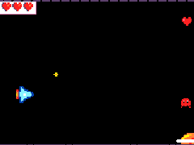
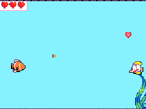

# Projet Jeu d'arcade — invente ton jeu d'arcade et fabrique ses commandes

Un jeu d'arcade, tu sais y jouer. Ici, tu le crées : tes personnages, tes niveaux, tes règles, ta musique. Et tu y joues avec des commandes que tu as fabriquées, au poignet, au pied, avec tout le corps.

Le parcours se fait en deux temps. D'abord un jeu de tir, que tu dessines et programmes, avec sa manette : un micro:bit au poignet et un bouton de tir en carton. Ensuite, seul ou en équipe, ton propre jeu (de plateforme, de course, de rythme, de réflexes ou de sport) et les commandes qui vont avec.

<figure markdown>

</figure>
<figure markdown>

</figure>

## Les séances

Chaque séance est publiée avant l'atelier, et reste en ligne après.

- **[Séance 1 — Ton premier jeu de tir](seances/s01-ton-premier-jeu-de-tir.md)**
  Tu dessines ton héros et tes ennemis, puis tu programmes ton héros pour qu'il tire sur les ennemis qui foncent sur lui.

- **[Séance 2 — Finis ton jeu : décor, score, vies](seances/s02-finis-ton-jeu.md)**
  Ton jeu a un écran de démarrage, un score, des vies, et un décor que tu dessines, qui défile derrière ton héros.

## Le matériel

- MakeCode Arcade, dans Chrome
- 1 micro:bit v2 et son bracelet
- du carton, du papier aluminium, des pinces crocodile
- une imprimante 3D
