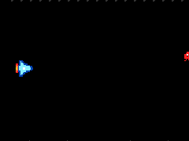
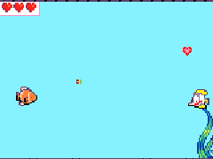
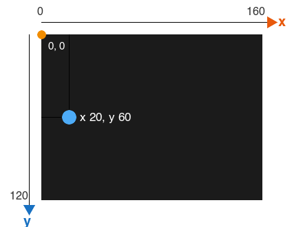

# Séance 1 — Ton premier jeu de tir

1. **[Ouvre ton parcours](#1-ouvre-ton-parcours)** : la skillmap du jeu de tir est ouverte sur la première activité.
2. **[Ton héros et son tir](#2-ton-heros-et-son-tir)** : ton héros monte, descend et tire.
3. **[Les ennemis](#3-les-ennemis)** : des ennemis foncent sur toi et explosent quand tu les touches.
4. **[Tes dessins, et le lien de ton jeu](#4-tes-dessins-et-le-lien-de-ton-jeu)** : ton jeu porte tes dessins, et tu as copié son lien.

<div class="gif-row" markdown>
<figure markdown>

</figure>
<figure markdown>

</figure>
</div>

Le même jeu, deux thèmes : à toi de choisir le tien.

## 1. Ouvre ton parcours

Dans Chrome, ouvre **[le parcours du jeu de tir](https://arcade.makecode.com/--skillmap?lang=fr#github:arbona-robin/tutoriels-arcade/jeu-de-tir)**, clique sur l'activité **Ton premier jeu de tir**, puis sur **Démarrage**.

Le tutoriel te guide pas à pas. Cette page te donne le programme de chaque étape, si tu bloques.

> [!NOTE] Ton jeu reste sur cet ordinateur
> Ta progression est enregistrée dans le navigateur. À chaque séance, reprends le même poste.

## 2. Ton héros et son tir

**Ce que tu vas obtenir :** ton héros, à gauche de l'écran, monte et descend avec les flèches, et tire quand tu appuies sur la touche espace.

### Dessine ton héros

Le thème est libre : un vaisseau, un dragon, un oiseau, un poisson. Pas d'idée ? Un vaisseau spatial.

Renomme sa variable : petite flèche de `mySprite`, **Renommer la variable...**, `heros`. Une variable est un nom qui te permet de retrouver ton héros dans les autres blocs.

Il regarde vers la droite : c'est de ce côté qu'il tirera. La **Galerie** propose des dessins tout faits, mais un dessin à toi rend ton jeu unique.

### Place-le à gauche de l'écran

<figure markdown>

<figcaption>x se compte vers la droite, y vers le bas, à partir du coin en haut à gauche.</figcaption>
</figure>

### Fais-le bouger et tirer

Dans `déplacer heros avec les boutons`, **vx** vaut 0 : ton héros ne bouge que de haut en bas. Plus tard, c'est ton bras qui le pilotera, avec le micro:bit au poignet.

Essaie avant d'ajouter `rester à l'écran` : ton héros sort de l'écran par le haut ou par le bas.

La touche **espace** du clavier est le bouton A de la console.

<details markdown>
<summary>Bloqué ? Le programme de cette étape</summary>

```blocks
scene.setBackgroundColor(15)
let heros = sprites.create(img`
    . . . . . . . . . . . . . . . .
    . . . . 8 8 8 . . . . . . . . .
    . . . . 8 9 8 8 . . . . . . . .
    . . . . 8 9 9 8 8 . . . . . . .
    . 2 2 . 8 9 9 9 8 8 8 . . . . .
    . 4 2 8 8 9 9 9 9 9 8 8 8 . . .
    . 4 4 8 9 9 9 9 9 9 9 9 9 8 8 .
    . 5 4 8 9 9 9 1 1 9 9 9 9 9 8 8
    . 5 4 8 9 9 9 1 1 9 9 9 9 9 8 8
    . 4 4 8 9 9 9 9 9 9 9 9 9 8 8 .
    . 4 2 8 8 9 9 9 9 9 8 8 8 . . .
    . 2 2 . 8 9 9 9 8 8 8 . . . . .
    . . . . 8 9 9 8 8 . . . . . . .
    . . . . 8 9 8 8 . . . . . . . .
    . . . . 8 8 8 . . . . . . . . .
    . . . . . . . . . . . . . . . .
    `, SpriteKind.Player)
heros.setPosition(20, 60)
controller.moveSprite(heros, 0, 100)
heros.setStayInScreen(true)
controller.A.onEvent(ControllerButtonEvent.Pressed, function () {
    let tir = sprites.createProjectileFromSprite(img`
        . 5 5 .
        5 4 4 5
        . 5 5 .
        `, heros, 150, 0)
})
```

</details>

> [!TIP] Ça marche si…
> Les flèches font monter et descendre ton héros sans qu'il sorte de l'écran, et la touche espace le fait tirer.

## 3. Les ennemis

**Ce que tu vas obtenir :** un ennemi arrive de la droite toutes les 900 ms, à une hauteur au hasard. Touché par un tir, il explose.

- L'ennemi a sa propre variable : petite flèche de `mySprite`, **Nouvelle variable...**, `ennemi`. Avec `heros`, chaque ennemi prendrait la place de ton héros, et les flèches feraient bouger le dernier ennemi.
- Sa vitesse **vx** est négative : il va vers la gauche.
- La **destruction automatique** efface l'ennemi sorti de l'écran. Sans elle, ils s'accumulent hors de l'écran et le jeu ralentit.
- Dans `quand sprite de type Projectile chevauche otherSprite de type Enemy`, **sprite** est le tir, **otherSprite** l'ennemi touché. Glisse le **otherSprite** rouge, en haut du bloc, dans le second `détruire`.

<details markdown>
<summary>Bloqué ? Le programme complet</summary>

```blocks
scene.setBackgroundColor(15)
let heros = sprites.create(img`
    . . . . . . . . . . . . . . . .
    . . . . 8 8 8 . . . . . . . . .
    . . . . 8 9 8 8 . . . . . . . .
    . . . . 8 9 9 8 8 . . . . . . .
    . 2 2 . 8 9 9 9 8 8 8 . . . . .
    . 4 2 8 8 9 9 9 9 9 8 8 8 . . .
    . 4 4 8 9 9 9 9 9 9 9 9 9 8 8 .
    . 5 4 8 9 9 9 1 1 9 9 9 9 9 8 8
    . 5 4 8 9 9 9 1 1 9 9 9 9 9 8 8
    . 4 4 8 9 9 9 9 9 9 9 9 9 8 8 .
    . 4 2 8 8 9 9 9 9 9 8 8 8 . . .
    . 2 2 . 8 9 9 9 8 8 8 . . . . .
    . . . . 8 9 9 8 8 . . . . . . .
    . . . . 8 9 8 8 . . . . . . . .
    . . . . 8 8 8 . . . . . . . . .
    . . . . . . . . . . . . . . . .
    `, SpriteKind.Player)
heros.setPosition(20, 60)
controller.moveSprite(heros, 0, 100)
heros.setStayInScreen(true)
controller.A.onEvent(ControllerButtonEvent.Pressed, function () {
    let tir = sprites.createProjectileFromSprite(img`
        . 5 5 .
        5 4 4 5
        . 5 5 .
        `, heros, 150, 0)
})
game.onUpdateInterval(900, function () {
    let ennemi = sprites.create(img`
        . . 2 2 2 2 . .
        . 2 2 2 2 2 2 .
        2 2 1 2 2 1 2 2
        2 2 f 2 2 f 2 2
        2 2 2 2 2 2 2 2
        2 2 2 2 2 2 2 2
        . 2 . 2 2 . 2 .
        2 . . . . . . 2
        `, SpriteKind.Enemy)
    ennemi.setPosition(160, randint(10, 110))
    ennemi.vx = -40
    ennemi.setFlag(SpriteFlag.AutoDestroy, true)
})
sprites.onOverlap(SpriteKind.Projectile, SpriteKind.Enemy, function (sprite, otherSprite) {
    sprites.destroy(sprite)
    sprites.destroy(otherSprite, effects.fire, 200)
})
```

</details>

> [!TIP] Ça marche si…
> Les ennemis traversent l'écran de droite à gauche, et chacun explose quand ton tir le touche.

## 4. Tes dessins, et le lien de ton jeu

**Ce que tu vas obtenir :** un jeu à ton image, et son lien pour le rouvrir n'importe où.

### Soigne tes dessins

Clique sur chaque dessin pour le retoucher : ton héros, son tir, tes ennemis.

- Commence par la silhouette, d'une couleur sombre.
- Trois ou quatre couleurs suffisent.
- Une couleur plus claire sur le dessus donne du volume.

Change la couleur du fond dans `définir couleur d'arrière-plan`, puis teste : un ennemi sombre sur un fond sombre ne se voit plus.

### Copie le lien de ton jeu

Clique sur **Terminé** à la fin du tutoriel, puis sur **Partager** en haut de l'écran. Donne un nom à ton jeu et copie le lien. Pas besoin de compte.

> [!IMPORTANT] Point de contrôle
> Montre ton jeu à l'animateur, avec son lien copié.

## Va plus loin

Ajoute un second ennemi, plus rapide, qui apparaît moins souvent : un deuxième `quand mise à jour du jeu chaque … ms`, avec un autre dessin et une autre vitesse.
