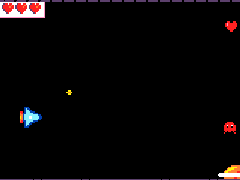
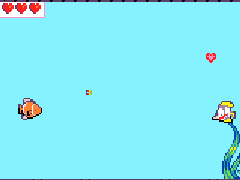

# Séance 2 — Finis ton jeu : décor, score, vies

1. **[Ouvre l'activité 2](#1-ouvre-lactivite-2)** : ton jeu de la séance 1 est ouvert dans l'activité **Finis ton jeu**.
2. **[Le démarrage, le score et les vies](#2-le-demarrage-le-score-et-les-vies)** : ton jeu attend le joueur, compte les points, offre parfois un cœur, et s'arrête quand il n'a plus de vie.
3. **[Le décor](#3-le-decor)** : des planètes, des nuages ou des étoiles défilent derrière ton héros.
4. **[Ton décor en pixel art, et le nouveau lien](#4-ton-decor-en-pixel-art-et-le-nouveau-lien)** : ton décor est dessiné, et tu as copié le nouveau lien de ton jeu.

<div class="gif-row" markdown>
<figure markdown>

</figure>
<figure markdown>

</figure>
</div>

Ton jeu à la fin de la séance, dans l'espace ou sous la mer.

## 1. Ouvre l'activité 2

Ta séance 1 n'est pas finie ? → [Ton premier jeu de tir](s01-ton-premier-jeu-de-tir.md). L'activité 2 reste verrouillée tant que la première n'est pas terminée.

Ouvre **[le parcours du jeu de tir](https://arcade.makecode.com/--skillmap?lang=fr#github:arbona-robin/tutoriels-arcade/jeu-de-tir)**, clique sur l'activité **Finis ton jeu**, puis sur **Démarrage**. Ton jeu reprend là où tu l'as laissé.

> [!NOTE] Ton jeu n'est plus là ?
> L'activité démarre alors d'un jeu tout prêt, avec d'autres dessins. Tes dessins sont dans le lien de partage de la séance 1 : l'animateur t'aide à les récupérer.

## 2. Le démarrage, le score et les vies

**Ce que tu vas obtenir :** ton jeu s'ouvre sur son titre et attend la touche A. Chaque ennemi détruit rapporte un point. Un ennemi qui te touche te retire une vie et fait trembler l'écran.

- L'écran de démarrage est le bloc `splash`, dans **Jeu**, tout en haut de `au démarrage`.
- `modifier le score de 1` et `définir vie à 3` sont dans **Info**.
- Dans `quand sprite de type Player chevauche otherSprite de type Enemy`, **sprite** est ton héros, **otherSprite** l'ennemi qui l'a touché.

À 0 vie, la partie s'arrête toute seule.

### Le cœur bonus

De temps en temps, un cœur traverse l'écran. Ton héros qui le touche gagne une vie.

- Chaque seconde, `si 15 % chance` décide s'il apparaît : `% chance` est dans **Maths**, `si alors` dans **Logique**.
- Le cœur est de type **Food** : c'est ce qui le distingue des ennemis dans le bloc `chevauche`.

<details markdown>
<summary>Bloqué ? Le programme de cette étape</summary>

```blocks
game.splash("Mon jeu de tir", "Appuie sur A pour jouer")
scene.setBackgroundColor(15)
let heros = sprites.create(img`
    . . . . . . . . . . . . . . . .
    . . . . 8 8 8 . . . . . . . . .
    . . . . 8 9 8 8 . . . . . . . .
    . . . . 8 9 9 8 8 . . . . . . .
    . 2 2 . 8 9 9 9 8 8 8 . . . . .
    . 4 2 8 8 9 9 9 9 9 8 8 8 . . .
    . 4 4 8 9 9 9 9 9 9 9 9 9 8 8 .
    . 5 4 8 9 9 9 1 1 9 9 9 9 9 8 8
    . 5 4 8 9 9 9 1 1 9 9 9 9 9 8 8
    . 4 4 8 9 9 9 9 9 9 9 9 9 8 8 .
    . 4 2 8 8 9 9 9 9 9 8 8 8 . . .
    . 2 2 . 8 9 9 9 8 8 8 . . . . .
    . . . . 8 9 9 8 8 . . . . . . .
    . . . . 8 9 8 8 . . . . . . . .
    . . . . 8 8 8 . . . . . . . . .
    . . . . . . . . . . . . . . . .
    `, SpriteKind.Player)
heros.setPosition(20, 60)
controller.moveSprite(heros, 0, 100)
heros.setStayInScreen(true)
info.setLife(3)
controller.A.onEvent(ControllerButtonEvent.Pressed, function () {
    let tir = sprites.createProjectileFromSprite(img`
        . 5 5 .
        5 4 4 5
        . 5 5 .
        `, heros, 150, 0)
})
game.onUpdateInterval(900, function () {
    let ennemi = sprites.create(img`
        . . 2 2 2 2 . .
        . 2 2 2 2 2 2 .
        2 2 1 2 2 1 2 2
        2 2 f 2 2 f 2 2
        2 2 2 2 2 2 2 2
        2 2 2 2 2 2 2 2
        . 2 . 2 2 . 2 .
        2 . . . . . . 2
        `, SpriteKind.Enemy)
    ennemi.setPosition(160, randint(10, 110))
    ennemi.vx = -40
    ennemi.setFlag(SpriteFlag.AutoDestroy, true)
})
sprites.onOverlap(SpriteKind.Projectile, SpriteKind.Enemy, function (sprite, otherSprite) {
    sprites.destroy(sprite)
    sprites.destroy(otherSprite, effects.fire, 200)
    info.changeScoreBy(1)
})
sprites.onOverlap(SpriteKind.Player, SpriteKind.Enemy, function (sprite, otherSprite) {
    sprites.destroy(otherSprite)
    info.changeLifeBy(-1)
    scene.cameraShake(4, 500)
})
game.onUpdateInterval(1000, function () {
    if (Math.percentChance(15)) {
        let coeur = sprites.create(img`
            . 2 2 . . 2 2 .
            2 3 2 2 2 2 2 2
            2 3 2 2 2 2 2 2
            2 2 2 2 2 2 2 2
            . 2 2 2 2 2 2 .
            . . 2 2 2 2 . .
            . . . 2 2 . . .
            `, SpriteKind.Food)
        coeur.setPosition(160, randint(10, 110))
        coeur.vx = -30
        coeur.setFlag(SpriteFlag.AutoDestroy, true)
    }
})
sprites.onOverlap(SpriteKind.Player, SpriteKind.Food, function (sprite, otherSprite) {
    sprites.destroy(otherSprite)
    info.changeLifeBy(1)
})
```

</details>

> [!TIP] Ça marche si…
> Le score monte à chaque ennemi détruit, un cœur attrapé ajoute une vie, et la partie s'arrête quand tu n'en as plus.

## 3. Le décor

**Ce que tu vas obtenir :** toutes les 3 secondes, un élément de décor arrive de la droite et passe lentement derrière ton héros.

C'est le même geste que pour les ennemis, avec une nouvelle variable, `decor`, et trois réglages :

- **vx** à -15, moins vite que les ennemis : le décor paraît plus loin.
- **z (profondeur)** à -1 : le décor est dessiné sous les autres sprites, qui ont tous 0.
- **fantôme** : le décor ne déclenche aucun bloc `chevauche`. Ni tes tirs ni ton héros ne le touchent.

<details markdown>
<summary>Bloqué ? Le programme complet</summary>

```blocks
game.splash("Mon jeu de tir", "Appuie sur A pour jouer")
scene.setBackgroundColor(15)
let heros = sprites.create(img`
    . . . . . . . . . . . . . . . .
    . . . . 8 8 8 . . . . . . . . .
    . . . . 8 9 8 8 . . . . . . . .
    . . . . 8 9 9 8 8 . . . . . . .
    . 2 2 . 8 9 9 9 8 8 8 . . . . .
    . 4 2 8 8 9 9 9 9 9 8 8 8 . . .
    . 4 4 8 9 9 9 9 9 9 9 9 9 8 8 .
    . 5 4 8 9 9 9 1 1 9 9 9 9 9 8 8
    . 5 4 8 9 9 9 1 1 9 9 9 9 9 8 8
    . 4 4 8 9 9 9 9 9 9 9 9 9 8 8 .
    . 4 2 8 8 9 9 9 9 9 8 8 8 . . .
    . 2 2 . 8 9 9 9 8 8 8 . . . . .
    . . . . 8 9 9 8 8 . . . . . . .
    . . . . 8 9 8 8 . . . . . . . .
    . . . . 8 8 8 . . . . . . . . .
    . . . . . . . . . . . . . . . .
    `, SpriteKind.Player)
heros.setPosition(20, 60)
controller.moveSprite(heros, 0, 100)
heros.setStayInScreen(true)
info.setLife(3)
controller.A.onEvent(ControllerButtonEvent.Pressed, function () {
    let tir = sprites.createProjectileFromSprite(img`
        . 5 5 .
        5 4 4 5
        . 5 5 .
        `, heros, 150, 0)
})
game.onUpdateInterval(900, function () {
    let ennemi = sprites.create(img`
        . . 2 2 2 2 . .
        . 2 2 2 2 2 2 .
        2 2 1 2 2 1 2 2
        2 2 f 2 2 f 2 2
        2 2 2 2 2 2 2 2
        2 2 2 2 2 2 2 2
        . 2 . 2 2 . 2 .
        2 . . . . . . 2
        `, SpriteKind.Enemy)
    ennemi.setPosition(160, randint(10, 110))
    ennemi.vx = -40
    ennemi.setFlag(SpriteFlag.AutoDestroy, true)
})
sprites.onOverlap(SpriteKind.Projectile, SpriteKind.Enemy, function (sprite, otherSprite) {
    sprites.destroy(sprite)
    sprites.destroy(otherSprite, effects.fire, 200)
    info.changeScoreBy(1)
})
sprites.onOverlap(SpriteKind.Player, SpriteKind.Enemy, function (sprite, otherSprite) {
    sprites.destroy(otherSprite)
    info.changeLifeBy(-1)
    scene.cameraShake(4, 500)
})
game.onUpdateInterval(1000, function () {
    if (Math.percentChance(15)) {
        let coeur = sprites.create(img`
            . 2 2 . . 2 2 .
            2 3 2 2 2 2 2 2
            2 3 2 2 2 2 2 2
            2 2 2 2 2 2 2 2
            . 2 2 2 2 2 2 .
            . . 2 2 2 2 . .
            . . . 2 2 . . .
            `, SpriteKind.Food)
        coeur.setPosition(160, randint(10, 110))
        coeur.vx = -30
        coeur.setFlag(SpriteFlag.AutoDestroy, true)
    }
})
sprites.onOverlap(SpriteKind.Player, SpriteKind.Food, function (sprite, otherSprite) {
    sprites.destroy(otherSprite)
    info.changeLifeBy(1)
})
game.onUpdateInterval(3000, function () {
    let decor = sprites.create(img`
        . . . . . . . . . . . . . . . . . . . . . . . .
        . . . . . . . . . 4 4 4 4 4 4 . . . . . . . . .
        . . . . . . . 4 4 5 5 5 5 4 4 4 4 . . . . . . .
        . . . . . . 4 5 5 5 5 4 4 4 4 4 4 4 . . . . . .
        . . . . . 4 5 5 5 4 4 4 4 4 4 2 4 4 4 . . . . .
        . . . . 4 5 5 4 4 4 4 4 4 2 2 4 4 4 4 . . . . .
        . 1 1 1 1 1 1 1 1 1 1 1 1 1 1 1 1 1 1 1 1 1 1 .
        1 1 1 1 1 1 1 1 1 1 1 1 1 1 1 1 1 1 1 1 1 1 1 1
        . 1 1 1 1 1 1 1 1 1 1 1 1 1 1 1 1 1 1 1 1 1 1 .
        . . . . 4 4 4 4 4 4 4 2 2 4 4 4 4 4 2 . . . . .
        . . . . . 4 4 4 4 4 2 2 4 4 4 4 4 2 . . . . . .
        . . . . . . 4 4 4 4 4 4 4 4 4 4 2 . . . . . . .
        . . . . . . . 4 4 4 4 4 4 4 2 2 . . . . . . . .
        . . . . . . . . . 2 2 2 2 2 . . . . . . . . . .
        . . . . . . . . . . . . . . . . . . . . . . . .
        . . . . . . . . . . . . . . . . . . . . . . . .
        `, SpriteKind.Player)
    decor.setPosition(160, randint(0, 120))
    decor.vx = -15
    decor.z = -1
    decor.setFlag(SpriteFlag.Ghost, true)
    decor.setFlag(SpriteFlag.AutoDestroy, true)
})
```

</details>

> [!TIP] Ça marche si…
> Ton décor passe derrière ton héros et tes ennemis, et tes tirs le traversent.

## 4. Ton décor en pixel art, et le nouveau lien

Retouche ton cœur et ton élément de décor, et change la couleur du fond si besoin. Vérifie que tes ennemis se voient bien devant.

Clique sur **Terminé** à la fin du tutoriel, puis sur **Partager** : copie le nouveau lien de ton jeu.

> [!IMPORTANT] Point de contrôle
> Montre ton jeu complet à l'animateur, avec son nouveau lien copié.

## Va plus loin

- **Équilibre ton jeu.** Trop facile ? Baisse la chance du cœur, augmente la vitesse des ennemis (-60 au lieu de -40), ou fais-les apparaître plus souvent (600 ms au lieu de 900). Trop dur ? Fais l'inverse. Fais tester ton jeu à un voisin.
- **Un deuxième type d'ennemi.** Un autre `quand mise à jour du jeu chaque … ms`, avec un autre dessin et une autre vitesse : un ennemi rare et très rapide, par exemple. Garde le type **Enemy** : tes blocs `chevauche` marchent déjà pour lui.
- **Des ennemis qui accélèrent.** Remplace le -40 de `définir ennemi vx` par un calcul de **Maths** : -40 moins `score` × 2. Plus tu marques de points, plus ils vont vite.
- **Un décor plus riche.** Un deuxième élément de décor, avec un autre dessin et une autre vitesse : les plus lents paraissent les plus loin.
