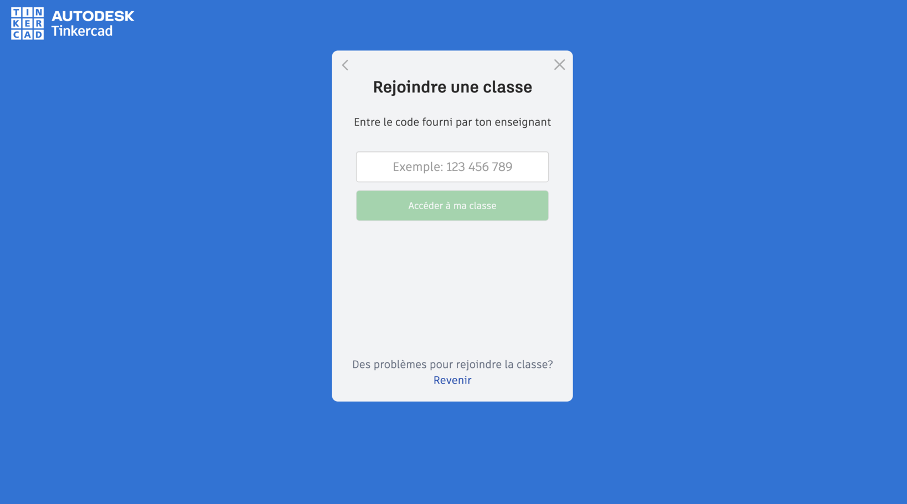
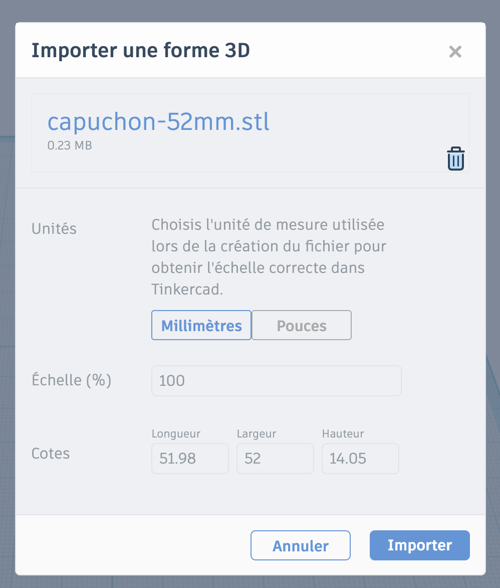
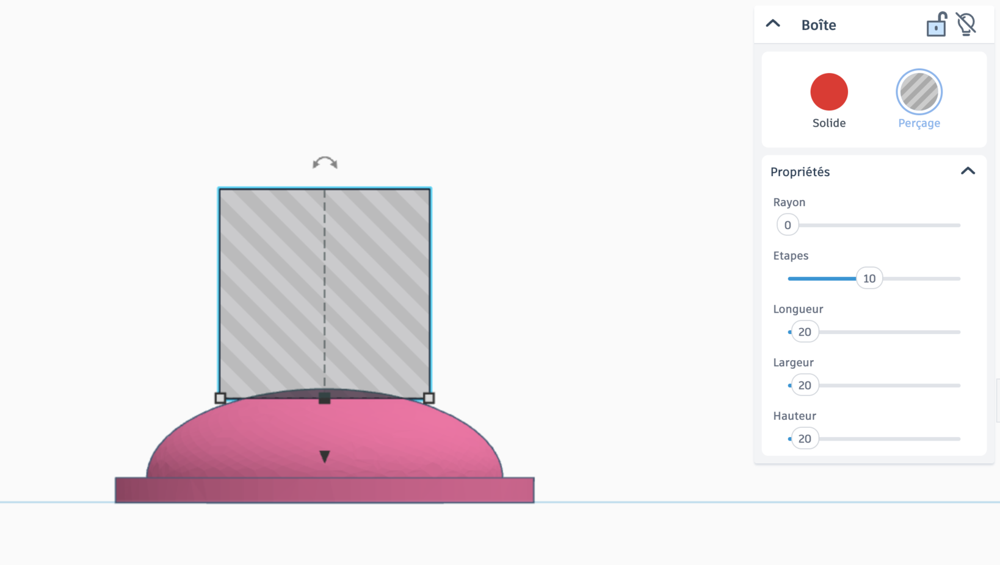
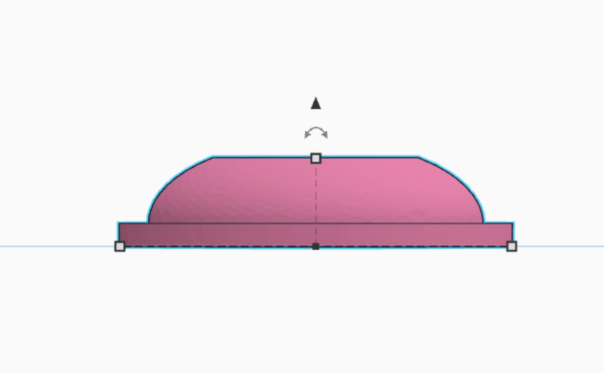
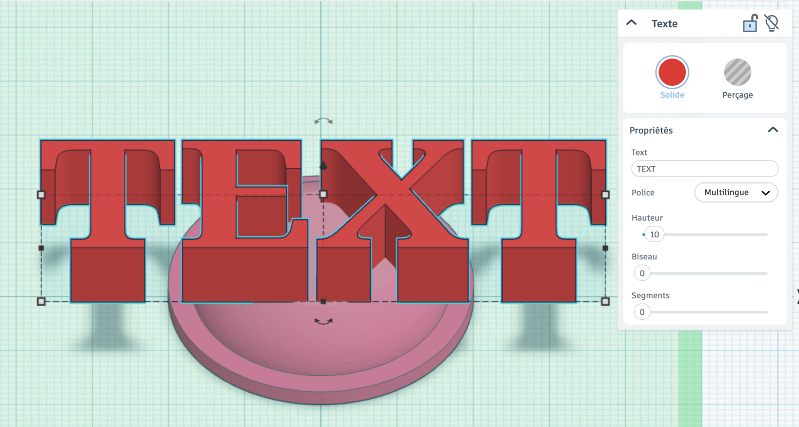
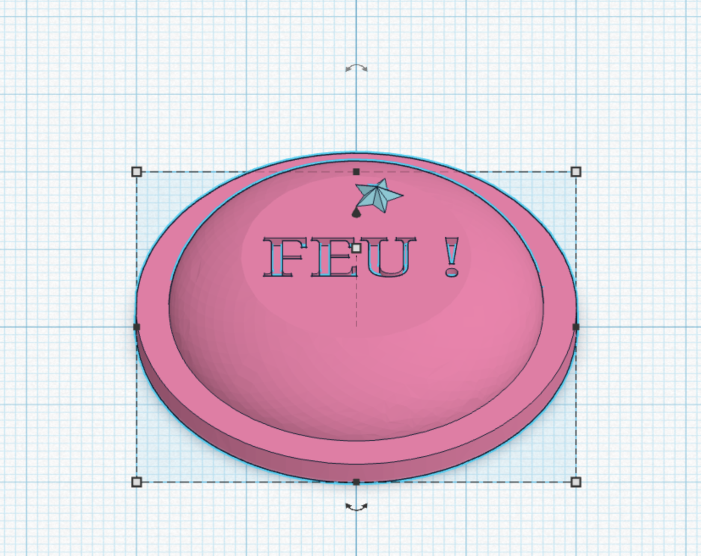
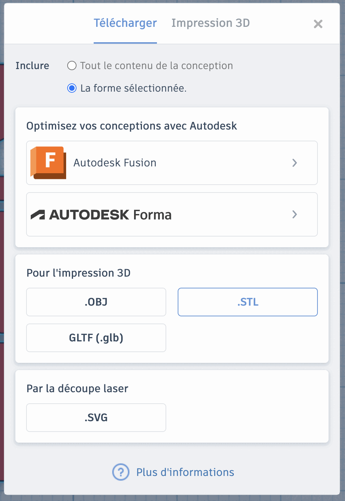
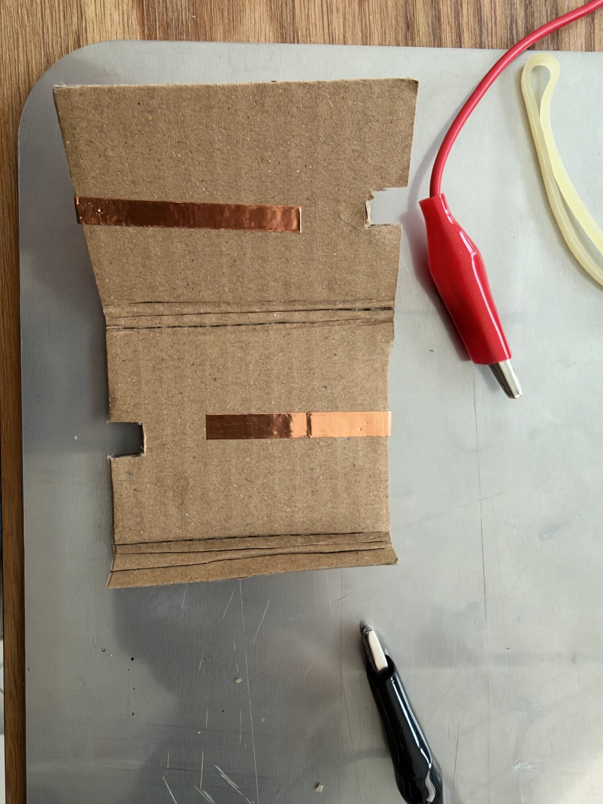
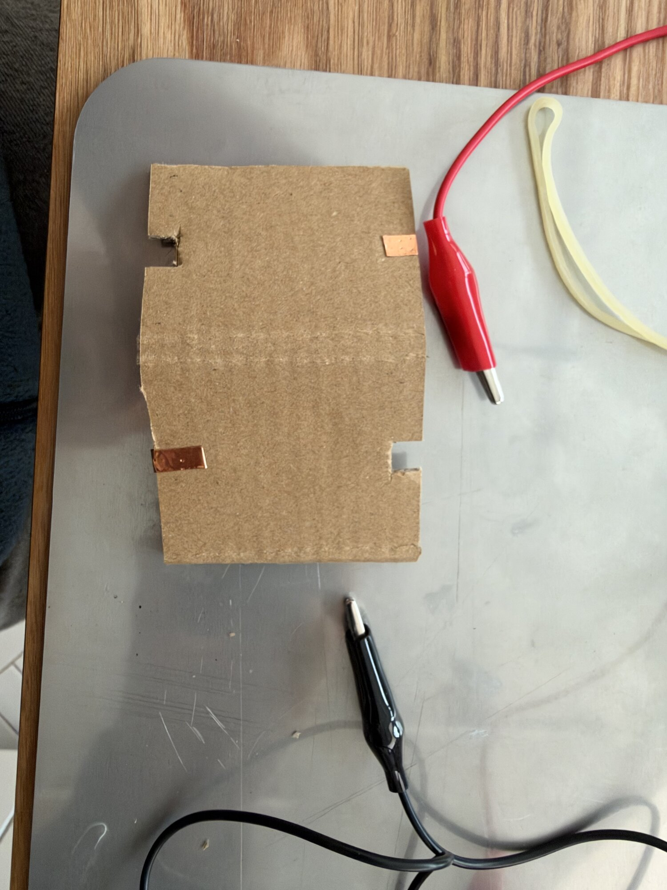
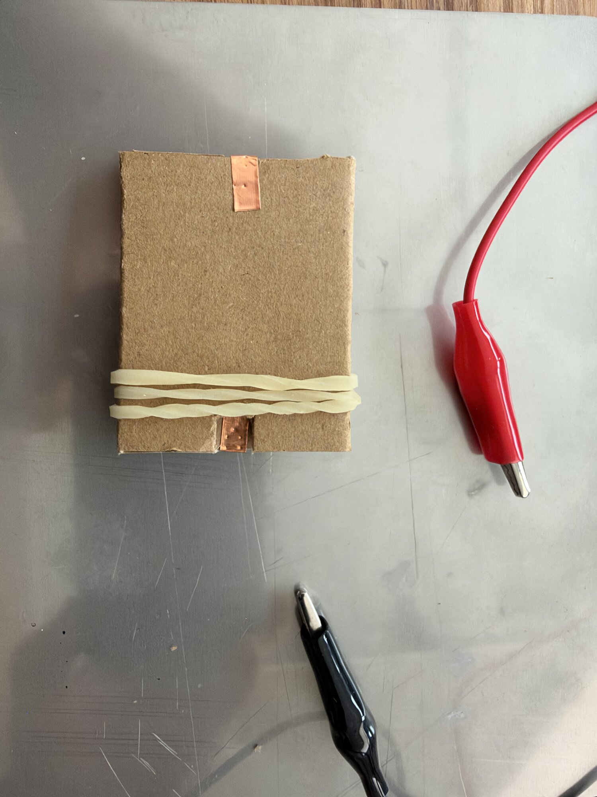

# Séance 4 — Dessine ton bouton de tir

1. **[Ton capuchon à la bonne taille](#1-ton-capuchon-a-la-bonne-taille)** : le bouton d'arcade, importé dans Tinkercad, fait 40 mm.
2. **[Ton capuchon à toi](#2-ton-capuchon-a-toi)** : ta forme, ton texte, et le fichier parti à l'impression.
3. **[Ton bouton en carton](#3-ton-bouton-en-carton)** : il fait contact quand tu appuies.

## 1. Ton capuchon à la bonne taille

**Ce que tu vas obtenir :** un capuchon de bouton d'arcade, importé dans Tinkercad et ramené à 40 mm de diamètre, sans être déformé.

### Rejoins la classe Tinkercad

Va sur [tinkercad.com/joinclass](https://www.tinkercad.com/joinclass), entre le **code de classe** que donne l'animateur, puis ton **identifiant d'élève**. Crée un nouveau design.

<figure class="screenshot" markdown>

</figure>

### Importe le capuchon

Télécharge **[capuchon-52mm.stl](../../../assets/arcade-s04/capuchon-52mm.stl)**. Dans Tinkercad, **Importer**, en haut à droite, puis **Choisir un fichier**.

<figure class="screenshot" markdown>

</figure>

Lis les **Cotes** : 52 × 52 × 14 mm. Le plan de ton bouton prévoit 40 mm de diamètre : il est trop grand.

### Mets-le à l'échelle

L'échelle, c'est la taille voulue divisée par la taille actuelle, en pourcentage : 40 ÷ 52 × 100 ≈ **77**.

1. Dans **Échelle (%)**, écris **77**.
2. Les **Cotes** passent à 40 × 40 × 10,8 mm : les trois ont changé ensemble.
3. **Importer**.

> [!NOTE] Un modèle trouvé en ligne
> Il arrive rarement à la bonne taille. On le mesure, on calcule l'échelle, et on change toutes les cotes ensemble : la forme reste la même.

> [!TIP] Ça marche si…
> Le capuchon sélectionné affiche 40 mm de long et 40 mm de large.

## 2. Ton capuchon à toi

**Ce que tu vas obtenir :** ton capuchon personnalisé, regroupé en une seule pièce, exporté en `.STL`.

La forme et le texte sont à toi. Deux contraintes : **40 mm de diamètre au plus**, sinon il dépasse de ton bouton, et **le dessous plat**, pour le coller.

L'exemple qui suit aplatit le sommet du dôme, puis y pose un texte.

### Aplatis le sommet

1. Pose une **Boîte** de **40 × 40 × 10 mm**, et passe-la en **Perçage**.
2. Sélectionne la boîte et le capuchon, puis **Aligner** : centre-la sur le capuchon, dans les deux sens.
3. Passe en vue **de face**. Monte la boîte avec la poignée au-dessus d'elle, jusqu'à ce qu'elle mange le haut du dôme sur 2 mm environ.
4. Sélectionne les deux, puis **Regrouper** (<kbd>Ctrl</kbd> + <kbd>G</kbd>).

<figure class="screenshot" markdown>

<figcaption>La boîte en **Perçage** mange le sommet…</figcaption>
</figure>
<figure class="screenshot" markdown>

<figcaption>… et après **Regrouper**, le sommet est plat.</figcaption>
</figure>

### Ajoute ton texte

1. Pose une forme **Texte**. Dans son panneau, écris ton mot dans **Text** (« FEU ! », ton initiale, ton pseudo), et règle sa **Hauteur** à **2 mm** : c'est son épaisseur.
2. Réduis-le pour qu'il tienne sur le sommet plat, en tirant un coin avec <kbd>Maj</kbd> enfoncée : il garde ses proportions.
3. **Aligner** : centre-le sur le capuchon.
4. En vue **de face**, monte-le avec sa poignée jusqu'à ce qu'il **repose** sur le sommet plat.

<figure class="screenshot" markdown>

</figure>

En **Solide**, ton texte sera en relief. En **Perçage**, descends-le de 1 mm dans le sommet : il sera creusé.

<figure class="screenshot" markdown>

<figcaption>En relief.</figcaption>
</figure>
<figure class="screenshot" markdown>

<figcaption>Creusé.</figcaption>
</figure>

→ [Modéliser et imprimer en 3D](../../../fiches/modeliser-imprimer-3d.md#importer-et-modifier-une-piece)

### Vérifie et exporte

Sélectionne tout, puis **Regrouper**. En vue **de face** : le dessous est plat, et rien ne flotte au-dessus du capuchon.

> [!IMPORTANT] Point de contrôle
> Fais valider ton capuchon avant d'exporter. Après, il part à l'impression tel quel.

**Exporter** → **La forme sélectionnée** → **.STL**

<figure class="screenshot" markdown>

</figure>

Nomme le fichier `prenom-capuchon.stl` et dépose-le où l'animateur te l'indique.

## 3. Ton bouton en carton

**Ce que tu vas obtenir :** un bouton plié, avec deux bandes de cuivre face à face qui se touchent quand tu appuies.

<figure markdown>

<figcaption>[Le plan à imprimer](../../../assets/plans/bouton-de-tir-v1.pdf), en A4 à 100 %, quatre boutons par page.</figcaption>
</figure>

> [!CAUTION] L'outil de découpe
> - Règle métallique **à rebord**, toujours.
> - Doigts **posés sur la règle, derrière le rebord**.
> - **Plusieurs passes légères**, sans forcer.
> - **Protection de lame remise** dès que tu poses l'outil.

1. Découpe le contour, et marque les deux plis. → [Tracer, découper, plier le carton](../../../fiches/carton-tracer-decouper-plier.md)
2. Colle le ruban de cuivre côté imprimé, sur les deux bandes orange.
3. Plie à la charnière, côté imprimé dedans, et tiens le bouton fermé avec deux élastiques.

<figure markdown>

</figure>
<figure markdown>

</figure>
<figure markdown>

</figure>

### Teste-le

Une pince dans chaque encoche : elle y mord le bout d'une seule bande. Le multimètre, en continuité, bipe quand les deux bandes se touchent.

<video class="portrait" controls playsinline preload="metadata" src="../../../../assets/arcade-s04/video-test-multimetre.mp4"></video>

> [!TIP] Ça marche si…
> Le multimètre affiche OL au repos, et bipe quand tu appuies. Il bipe sans que tu appuies ? Desserre les élastiques, ou vérifie qu'une pince ne mord pas les deux faces.

Ton capuchon s'imprime pendant la semaine : tu le colles sur ton bouton à la séance 5.

## Va plus loin

Un second capuchon, d'une autre forme (étoile, cœur, flèche), pour un second bouton : ta manette en aura besoin si ton jeu utilise B.
