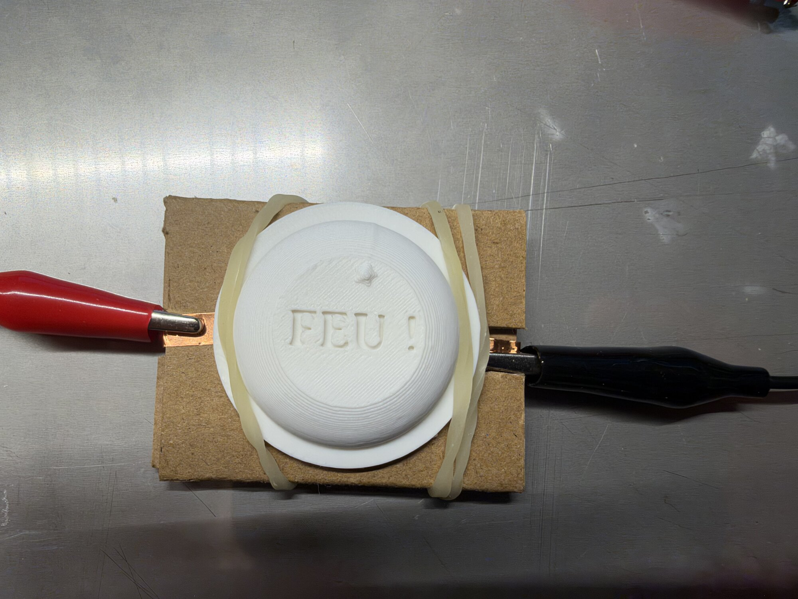
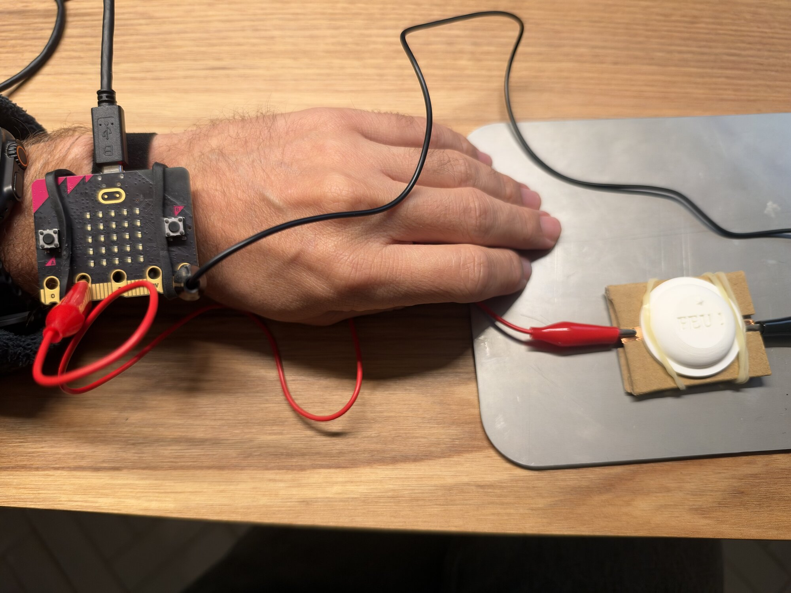

# Séance 5 — Ta manette : le bracelet et le bouton de tir

1. **[Monte ton bouton](#1-monte-ton-bouton)** : ton capuchon est sur ton bouton.
2. **[Branche ton bouton](#2-branche-ton-bouton)** : ton bouton tire, comme le bouton A.
3. **[Ta manette au poignet](#3-ta-manette-au-poignet)** : tu montes et descends en tournant l'avant-bras.
4. **[Joue](#4-joue)** : tu joues à ton jeu avec ton bras et ton bouton.

## 1. Monte ton bouton

**Ce que tu vas obtenir :**

<figure markdown>

</figure>

Pose ton capuchon sur le cercle de ton bouton, et fais passer les deux élastiques par-dessus : ils tiennent le bouton fermé et le capuchon en place.

## 2. Branche ton bouton

**Ce que tu vas obtenir :** ta manette envoie `A` quand tu frappes ton bouton, comme quand tu appuies sur son bouton A.

Une pince d'une encoche sur l'anneau **1** de ton micro:bit, l'autre sur l'anneau **GND**. Frapper le bouton ferme le circuit entre `P1` et `GND`.

Rouvre le projet **Ta manette** dans MakeCode micro:bit, depuis **Mes projets**. Dans le `si` du bouton A :

1. Prends `ou`, dans **Logique**, et mets `bouton A est pressé` à sa gauche.
2. À sa droite, `broche P1 est pressée`, dans **Entrée**.

```blocks
basic.forever(function () {
    if (input.acceleration(Dimension.Y) < -300) {
        serial.writeLine("haut")
    } else if (input.acceleration(Dimension.Y) > 300) {
        serial.writeLine("bas")
    }
    if (input.buttonIsPressed(Button.A) || input.pinIsPressed(TouchPin.P1)) {
        serial.writeLine("A")
    }
    basic.pause(20)
})
```

Le jeu ne voit pas la différence : il reçoit `A`, que tu appuies sur le bouton A ou que tu frappes ton bouton.

## 3. Ta manette au poignet

**Ce que tu vas obtenir :** ton héros monte et descend quand tu tournes l'avant-bras, et reste immobile quand ton bras est au repos.

Glisse ton micro:bit dans le bracelet, et le bracelet à ton poignet.

<figure markdown>

</figure>

### Mesure ton geste

Au poignet, ce n'est plus le même geste qu'en main. Rouvre le projet **accelerometre**, et écris les deux valeurs, `x` et `y`.

```blocks
basic.forever(function () {
    serial.writeValue("x", input.acceleration(Dimension.X))
    serial.writeValue("y", input.acceleration(Dimension.Y))
})
```

Télécharge, puis **Afficher données Appareil**. Tourne l'avant-bras, paume vers le bas puis vers le haut.

| Tu tournes l'avant-bras | Quelle courbe bouge, x ou y ? | À partir de quelle valeur ? |
|---|---|---|
| Paume vers le bas | | |
| Paume vers le haut | | |

### Change ta manette

Dans **Ta manette**, mets dans les deux conditions l'axe qui bouge et tes nouveaux seuils.

```blocks
basic.forever(function () {
    if (input.acceleration(Dimension.X) < -300) {
        serial.writeLine("haut")
    } else if (input.acceleration(Dimension.X) > 300) {
        serial.writeLine("bas")
    }
    if (input.buttonIsPressed(Button.A) || input.pinIsPressed(TouchPin.P1)) {
        serial.writeLine("A")
    }
    basic.pause(20)
})
```

Ici, c'est `x`, avec -300 et 300. Entre tes deux seuils, ta manette n'envoie rien : c'est la **zone morte**. Elle doit être assez large pour que ton héros ne bouge pas quand ton bras est au repos.

Télécharge, puis ferme tous les onglets MakeCode micro:bit.

## 4. Joue

**Ce que tu vas obtenir :** ta partie, jouée au poignet et au bouton.

<video controls playsinline preload="metadata" src="../../../../assets/arcade-s05/video-jeu-au-poignet.mp4"></video>

Ouvre **[la page relais](../../../relais/index.html)**, colle le lien de ton jeu, **Charger**, puis **Connecter la manette**.

> [!TIP] Ça marche si…
> Ton héros suit ton avant-bras, reste immobile bras au repos, et tire quand tu frappes ton bouton. Il bouge tout seul ? Écarte tes seuils. Il réagit trop tard ? Rapproche-les. Il monte quand il devrait descendre ? Échange haut et bas.

> [!IMPORTANT] Point de contrôle
> Joue une partie devant l'animateur, au poignet et au bouton.

## Va plus loin

- **Un deuxième bouton.** Un second bouton en carton sur `P2`, qui envoie `B`. Dans ton jeu, `quand bouton B est appuyé` peut déclencher un pouvoir : un tir en éventail, un bouclier.
- **Ta manette à ta main.** Le bouton à gauche pour un droitier, ou fixé sur un pupitre en carton : trouve la position où tu joues le mieux.
