# Séance 2 — Compose la lumière de ta lampe

1. **[Termine ta lampe](#1-termine-ta-lampe)** : les pistes de cuivre, les vis, le micro:bit et la matrice en place.
2. **[Allume-la](#2-allume-la)** : la matrice s'allume en rouge.
3. **[Dessine et anime](#3-dessine-et-anime)** : ton image, puis une lumière qui respire.

## 1. Termine ta lampe

**Ce que tu vas obtenir :**

<video controls playsinline preload="metadata" src="../../../../assets/objets-connectes-s02/video-coeur.mp4"></video>

Tout le câblage de ta lampe tient sur ce schéma. Garde-le sous les yeux pendant le montage.

<figure class="plan" markdown>

</figure>

### Les pistes et les vis

> [!NOTE] Pourquoi des pistes de cuivre ?
> Le premier prototype de la lampe tenait avec 9 câbles, qui se décrochaient et s'emmêlaient. Les pistes et les vis font le même travail : il ne reste que 3 câbles, ceux de la matrice.

<div class="photo-row" markdown>

<figure markdown>
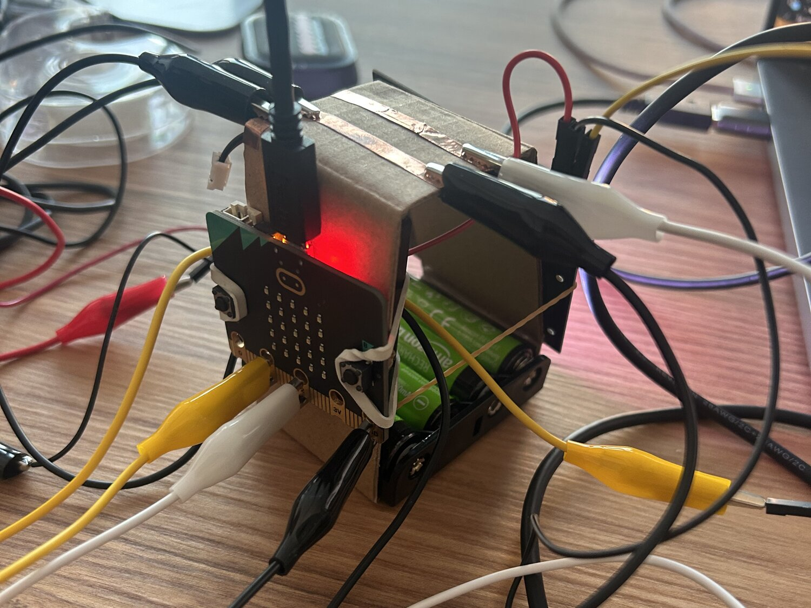
</figure>

<figure markdown>
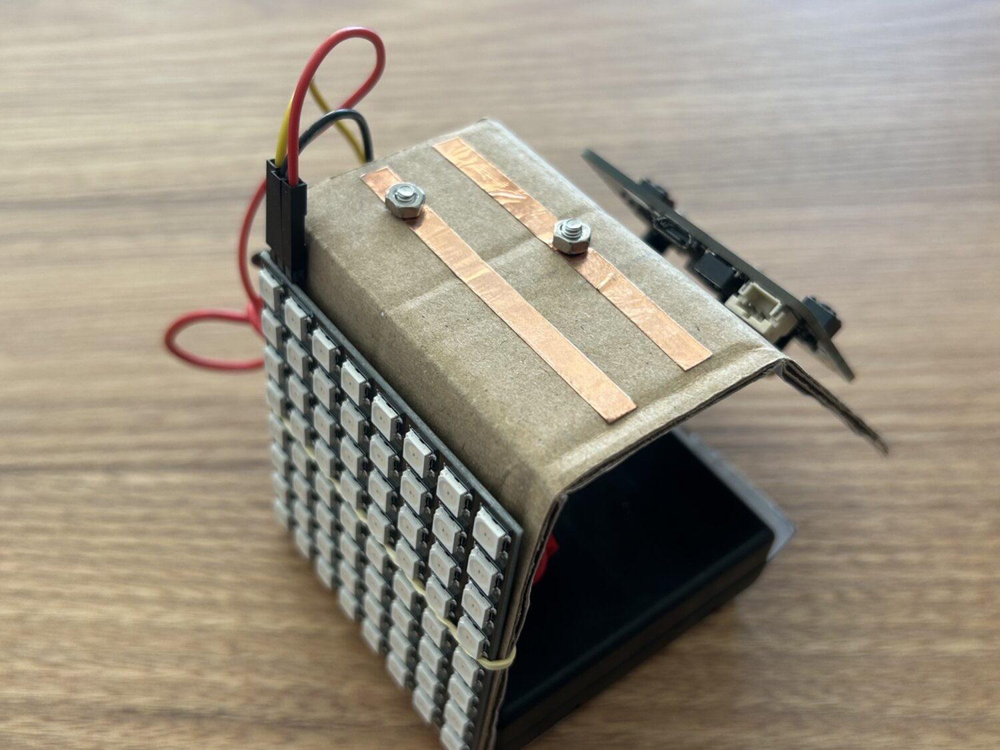
</figure>

</div>

Colle les deux pistes de cuivre sur la face intérieure, sur celles du plan : `P2`, 70 mm, et `GND`, 86 mm. Chacune part de l'anneau du micro:bit et va jusqu'à sa bande du dessus.

Avec la punaise, agrandis chaque trou à travers le cuivre et le carton : les deux trous des bandes, puis les trois anneaux du micro:bit, `2`, `1` et `GND`.

<figure markdown>
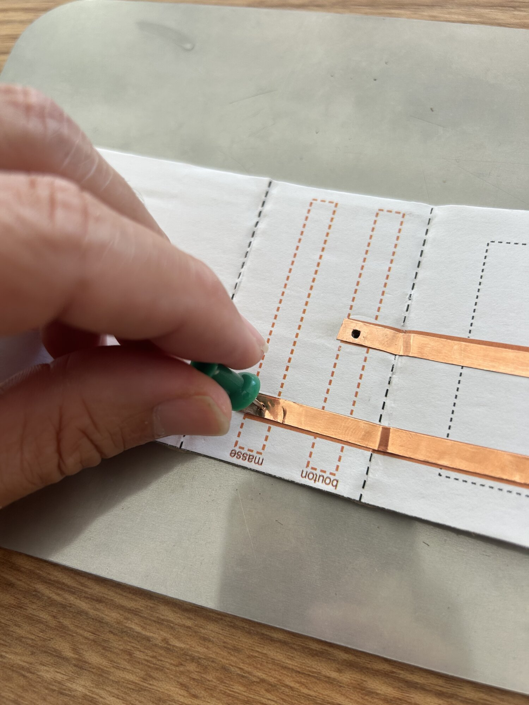
</figure>

Une vis par trou, tête à l'extérieur. Pour le micro:bit, une entretoise entre la carte et le carton. À l'intérieur, une rondelle sur le cuivre, puis l'écrou, serré.

<figure markdown>
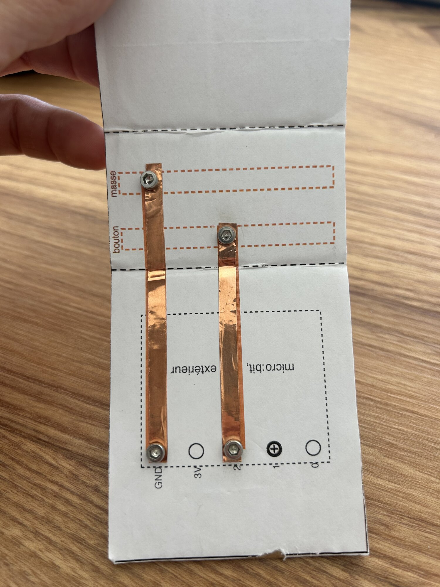
</figure>

<div class="photo-row" markdown>

<figure markdown>
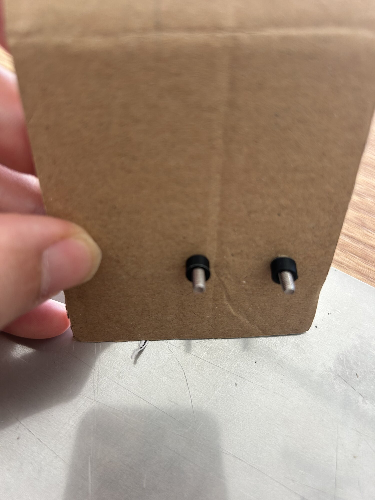
</figure>

<figure markdown>
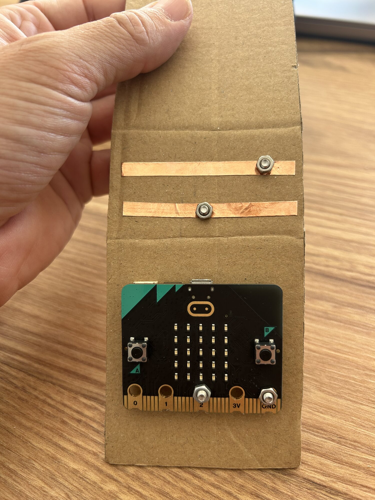
</figure>

</div>

Chaque bande du dessus est maintenant reliée à son anneau du micro:bit : la bande `bouton` à `P2`, la bande `masse` à `GND`.

Vérifie-le au multimètre, en mode continuité : une pointe sur la vis d'une bande, l'autre sur l'anneau du micro:bit. Il bipe : le courant passe. Fais-le pour les deux bandes.

<figure markdown>
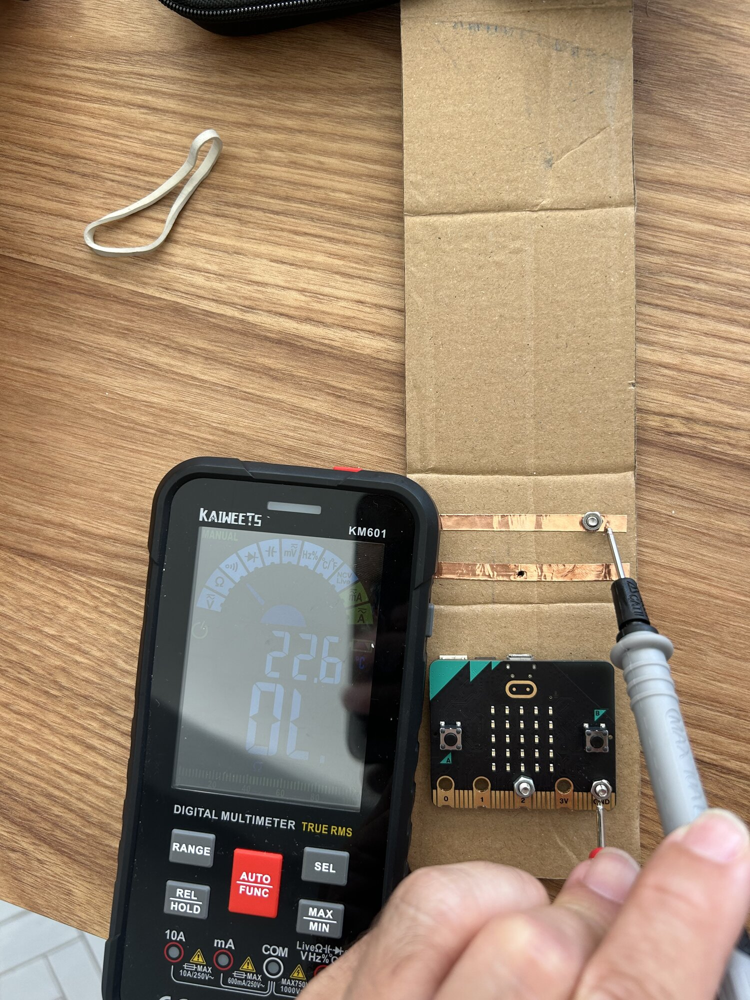
</figure>

> [!IMPORTANT] Point de contrôle
> Refais ta vérification devant l'animateur : deux bips, un par bande.

### La matrice et le pack

Trois broches, au dos de la matrice, et un câble Dupont femelle / pince crocodile sur chacune :

<figure markdown>

</figure>

D'abord, glisse le fil `−` du pack sous la rondelle de l'écrou de `GND`, et resserre. Puis les trois pinces :

1. `DI` sur l'écrou de l'anneau `1`.
2. `G` sur l'écrou de `GND` : la matrice, le pack et le micro:bit partagent la même masse.
3. `V` sur le fil `+` du pack.

<div class="photo-row" markdown>

<figure markdown>
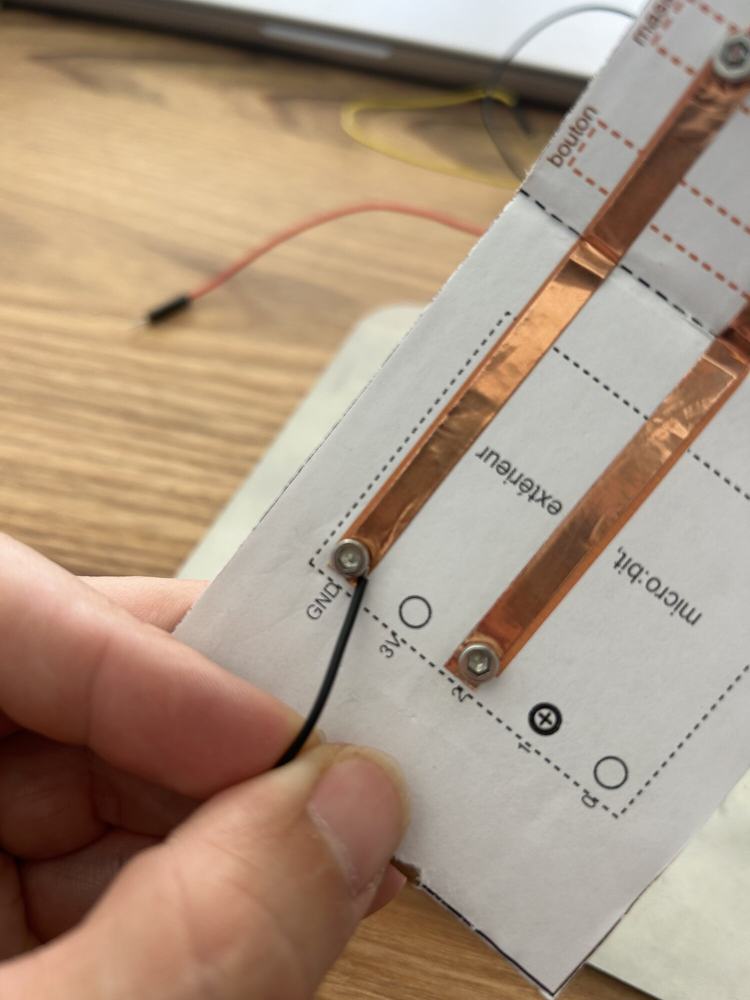
</figure>

<figure markdown>
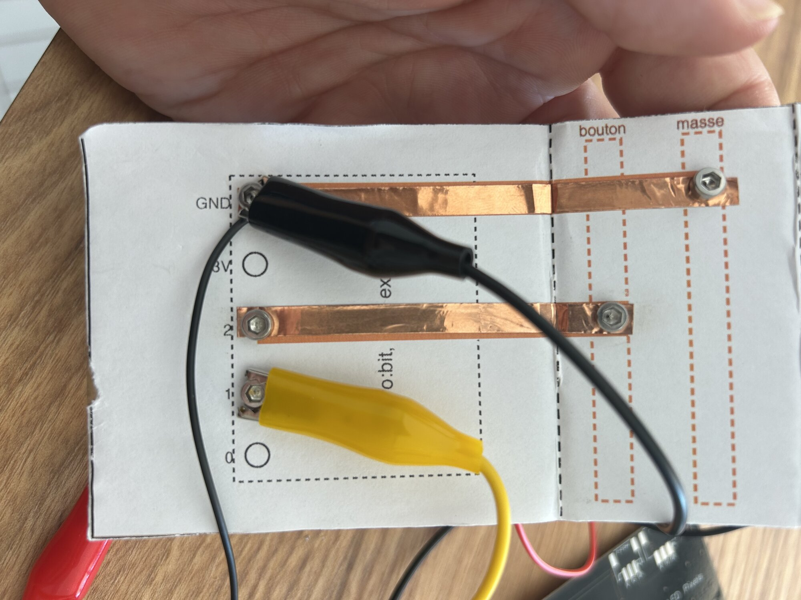
</figure>

</div>

Le pack reçoit **trois accus et une fausse pile** : un cylindre imprimé en 3D, entouré d'une bande de cuivre d'un bout à l'autre. Elle laisse passer le courant sans en fournir. Avec quatre accus, la matrice ne comprend plus le signal du micro:bit quand il est sur piles.

<div class="photo-row" markdown>

<figure markdown>
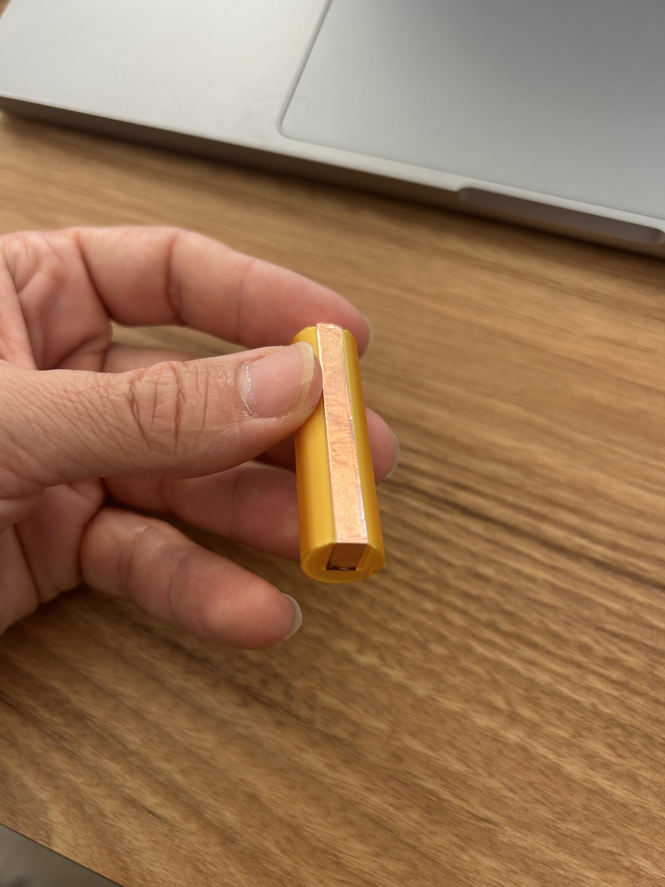
</figure>

<figure markdown>
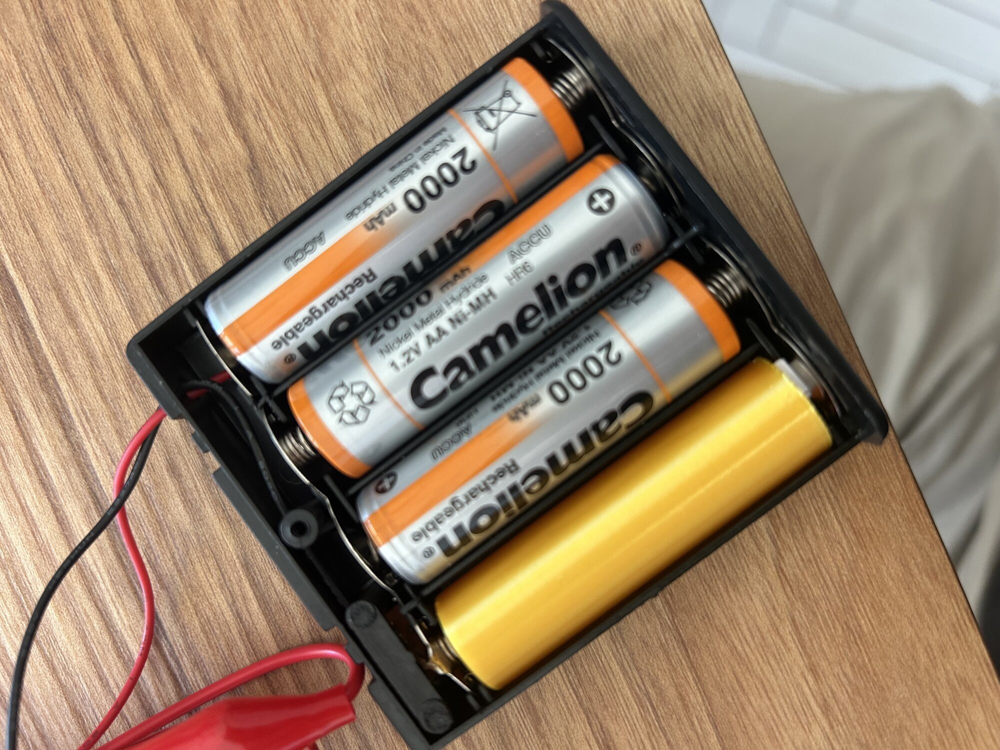
</figure>

</div>

→ [Pourquoi trois accus](../../../fiches/matrice-rgb.md#trois-accus-et-une-fausse-pile)

**Ne mets pas encore les piles dans le pack.**

> [!CAUTION] Les fils du pack
> Le fil `+` et le fil `−` du pack ne se touchent jamais.

La matrice se pose sur le second montant, tenue par un élastique. Le pack va à l'intérieur, sur la base. Le micro:bit reste à l'avant, **écran vers la pièce** : la séance 3 en a besoin.

<figure markdown>
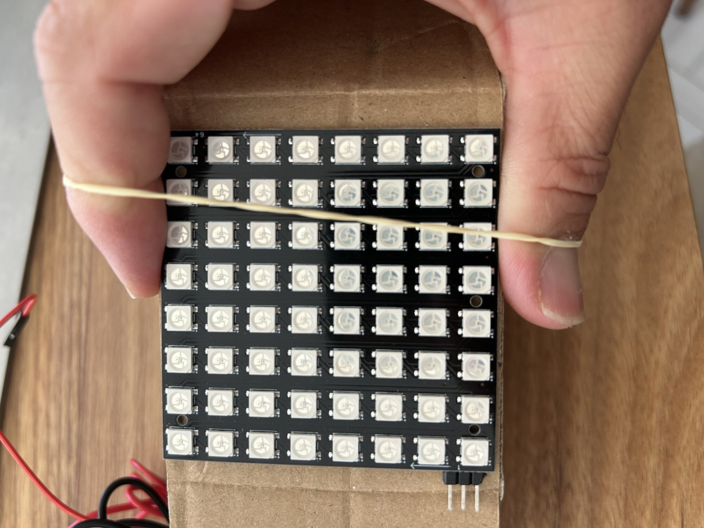
</figure>

→ [La matrice de LED RGB](../../../fiches/matrice-rgb.md) · [La masse commune](../../../fiches/cabler-un-circuit.md#la-masse-commune)

## 2. Allume-la

**Ce que tu vas obtenir :** la matrice s'allume en rouge.

Dans ton projet `lampe` : **Extensions** → colle l'adresse `https://github.com/arbona-robin/pxt-neopixel-matrix-extension` → clique sur la carte **neopixel-extended**.

<figure class="screenshot" markdown>

</figure>

Les blocs sont dans la catégorie **neopixel-extended**, en anglais : cherche-les tels qu'ils sont écrits. Dans `au démarrage` :

```blocks
let strip = neopixelExtended.create(DigitalPin.P1, 64, neopixelExtended.Format.RGB)
strip.setBrightness(50)
strip.setColor(0xff0000)
strip.show()
```

> [!CAUTION] La luminosité d'abord
> `set brightness` à **50**, avant de mettre les piles. À fond, la matrice tire trop de courant, et la carte redémarre.

> [!IMPORTANT] Point de contrôle
> Fais vérifier ton câblage et ta luminosité. Puis téléverse, et mets les piles dans le pack.

> [!TIP] Rien ne s'allume ?
> `DI` sur l'écrou de l'anneau `1` ? Le fil `−` du pack bien serré sous la rondelle de `GND` ?

## 3. Dessine et anime

**Ce que tu vas obtenir :** ton image sur la matrice, puis une lumière qui respire.

Remplace `set color` par `set NeoPixel 8x8` : une grille de 8 × 8, une couleur par case. Garde `show changes` après. Dans `au démarrage`, ajoute `set NeoPixel matrix layout to row by row` : ta matrice est câblée ligne par ligne.

```blocks
let strip = neopixelExtended.create(DigitalPin.P1, 64, neopixelExtended.Format.RGB)
strip.setBrightness(50)
strip.setMatrixLayout(neopixelExtended.MatrixLayout.RowByRow)
strip.setMatrix64(
    neopixelExtended.rowOf8(0x000000, 0x000000, 0xffff00, 0xffff00, 0xffff00, 0xffff00, 0x000000, 0x000000),
    neopixelExtended.rowOf8(0x000000, 0xffff00, 0x000000, 0x000000, 0x000000, 0x000000, 0xffff00, 0x000000),
    neopixelExtended.rowOf8(0xffff00, 0x000000, 0xffff00, 0x000000, 0x000000, 0xffff00, 0x000000, 0xffff00),
    neopixelExtended.rowOf8(0xffff00, 0x000000, 0x000000, 0x000000, 0x000000, 0x000000, 0x000000, 0xffff00),
    neopixelExtended.rowOf8(0xffff00, 0x000000, 0xffff00, 0x000000, 0x000000, 0xffff00, 0x000000, 0xffff00),
    neopixelExtended.rowOf8(0xffff00, 0x000000, 0x000000, 0xffff00, 0xffff00, 0x000000, 0x000000, 0xffff00),
    neopixelExtended.rowOf8(0x000000, 0xffff00, 0x000000, 0x000000, 0x000000, 0x000000, 0xffff00, 0x000000),
    neopixelExtended.rowOf8(0x000000, 0x000000, 0xffff00, 0xffff00, 0xffff00, 0xffff00, 0x000000, 0x000000)
)
strip.show()
```

`set NeoPixel 8x8` prépare l'image : rien ne change sur la matrice avant `show changes`. Une case laissée en gris s'allume en gris ; pour l'éteindre, choisis le noir.

> [!TIP] Éteindre toutes les cases grises d'un coup
> Passe en **JavaScript**, ouvre « Rechercher et remplacer » (`Ctrl` + `H`), remplace `0x888888` par `0x000000`, puis reviens aux **Blocs**.

<figure markdown>
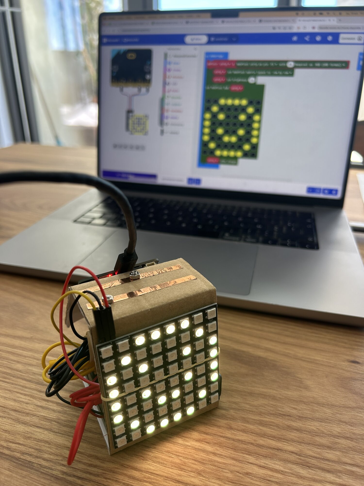
</figure>

**À toi : fais-la respirer.** Dans `toujours`, la lumière monte de 0 à 50, puis redescend : `set brightness`, `set color`, puis `show changes` à chaque pas, et une pause de 20 ms. La boucle `pour index variant de 0 à 50`, dans **Boucles**, compte les pas pour toi.

`set brightness` ne change que les couleurs données après lui : redonne la couleur à chaque pas.

→ [Répéter en comptant](../../../fiches/makecode-prise-en-main.md#repeter-en-comptant)

<details markdown>
<summary>La solution</summary>

```blocks
basic.forever(function () {
    for (let index = 0; index <= 50; index++) {
        strip.setBrightness(index)
        strip.setColor(0xff8c00)
        strip.show()
        basic.pause(20)
    }
    for (let index = 0; index <= 50; index++) {
        strip.setBrightness(50 - index)
        strip.setColor(0xff8c00)
        strip.show()
        basic.pause(20)
    }
})
let strip: neopixelExtended.Strip = null
```

`index` vaut 0, puis 1, puis 2… jusqu'à 50. Dans la seconde boucle, `50 - index` fait le chemin inverse.

</details>

<video controls playsinline preload="metadata" src="../../../../assets/objets-connectes-s02/video-respiration.mp4"></video>

## Va plus loin

- **Un cœur qui bat.** Quatre images dans `toujours`, 200 ms chacune : grand, moyen, petit, moyen. L'image intermédiaire rend le mouvement plus doux.
- **Un diffuseur.** Une simple feuille de papier devant la matrice : les 64 points se fondent en une seule lumière.
- **Crée ta propre animation.** Plusieurs images à la suite, chacune avec son `show changes` et sa pause.

<details markdown>
<summary>La solution du cœur</summary>

```blocks
basic.forever(function () {
    strip.setMatrix64(
        neopixelExtended.rowOf8(0x000000, 0xff0000, 0xff0000, 0x000000, 0x000000, 0xff0000, 0xff0000, 0x000000),
        neopixelExtended.rowOf8(0xff0000, 0xff0000, 0xff0000, 0xff0000, 0xff0000, 0xff0000, 0xff0000, 0xff0000),
        neopixelExtended.rowOf8(0xff0000, 0xff0000, 0xff0000, 0xff0000, 0xff0000, 0xff0000, 0xff0000, 0xff0000),
        neopixelExtended.rowOf8(0xff0000, 0xff0000, 0xff0000, 0xff0000, 0xff0000, 0xff0000, 0xff0000, 0xff0000),
        neopixelExtended.rowOf8(0x000000, 0xff0000, 0xff0000, 0xff0000, 0xff0000, 0xff0000, 0xff0000, 0x000000),
        neopixelExtended.rowOf8(0x000000, 0x000000, 0xff0000, 0xff0000, 0xff0000, 0xff0000, 0x000000, 0x000000),
        neopixelExtended.rowOf8(0x000000, 0x000000, 0x000000, 0xff0000, 0xff0000, 0x000000, 0x000000, 0x000000),
        neopixelExtended.rowOf8(0x000000, 0x000000, 0x000000, 0x000000, 0x000000, 0x000000, 0x000000, 0x000000)
    )
    strip.show()
    basic.pause(200)
    strip.setMatrix64(
        neopixelExtended.rowOf8(0x000000, 0x000000, 0x000000, 0x000000, 0x000000, 0x000000, 0x000000, 0x000000),
        neopixelExtended.rowOf8(0x000000, 0xff0000, 0xff0000, 0x000000, 0x000000, 0xff0000, 0xff0000, 0x000000),
        neopixelExtended.rowOf8(0x000000, 0xff0000, 0xff0000, 0xff0000, 0xff0000, 0xff0000, 0xff0000, 0x000000),
        neopixelExtended.rowOf8(0x000000, 0xff0000, 0xff0000, 0xff0000, 0xff0000, 0xff0000, 0xff0000, 0x000000),
        neopixelExtended.rowOf8(0x000000, 0xff0000, 0xff0000, 0xff0000, 0xff0000, 0xff0000, 0xff0000, 0x000000),
        neopixelExtended.rowOf8(0x000000, 0x000000, 0xff0000, 0xff0000, 0xff0000, 0xff0000, 0x000000, 0x000000),
        neopixelExtended.rowOf8(0x000000, 0x000000, 0x000000, 0xff0000, 0xff0000, 0x000000, 0x000000, 0x000000),
        neopixelExtended.rowOf8(0x000000, 0x000000, 0x000000, 0x000000, 0x000000, 0x000000, 0x000000, 0x000000)
    )
    strip.show()
    basic.pause(200)
    strip.setMatrix64(
        neopixelExtended.rowOf8(0x000000, 0x000000, 0x000000, 0x000000, 0x000000, 0x000000, 0x000000, 0x000000),
        neopixelExtended.rowOf8(0x000000, 0x000000, 0x000000, 0x000000, 0x000000, 0x000000, 0x000000, 0x000000),
        neopixelExtended.rowOf8(0x000000, 0xff0000, 0xff0000, 0x000000, 0x000000, 0xff0000, 0xff0000, 0x000000),
        neopixelExtended.rowOf8(0x000000, 0xff0000, 0xff0000, 0xff0000, 0xff0000, 0xff0000, 0xff0000, 0x000000),
        neopixelExtended.rowOf8(0x000000, 0x000000, 0xff0000, 0xff0000, 0xff0000, 0xff0000, 0x000000, 0x000000),
        neopixelExtended.rowOf8(0x000000, 0x000000, 0x000000, 0xff0000, 0xff0000, 0x000000, 0x000000, 0x000000),
        neopixelExtended.rowOf8(0x000000, 0x000000, 0x000000, 0x000000, 0x000000, 0x000000, 0x000000, 0x000000),
        neopixelExtended.rowOf8(0x000000, 0x000000, 0x000000, 0x000000, 0x000000, 0x000000, 0x000000, 0x000000)
    )
    strip.show()
    basic.pause(200)
    strip.setMatrix64(
        neopixelExtended.rowOf8(0x000000, 0x000000, 0x000000, 0x000000, 0x000000, 0x000000, 0x000000, 0x000000),
        neopixelExtended.rowOf8(0x000000, 0xff0000, 0xff0000, 0x000000, 0x000000, 0xff0000, 0xff0000, 0x000000),
        neopixelExtended.rowOf8(0x000000, 0xff0000, 0xff0000, 0xff0000, 0xff0000, 0xff0000, 0xff0000, 0x000000),
        neopixelExtended.rowOf8(0x000000, 0xff0000, 0xff0000, 0xff0000, 0xff0000, 0xff0000, 0xff0000, 0x000000),
        neopixelExtended.rowOf8(0x000000, 0xff0000, 0xff0000, 0xff0000, 0xff0000, 0xff0000, 0xff0000, 0x000000),
        neopixelExtended.rowOf8(0x000000, 0x000000, 0xff0000, 0xff0000, 0xff0000, 0xff0000, 0x000000, 0x000000),
        neopixelExtended.rowOf8(0x000000, 0x000000, 0x000000, 0xff0000, 0xff0000, 0x000000, 0x000000, 0x000000),
        neopixelExtended.rowOf8(0x000000, 0x000000, 0x000000, 0x000000, 0x000000, 0x000000, 0x000000, 0x000000)
    )
    strip.show()
    basic.pause(200)
})
let strip: neopixelExtended.Strip = null
```

Une image intermédiaire rend le mouvement plus doux : le cœur se gonfle et se dégonfle, au lieu de sauter d'une taille à l'autre.

</details>
