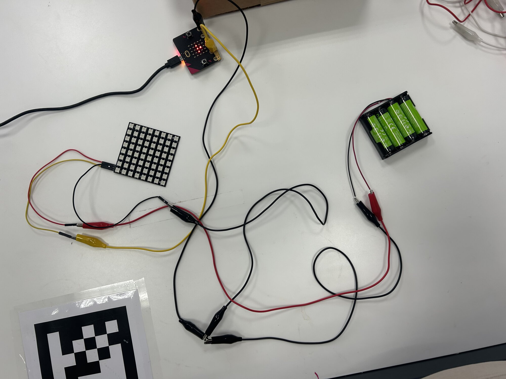
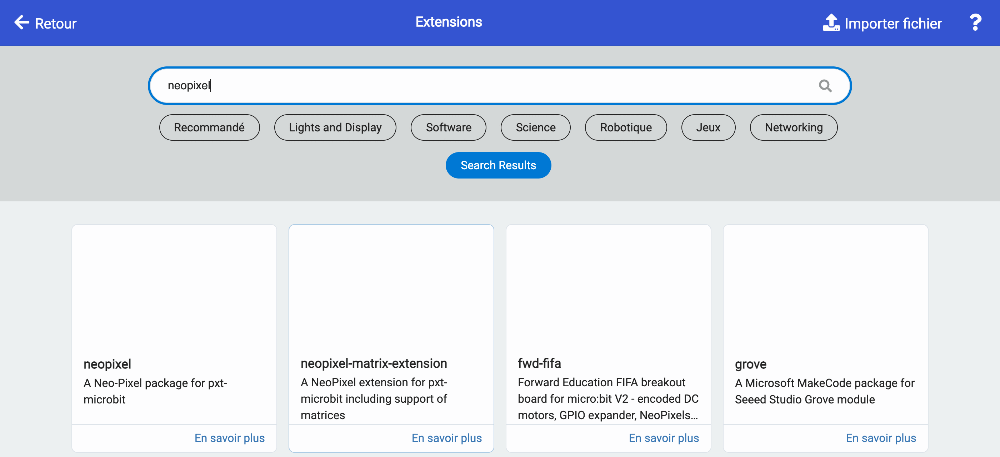

# Séance 2 — Compose la lumière de ta lampe

1. **[Câble la matrice](#1-cable-la-matrice)** : 64 LED de couleur reliées au micro:bit et au pack d'accus.
2. **[Allume-la](#2-allume-la)** : la matrice s'allume en rouge.
3. **[Dessine et anime](#3-dessine-et-anime)** : ton image, puis une animation.
4. **[Pose-la sur la lampe](#4-pose-la-sur-la-lampe)** : la matrice tient sur la lampe, derrière du papier calque.

## 1. Câble la matrice

**Ce que tu vas obtenir :**

<figure markdown>

</figure>

Trois broches, au dos de la matrice :

<figure markdown>

</figure>

Un câble Dupont sur chaque broche, puis des pinces :

1. `V` au `+` du pack.
2. `G` au `−` du pack. Une seconde pince relie le `−` du pack au `GND` du micro:bit : c'est la masse commune.
3. `DI` sur `P1`. `P2` reste à ton bouton de cuivre.

<figure class="plan" markdown>

</figure>

**Ne branche pas encore le pack.**

> [!CAUTION] Les pinces du pack
> Les pinces du `+` et du `−` ne se touchent jamais.

→ [La matrice de LED RGB](../../../fiches/matrice-rgb.md) · [La masse commune](../../../fiches/cabler-un-circuit.md#la-masse-commune)

## 2. Allume-la

**Ce que tu vas obtenir :** la matrice s'allume en rouge.

Dans ton projet `lampe` : **Extensions** → colle l'adresse `https://github.com/arbona-robin/pxt-neopixel-matrix-extension` → clique sur la carte **neopixel-extended**.

<figure class="screenshot" markdown>

</figure>

Les blocs sont dans la catégorie **neopixel-extended**, en anglais : cherche-les tels qu'ils sont écrits. Dans `au démarrage` :

```blocks
let strip = neopixelExtended.create(DigitalPin.P1, 64, neopixelExtended.Format.RGB)
strip.setBrightness(50)
strip.showColor(0xff0000)
```

> [!CAUTION] La luminosité d'abord
> `set brightness` à **50**, avant de brancher le pack. À fond, la matrice tire trop de courant, et la carte redémarre.

> [!IMPORTANT] Point de contrôle
> Fais vérifier ton câblage et ta luminosité. Puis téléverse, et branche le pack.

> [!TIP] Rien ne s'allume ?
> `DI` sur `P1` ? Le `GND` du micro:bit relié au `−` du pack ?

## 3. Dessine et anime

**Ce que tu vas obtenir :** ton image sur la matrice, qui défile ou qui change.

Remplace `show color` par `set NeoPixel 8x8` : une grille de 8 × 8, une couleur par case. Puis `show changes`. Dans `au démarrage`, ajoute `set NeoPixel matrix layout to row by row` : ta matrice est câblée ligne par ligne.

```blocks
let strip = neopixelExtended.create(DigitalPin.P1, 64, neopixelExtended.Format.RGB)
strip.setBrightness(50)
strip.setMatrixLayout(neopixelExtended.MatrixLayout.RowByRow)
strip.setMatrix64(
    neopixelExtended.rowOf8(0x000000, 0x000000, 0xffff00, 0xffff00, 0xffff00, 0xffff00, 0x000000, 0x000000),
    neopixelExtended.rowOf8(0x000000, 0xffff00, 0x000000, 0x000000, 0x000000, 0x000000, 0xffff00, 0x000000),
    neopixelExtended.rowOf8(0xffff00, 0x000000, 0xffff00, 0x000000, 0x000000, 0xffff00, 0x000000, 0xffff00),
    neopixelExtended.rowOf8(0xffff00, 0x000000, 0x000000, 0x000000, 0x000000, 0x000000, 0x000000, 0xffff00),
    neopixelExtended.rowOf8(0xffff00, 0x000000, 0xffff00, 0x000000, 0x000000, 0xffff00, 0x000000, 0xffff00),
    neopixelExtended.rowOf8(0xffff00, 0x000000, 0x000000, 0xffff00, 0xffff00, 0x000000, 0x000000, 0xffff00),
    neopixelExtended.rowOf8(0x000000, 0xffff00, 0x000000, 0x000000, 0x000000, 0x000000, 0xffff00, 0x000000),
    neopixelExtended.rowOf8(0x000000, 0x000000, 0xffff00, 0xffff00, 0xffff00, 0xffff00, 0x000000, 0x000000)
)
strip.show()
```

`set NeoPixel 8x8` prépare l'image : rien ne change sur la matrice avant `show changes`. Une case laissée en gris s'allume en gris ; pour l'éteindre, choisis le noir.

> [!TIP] Éteindre toutes les cases grises d'un coup
> Passe en **JavaScript**, ouvre « Rechercher et remplacer » (`Ctrl` + `H`), remplace `0x888888` par `0x000000`, puis reviens aux **Blocs**.

<span class="todo-media">[photo : la matrice qui affiche un visage]</span>

**À toi : fais-la défiler.** Dans `toujours` : `rotate pixels by 8`, `show changes`, une pause de 200 ms.

<details markdown>
<summary>La solution</summary>

```blocks
basic.forever(function () {
    strip.rotate(8)
    strip.show()
    basic.pause(200)
})
let strip: neopixelExtended.Strip = null
```

La matrice est un ruban de 64 LED, posé en 8 lignes : décaler de 8, c'est décaler d'une ligne. Essaie avec 1.

</details>

<span class="todo-media">[vidéo : l'image qui défile ligne par ligne]</span>

**À toi : deux images.** Elles alternent, chacune une seconde.

<details markdown>
<summary>La solution</summary>

```blocks
basic.forever(function () {
    strip.setMatrix64(
        neopixelExtended.rowOf8(0x000000, 0x000000, 0xffff00, 0xffff00, 0xffff00, 0xffff00, 0x000000, 0x000000),
        neopixelExtended.rowOf8(0x000000, 0xffff00, 0x000000, 0x000000, 0x000000, 0x000000, 0xffff00, 0x000000),
        neopixelExtended.rowOf8(0xffff00, 0x000000, 0xffff00, 0x000000, 0x000000, 0xffff00, 0x000000, 0xffff00),
        neopixelExtended.rowOf8(0xffff00, 0x000000, 0x000000, 0x000000, 0x000000, 0x000000, 0x000000, 0xffff00),
        neopixelExtended.rowOf8(0xffff00, 0x000000, 0xffff00, 0x000000, 0x000000, 0xffff00, 0x000000, 0xffff00),
        neopixelExtended.rowOf8(0xffff00, 0x000000, 0x000000, 0xffff00, 0xffff00, 0x000000, 0x000000, 0xffff00),
        neopixelExtended.rowOf8(0x000000, 0xffff00, 0x000000, 0x000000, 0x000000, 0x000000, 0xffff00, 0x000000),
        neopixelExtended.rowOf8(0x000000, 0x000000, 0xffff00, 0xffff00, 0xffff00, 0xffff00, 0x000000, 0x000000)
    )
    strip.show()
    basic.pause(1000)
    strip.setMatrix64(
        neopixelExtended.rowOf8(0x000000, 0xffff00, 0xffff00, 0x000000, 0x000000, 0xffff00, 0xffff00, 0x000000),
        neopixelExtended.rowOf8(0xffff00, 0xffff00, 0xffff00, 0xffff00, 0xffff00, 0xffff00, 0xffff00, 0xffff00),
        neopixelExtended.rowOf8(0xffff00, 0xffff00, 0xffff00, 0xffff00, 0xffff00, 0xffff00, 0xffff00, 0xffff00),
        neopixelExtended.rowOf8(0xffff00, 0xffff00, 0xffff00, 0xffff00, 0xffff00, 0xffff00, 0xffff00, 0xffff00),
        neopixelExtended.rowOf8(0x000000, 0xffff00, 0xffff00, 0xffff00, 0xffff00, 0xffff00, 0xffff00, 0x000000),
        neopixelExtended.rowOf8(0x000000, 0x000000, 0xffff00, 0xffff00, 0xffff00, 0xffff00, 0x000000, 0x000000),
        neopixelExtended.rowOf8(0x000000, 0x000000, 0x000000, 0xffff00, 0xffff00, 0x000000, 0x000000, 0x000000),
        neopixelExtended.rowOf8(0x000000, 0x000000, 0x000000, 0x000000, 0x000000, 0x000000, 0x000000, 0x000000)
    )
    strip.show()
    basic.pause(1000)
})
let strip: neopixelExtended.Strip = null
```

</details>

## 4. Pose-la sur la lampe

**Ce que tu vas obtenir :**

<span class="todo-media">[photo : la matrice tenue sur la lampe par deux élastiques, papier calque devant]</span>

Deux élastiques tiennent la matrice. Le papier calque devant adoucit la lumière. Le micro:bit reste à l'avant, **écran vers la pièce** : la séance 3 en a besoin.

## Va plus loin

- **Un arc-en-ciel.** `show rainbow from 1 to 360`.
- **Une respiration.** Dans une boucle, `set brightness` monte de 0 à 50, puis redescend, avec `show changes` à chaque pas.
- **Ton bouton de cuivre.** Quand tu touches les bandes, la matrice change d'image.
