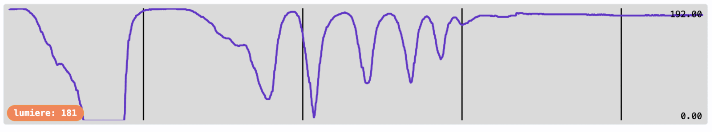

# Séance 3 — Fais-la s'allumer quand il fait nuit

1. **[Regarde les valeurs](#1-regarde-les-valeurs)** : tu sais ce que mesure ta carte, du plein jour au noir, et tu choisis ton seuil.
2. **[La décision](#2-la-decision)** : sous ton seuil, la lampe s'allume ; au-dessus, elle s'éteint.
3. **[Ton interrupteur en cuivre](#3-ton-interrupteur-en-cuivre)** : tu touches les bandes, la lampe passe en marche ou en veille.

## 1. Regarde les valeurs

**Ce que tu vas obtenir :** tes valeurs, de la salle éclairée au noir, et ton seuil.

<video class="portrait" controls playsinline preload="metadata" src="../../../../assets/objets-connectes-s03/video-main-courbe.mp4"></video>

Le micro:bit mesure la lumière avec **son écran** : `niveau d'intensité lumineuse`, dans **Entrée**, de `0` (noir) à `255` (pleine lumière).

Nouveau projet : `lumiere`. Dans `toujours` :

```blocks
basic.forever(function () {
    serial.writeValue("lumiere", input.lightLevel())
    basic.pause(200)
})
```

Téléverse, USB branché, puis **Afficher données Appareil**.

<figure class="screenshot" markdown>

</figure>

> [!CAUTION] L'écran reste éteint, et tu ne le touches pas
> - Le capteur, c'est l'écran. Une icône affichée pendant la mesure fausse la valeur.
> - Pour faire de l'ombre, passe la main au-dessus sans toucher la carte, ou pose un objet devant : un carton, une feuille. Un doigt sur la carte rend la valeur erratique.

Remplis ce tableau :

| Où | Valeur |
|---|---|
| Salle éclairée | |
| Main au-dessus de la carte | |
| Près de la fenêtre | |
| Lumière de la salle éteinte | |

Ton seuil est entre la pénombre et la salle éclairée. Il dépend de l'endroit où tu poseras ta lampe : le tien n'est pas celui du voisin.

→ [Le capteur de lumière](../../../fiches/makecode-prise-en-main.md#le-capteur-de-lumiere)

## 2. La décision

**Ce que tu vas obtenir :** tu couvres la carte, la matrice s'allume ; tu la découvres, elle s'éteint.

<video class="portrait" controls playsinline preload="metadata" src="../../../../assets/objets-connectes-s03/video-doigt-allume.mp4"></video>

Retour dans ton projet `lampe`.

**À toi.** Dans `toujours` : si la lumière est sous ton seuil, allume toute la matrice d'une couleur avec `set color`, dans **neopixel-extended**, puis `show changes`. Sinon, éteins la matrice avec `clear all colors` et `show changes`.

<details markdown>
<summary>La solution</summary>

```blocks
basic.forever(function () {
    if (input.lightLevel() < 40) {
        strip.setColor(0xff8c00)
        strip.show()
    } else {
        strip.clear()
        strip.show()
    }
})
let strip: neopixelExtended.Strip = null
```

`40` est le seuil de ce montage. Prends le tien.

</details>

## 3. Ton interrupteur en cuivre

**Ce que tu vas obtenir :** tu touches les bandes de cuivre, une coche s'affiche et la lampe se met en marche ; tu les touches encore, une croix, et elle passe en veille.

<video class="portrait" controls playsinline preload="metadata" src="../../../../assets/objets-connectes-s03/video-interrupteur.mp4"></video>

La lampe doit **se souvenir** si elle est en marche ou en veille. C'est le rôle d'une variable : `active`, qui vaut `1` en marche, `0` en veille.

Tes bandes de cuivre deviennent un bouton : un doigt posé à cheval sur les deux ferme le circuit entre `P2` et `GND`. Cette fois, `P2` est une **entrée**. `lorsque la broche P2 est activée`, dans **Entrée**, se déclenche une seule fois à chaque toucher des deux bandes. À chaque toucher, `active` bascule : `0` devient `1`, `1` devient `0`.

**À toi.**

1. Crée la variable `active` : **Variables** → **Créer une variable…**.
2. Dans `lorsque la broche P2 est activée` : si `active` vaut `0`, mets-la à `1` et montre une coche ; sinon, mets-la à `0` et montre une croix. Une seconde, puis `effacer l'écran`.
3. Dans `toujours`, la lampe ne s'allume que si elle est active **et** qu'il fait sombre. Sinon, elle s'éteint.

<details markdown>
<summary>La solution</summary>

```blocks
input.onPinPressed(TouchPin.P2, function () {
    if (active == 0) {
        active = 1
        basic.showIcon(IconNames.Yes)
    } else {
        active = 0
        basic.showIcon(IconNames.No)
    }
    basic.pause(1000)
    basic.clearScreen()
})
basic.forever(function () {
    if (active == 1 && input.lightLevel() < 40) {
        strip.setColor(0xff8c00)
        strip.show()
    } else {
        strip.clear()
        strip.show()
    }
})
let active = 0
let strip: neopixelExtended.Strip = null
```

→ [Un interrupteur : basculer un état](../../../fiches/makecode-prise-en-main.md#un-interrupteur-basculer-un-etat)

</details>

> [!TIP] La lampe clignote quand tu la touches ?
> La coche et la croix s'affichent sur l'écran, et l'écran est aussi le capteur de lumière : pendant cette seconde, la mesure est fausse. `effacer l'écran` juste après, et tout rentre dans l'ordre.

Si ta matrice éclaire l'écran du micro:bit, la lampe se voit elle-même : elle s'allume, mesure sa propre lumière, s'éteint, et recommence. L'écran du micro:bit regarde la pièce, pas la lampe.

> [!IMPORTANT] Point de contrôle
> Touche les bandes : une coche, et la lampe s'allume quand tu couvres la carte. Touche encore : une croix, et elle reste éteinte, même couverte.

## Va plus loin

- **Deux seuils.** À la limite, la valeur oscille et la lampe clignote. Un seuil pour s'allumer (`40`), un autre pour s'éteindre (`60`) : entre les deux, elle ne bouge pas.

### Un réveil en douceur

À l'allumage, la lumière monte de 0 à 50 au lieu d'apparaître d'un coup. Une variable `intensite` monte d'un cran à chaque tour de `toujours`, jusqu'à 50, avec `set brightness`. Elle repart à 0 quand la lampe s'éteint. Une courte pause pendant la montée la rend visible : allonge-la pour un réveil plus lent.

<details markdown>
<summary>La solution</summary>

```blocks
basic.forever(function () {
    if (active == 1 && input.lightLevel() < 40) {
        if (intensite < 50) {
            intensite = intensite + 1
            basic.pause(30)
        }
        strip.setBrightness(intensite)
        strip.setColor(0xff8c00)
        strip.show()
    } else {
        intensite = 0
        strip.clear()
        strip.show()
    }
})
let intensite = 0
let active = 0
let strip: neopixelExtended.Strip = null
```

`set brightness` ne change que les couleurs données après lui : il passe avant `set color`.

</details>
