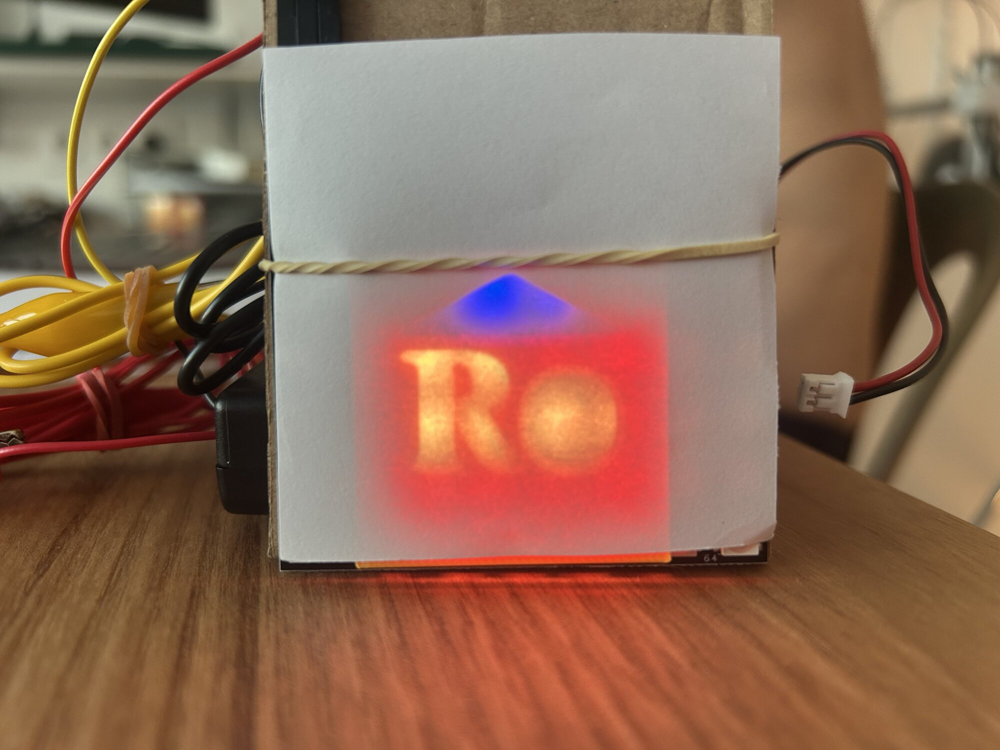
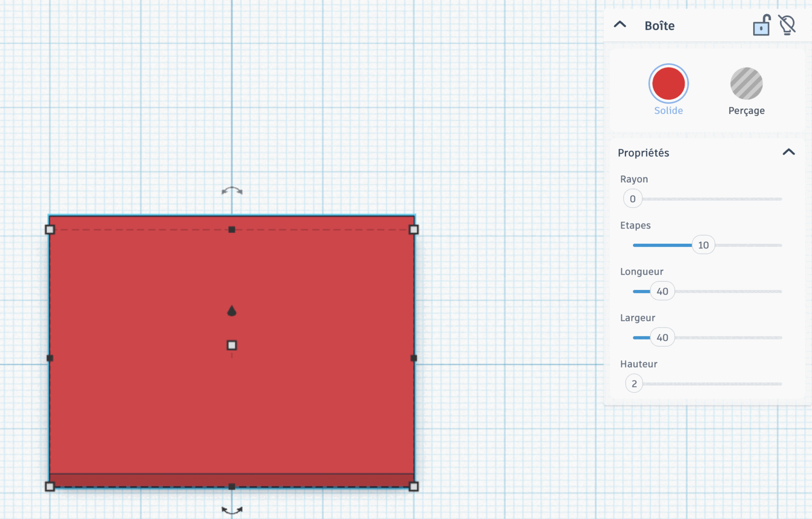
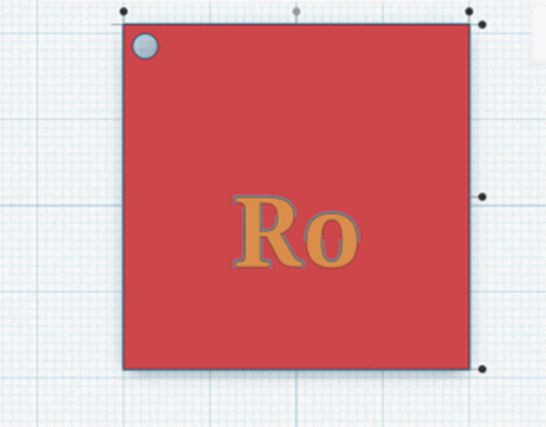
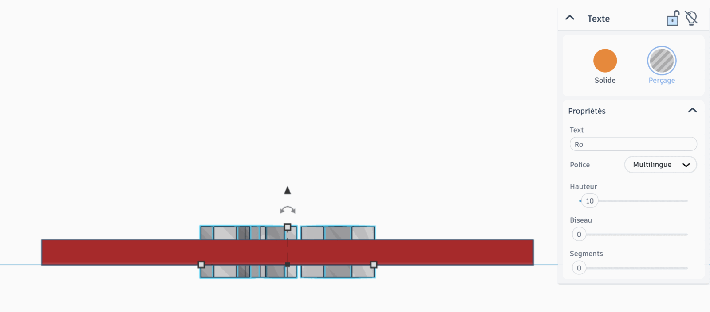
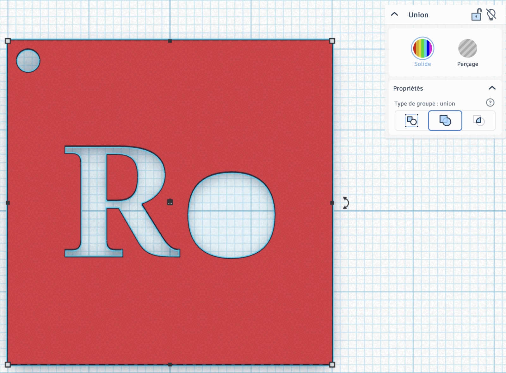
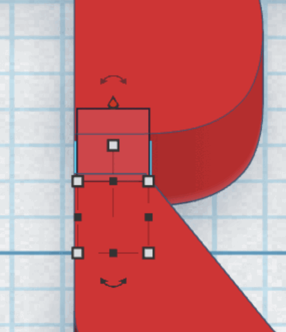
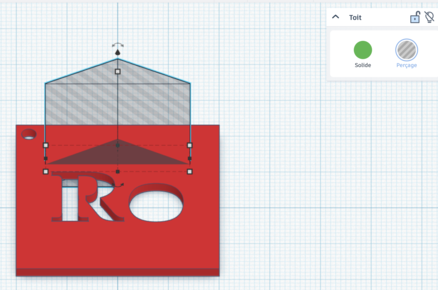
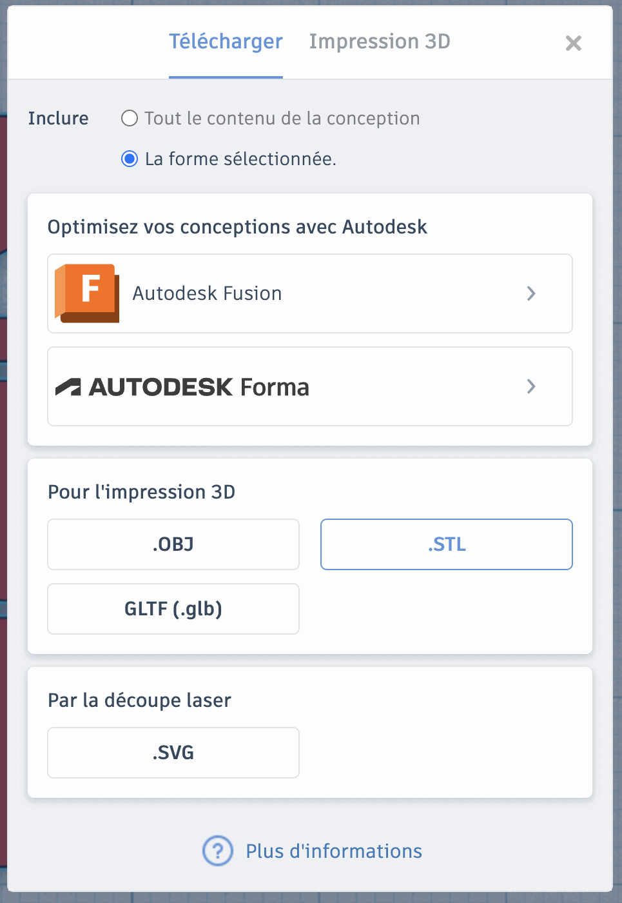

# Séance 4 — Dessine le pochoir de ta lampe

1. **[Ta plaque et ton prénom](#1-ta-plaque-et-ton-prenom)** : une plaque de 40 × 40 × 2 mm percée de ton prénom, avec un trou de porte-clés.
2. **[Est-ce que tout tient ?](#2-est-ce-que-tout-tient)** : aucune partie de ton pochoir ne tombe.
3. **[Une forme, puis exporte](#3-une-forme-puis-exporte)** : ton pochoir validé part à l'impression.

## 1. Ta plaque et ton prénom

**Ce que tu vas obtenir :**

<figure markdown>

</figure>

### Rejoins la classe Tinkercad

Va sur [tinkercad.com/joinclass](https://www.tinkercad.com/joinclass), entre le **code de classe** que donne l'animateur, puis ton **identifiant d'élève**.

<figure class="screenshot" markdown>

</figure>

### La plaque

Pose une **Boîte**, et règle-la à **40 × 40 × 2 mm**.

<figure class="screenshot" markdown>

</figure>

> [!CAUTION] Les cotes ne se discutent pas
> Tous les pochoirs partent sur **un seul plateau d'imprimante**. Un pochoir hors cotes ne part pas à l'impression.

### Le trou de porte-clés

Un **Cylindre** en **Perçage**, réglé à **3 mm**, dans un coin. Il ne touche pas le bord.

### Ton prénom

Ajoute une forme **Texte**, tape ton prénom ou tes initiales, pose-la sur la plaque. Agrandis-la : un motif large se lit mieux, éclairé. Centre-la avec l'outil **Aligner**, pas à l'œil.

<figure class="screenshot" markdown>

</figure>

Passe le texte en **Perçage**. Puis passe en vue **de face** : il doit traverser la plaque, dessus et dessous. Sinon, descends-le avec la poignée d'altitude.

<figure class="screenshot" markdown>

</figure>

Sélectionne tout, puis **Regroupe** (<kbd>Ctrl</kbd> + <kbd>G</kbd>).

## 2. Est-ce que tout tient ?

**Ce que tu vas obtenir :** chaque partie de ton pochoir reste reliée au reste de la plaque.

L'imprimante empile des couches de plastique et ne pose rien dans le vide. Le centre d'un `R`, d'un `o` ou d'un `A` n'est relié à rien : à l'impression, il tombe.

<figure class="screenshot" markdown>

<figcaption>Le <code>o</code> est évidé. Le centre du <code>R</code> ne tient à rien.</figcaption>
</figure>

Deux façons de t'en sortir :

- **évide la lettre** : un **Cylindre** en perçage par-dessus, le `o` devient un disque
- ou **relie** le centre au reste de la plaque par un **pont** : une petite **Boîte** pleine, de 1,5 mm de large au moins

<figure class="screenshot" markdown>

</figure>

Puis regroupe une nouvelle fois.

## 3. Une forme, puis exporte

**Ce que tu vas obtenir :** ton pochoir complet, validé, exporté en `.STL`.

### Une forme en plus

Ajoute une forme de la palette, un **Toit** ou une autre, passe-la en **Perçage**, et place-la sur la plaque, à côté de ton texte. Si elle détache une partie de la plaque, ajoute un pont.

<figure class="screenshot" markdown>

</figure>

### Vérifie et exporte

**Est-ce que tout s'imprime ?** Rien n'est trop fin : **2 mm** au moins pour une ouverture, **1,5 mm** pour un pont.

> [!IMPORTANT] Point de contrôle
> Fais valider ton pochoir avant d'exporter. Après, il part à l'impression tel quel.

Sélectionne tout, **Regroupe**, puis **Exporter** → **La forme sélectionnée** → **.STL**

<figure class="screenshot" markdown>

</figure>

Nomme le fichier `prenom-pochoir.stl` et dépose-le où l'animateur te l'indique.

→ [Modéliser et imprimer en 3D](../../../fiches/modeliser-imprimer-3d.md)

## Va plus loin

### Une forme à main levée

Dessine ta propre forme avec **Scribble**, dans la palette, puis passe-la en **Perçage**. Repose ensuite les deux questions : est-ce que tout tient, est-ce que tout s'imprime ?
