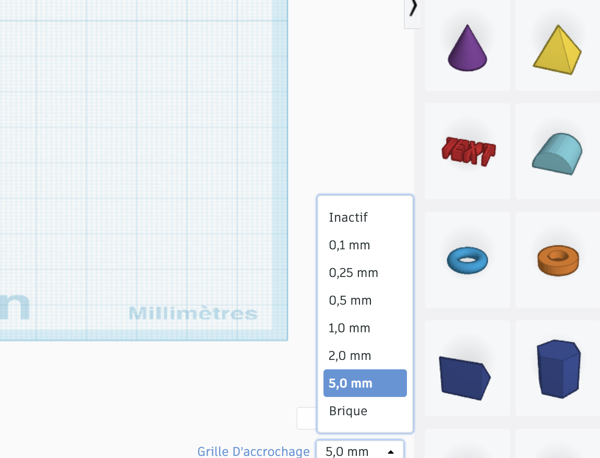
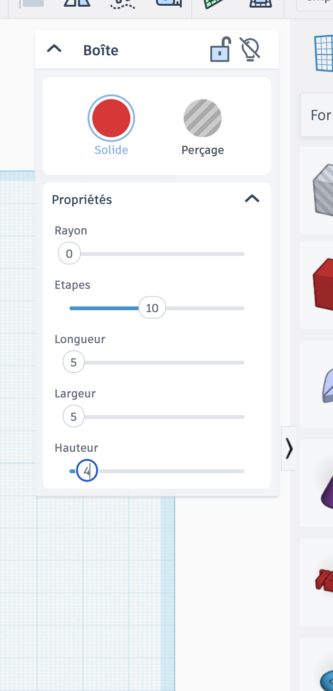
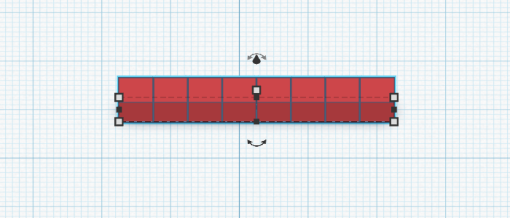
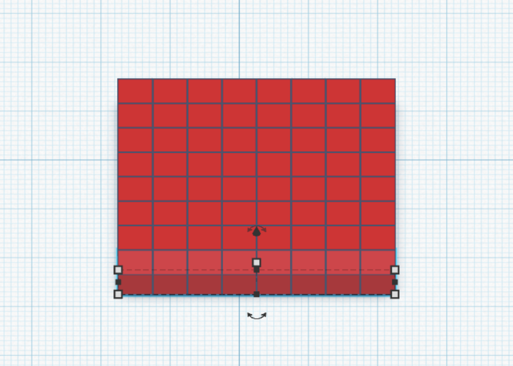
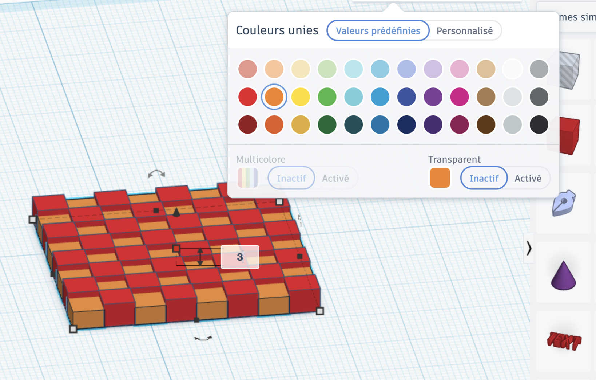
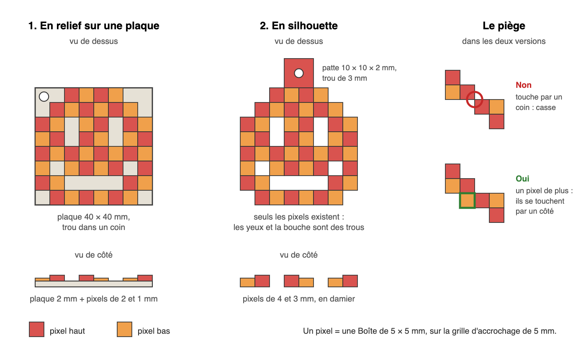
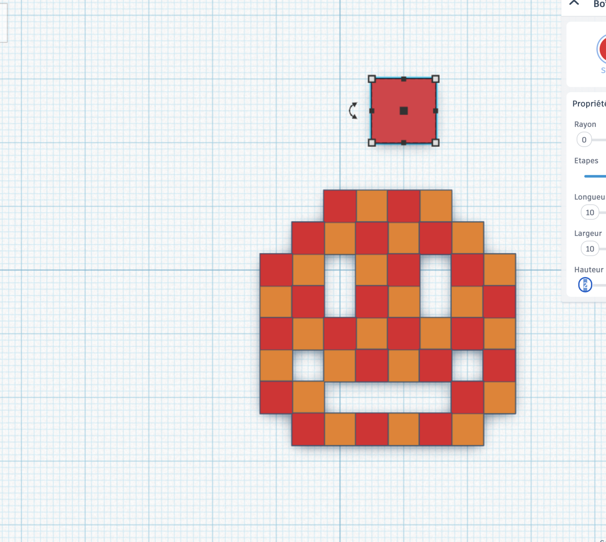
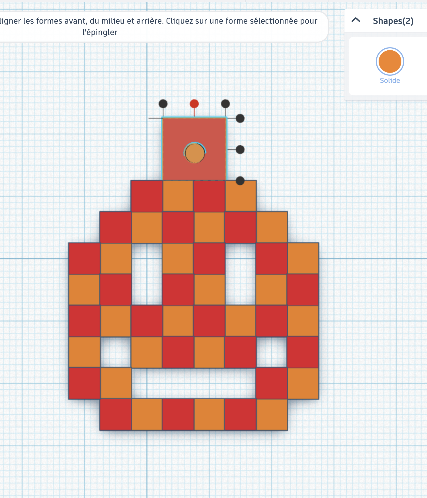
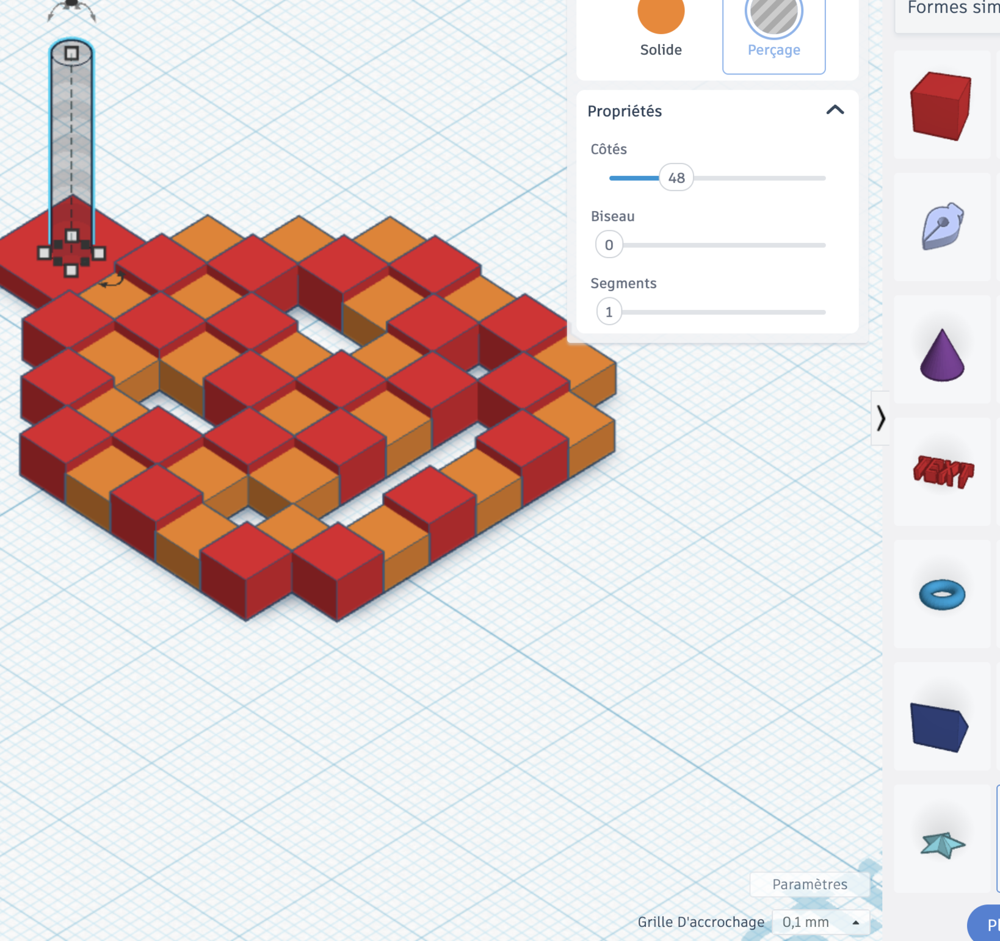
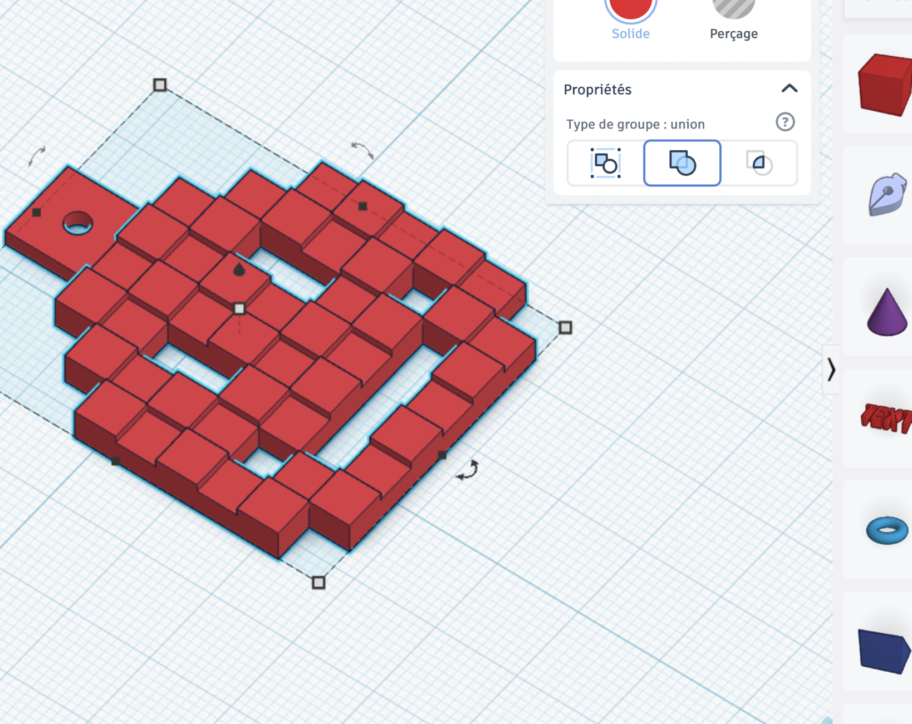

# Séance 4 — Dessine ton porte-clés pixel

1. **[Ta grille de pixels](#1-ta-grille-de-pixels)** : 64 pixels de 5 mm, en damier.
2. **[Ton dessin](#2-ton-dessin)** : ton personnage pixel, avec sa patte de porte-clés.
3. **[Vérifie et exporte](#3-verifie-et-exporte)** : ton porte-clés part à l'impression.

## 1. Ta grille de pixels

**Ce que tu vas obtenir :**

[photo : le porte-clés pixel imprimé, à côté de la lampe qui affiche le même dessin]

### Rejoins la classe Tinkercad

Va sur [tinkercad.com/joinclass](https://www.tinkercad.com/joinclass), entre le **code de classe** que donne l'animateur, puis ton **identifiant d'élève**.

<figure class="screenshot" markdown>

</figure>

### Un pixel

En bas à droite, **Grille d'accrochage** → **5,0 mm** : chaque forme se pose pile sur une case.

<figure class="screenshot" markdown>

</figure>

Pose une **Boîte**, et règle-la à **5 × 5 × 4 mm** : c'est ton premier pixel.

<figure class="screenshot" markdown>

</figure>

> [!CAUTION] Les cotes ne se discutent pas
> Tous les porte-clés partent sur **un seul plateau d'imprimante** : 8 × 8 pixels au plus. Un porte-clés hors cotes ne part pas à l'impression.

### La grille

Passe en vue **de dessus**. Sélectionne ton pixel, **Dupliquer** (<kbd>Ctrl</kbd> + <kbd>D</kbd>), puis décale la copie d'une case avec une flèche du clavier. Recommence : huit pixels en rangée.

<figure class="screenshot" markdown>

</figure>

Sélectionne la rangée, duplique-la, décale-la d'une case vers le haut. Huit rangées : ta grille de 8 × 8, la même que ta lampe.

<figure class="screenshot" markdown>

</figure>

### Le damier

Sélectionne un pixel sur deux, en damier, en maintenant <kbd>Maj</kbd>. Règle leur **hauteur à 3 mm**, et donne-leur une autre couleur pour t'y retrouver. Imprimé d'une seule couleur, ce relief fait ressortir chaque pixel.

<figure class="screenshot" markdown>

</figure>

Ton porte-clés peut prendre deux formes : en silhouette, ou en relief sur une plaque. Dans les deux cas, chaque pixel touche un voisin par un côté.

<figure markdown>

</figure>

## 2. Ton dessin

**Ce que tu vas obtenir :** ton personnage pixel, comme sur ta lampe.

Reprends le dessin de ta lampe, ou invente-le. Supprime les pixels éteints : il ne reste que ton dessin.

<figure class="screenshot" markdown>

</figure>

**Chaque pixel touche un voisin par un côté.** Deux pixels qui ne se touchent que par un coin cassent à la première chute.

### La patte de porte-clés

Une **Boîte** de **10 × 10 × 2 mm**, collée au bord de ton dessin. Un **Cylindre** de **3 mm** de diamètre, centré dedans avec l'outil **Aligner**.

<figure class="screenshot" markdown>

</figure>

Passe le cylindre en **Perçage**. En vue **de face**, il doit traverser la patte, dessus et dessous.

<figure class="screenshot" markdown>

</figure>

## 3. Vérifie et exporte

**Ce que tu vas obtenir :** ton porte-clés regroupé en une seule pièce, exporté en `.STL`.

Sélectionne tout, puis **Regroupe** (<kbd>Ctrl</kbd> + <kbd>G</kbd>).

<figure class="screenshot" markdown>

</figure>

**Est-ce que tout tient ?** Chaque pixel touche un voisin par un côté, et la patte touche ton dessin.

> [!IMPORTANT] Point de contrôle
> Fais valider ton porte-clés avant d'exporter. Après, il part à l'impression tel quel.

**Exporter** → **La forme sélectionnée** → **.STL**

<figure class="screenshot" markdown>

</figure>

Nomme le fichier `prenom-pixel.stl` et dépose-le où l'animateur te l'indique.

→ [Modéliser et imprimer en 3D](../../../fiches/modeliser-imprimer-3d.md)

## Va plus loin

- **En relief sur une plaque.** Plutôt qu'une silhouette : une plaque de 40 × 40 × 2 mm, et tes pixels posés dessus, à 2 et 1 mm en damier. Rien ne peut tomber, et les cases vides se lisent en creux.
