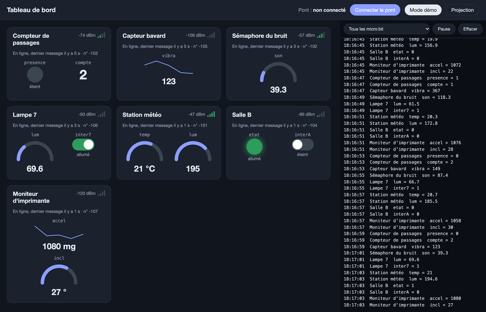

# Séance 5 — Mets ta lampe en ligne

1. **[Ta lampe émet](#1-ta-lampe-emet)** : sur le grand écran, ta lampe a sa carte, avec sa lumière et son interrupteur.
2. **[Le tableau de bord la commande](#2-le-tableau-de-bord-la-commande)** : on bascule l'interrupteur à l'écran, ta lampe passe en marche ou en veille.
3. **[Sans le pont](#3-sans-le-pont)** : le tableau de bord débranché, ta lampe continue.

## 1. Ta lampe émet

**Ce que tu vas obtenir :** ta carte sur le tableau de bord, avec la lumière que mesure ta lampe et un interrupteur.

<figure class="screenshot" markdown>

</figure>

<figure markdown>

</figure>

Ta lampe prend le numéro de ton poste : c'est lui qui la distingue des autres.

Reprends ton projet `lampe`. Dans `au démarrage`, sous ce qui y est déjà, ajoute `radio régler la bande de fréquence` à `40` et `radio régler le numéro de série de transmission` à **vrai**, dans **Radio**. Le tableau de bord reconnaît ta carte à son numéro de série.

```blocks
radio.setFrequencyBand(40)
radio.setTransmitSerialNumber(true)
```

**À toi.** Ajoute un second `toujours`. Toutes les 5 secondes, il envoie deux valeurs avec `envoyer la valeur … = …`, dans **Radio** :

- `lum` = `niveau d'intensité lumineuse`
- `inter` suivi de ton numéro, `inter7` pour la lampe 7 = `active`

<details markdown>
<summary>La solution</summary>

```blocks
basic.forever(function () {
    radio.sendValue("lum", input.lightLevel())
    radio.sendValue("inter7", active)
    basic.pause(5000)
})
let active = 0
```

Deux `toujours` tournent en même temps : le premier décide de la lumière, le second émet.

</details>

Téléverse. Sur le grand écran, ta carte apparaît : clique sur son nom pour le remplacer par le tien.

> [!TIP] Ça marche si…
> `lum` baisse quand tu couvres ta lampe, et `inter7` suit ton interrupteur en cuivre, en 5 secondes au plus. Pas de carte ? Vérifie la bande `40` et le numéro de série dans `au démarrage`.

→ [La langue commune](../catalogue.md#la-langue-commune)

## 2. Le tableau de bord la commande

**Ce que tu vas obtenir :** on bascule l'interrupteur de ta carte sur le grand écran, ta lampe passe en marche ou en veille.

<video class="portrait" controls playsinline preload="metadata" src="../../../../assets/objets-connectes-s05/video-tableau-de-bord.mp4"></video>

Quand on bascule l'interrupteur, le pont envoie `inter7` = `1` ou `0`. Toutes les lampes l'entendent : seule la 7 doit réagir. L'adresse est dans la clé.

**À toi.** Prends le `quand une donnée est reçue par radio` qui apporte `nom` et `valeur`. Si `nom` = `inter7`, `définir active à valeur`.

`nom` est un texte. Pour le comparer, prends dans **Logique** le bloc d'égalité à **cases blanches**.

<figure class="screenshot" markdown>

</figure>

<details markdown>
<summary>La solution</summary>

```blocks
radio.onReceivedValue(function (name, value) {
    if (name == "inter7") {
        active = value
    }
})
let active = 0
```

</details>

> [!TIP] Ça marche si…
> Pose un papier sur l'écran de ton micro:bit. L'interrupteur basculé à l'écran, ta lampe s'allume ; rebasculé, elle s'éteint.

## 3. Sans le pont

**Ce que tu vas obtenir :** ta lampe fonctionne sans le tableau de bord.

L'animateur débranche le pont. Le tableau de bord affiche « Pont débranché » et se fige.

Touche le cuivre, couvre ta lampe : elle marche toujours.

> [!IMPORTANT] Point de contrôle
> Ta carte est en ligne, l'interrupteur de l'écran met ta lampe en marche et en veille, et pont débranché, elle continue.

## Va plus loin

- **Tout de suite quand ça change.** Quand tu touches le cuivre, envoie `inter7` = `active` aussitôt, sans attendre les 5 secondes : l'interrupteur de l'écran suit sans délai.
- **Chez toi.** Avec un deuxième micro:bit en pont, ta lampe a son tableau de bord. → [Installer le pont et le tableau de bord](../../../fiches/pont-et-tableau-de-bord.md)
