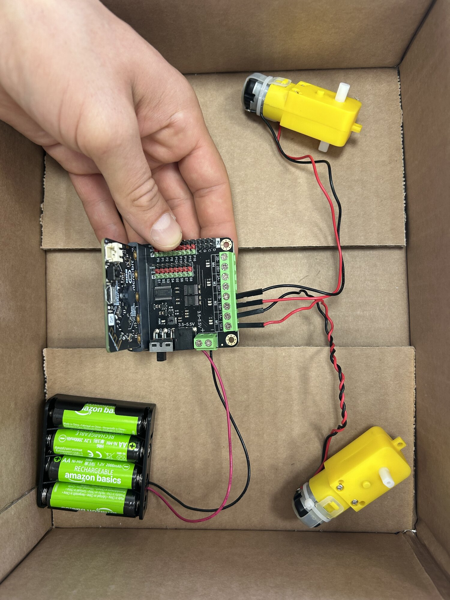
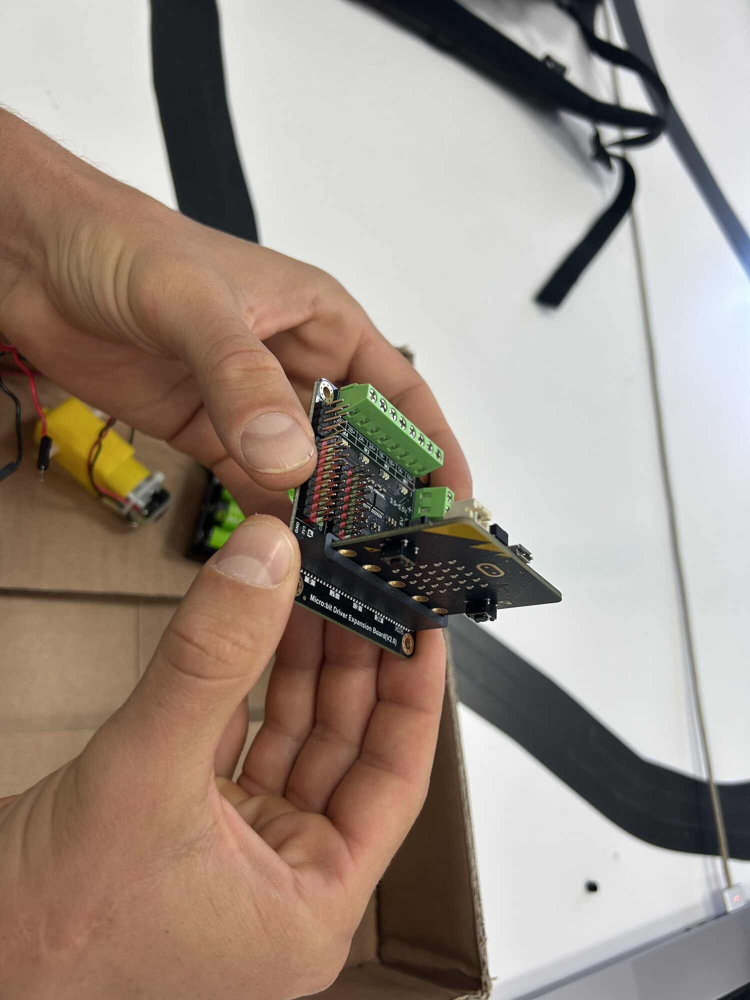
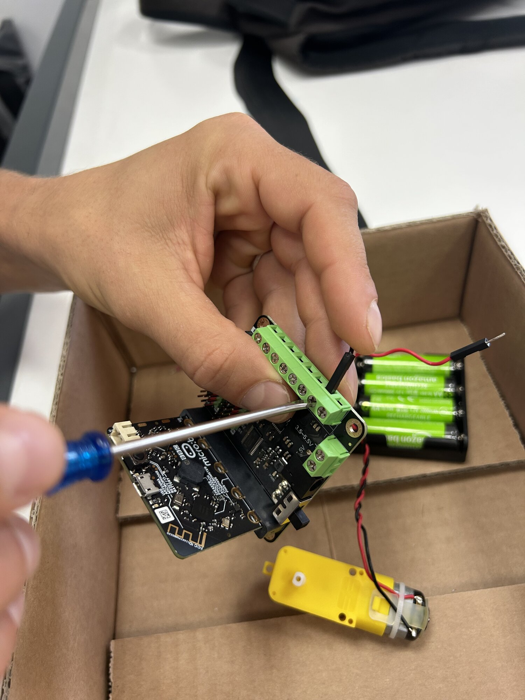
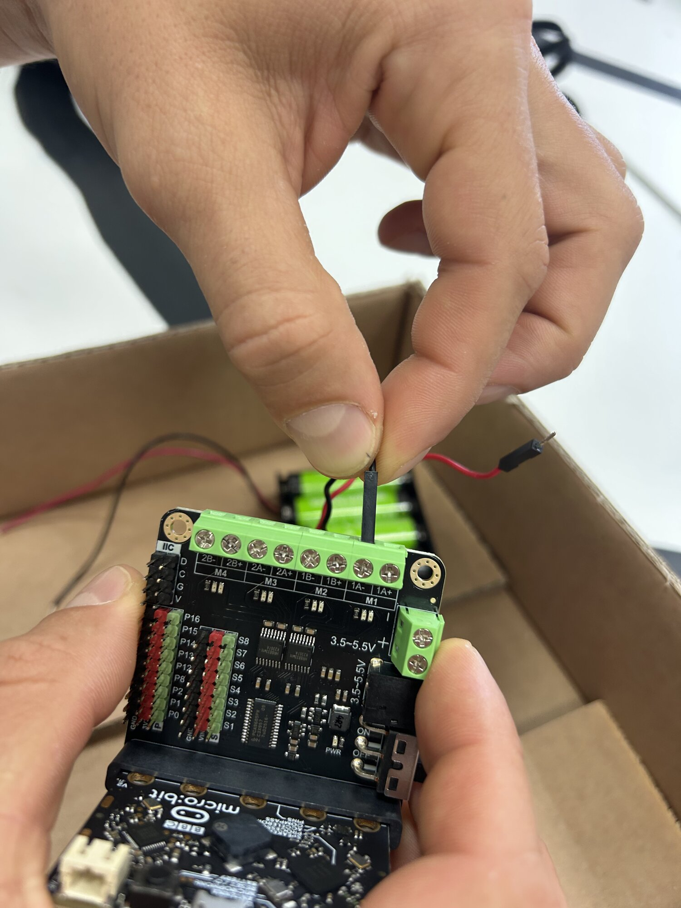
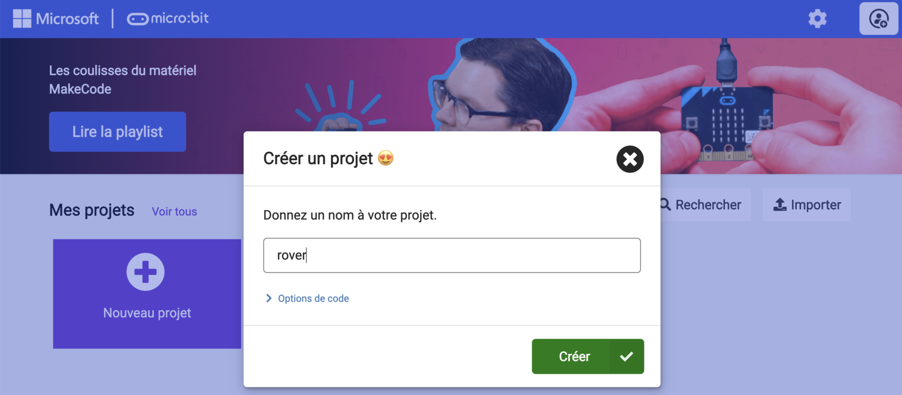
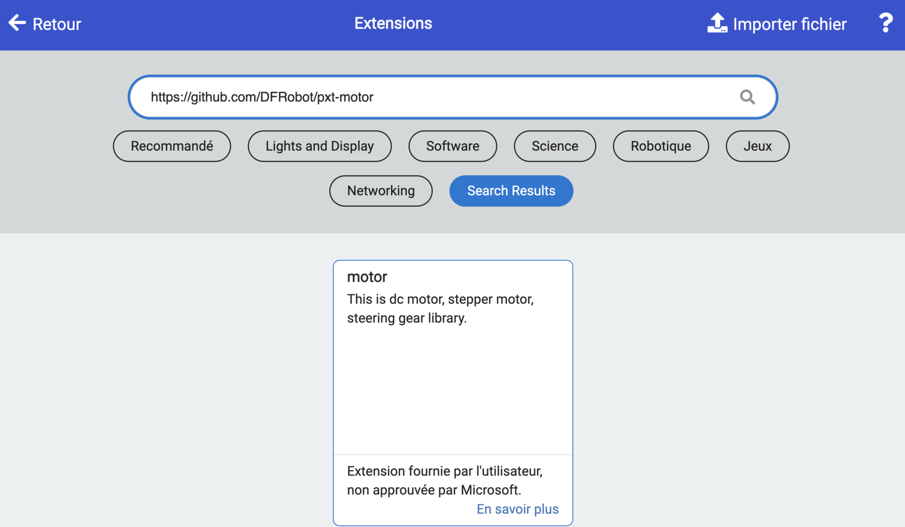
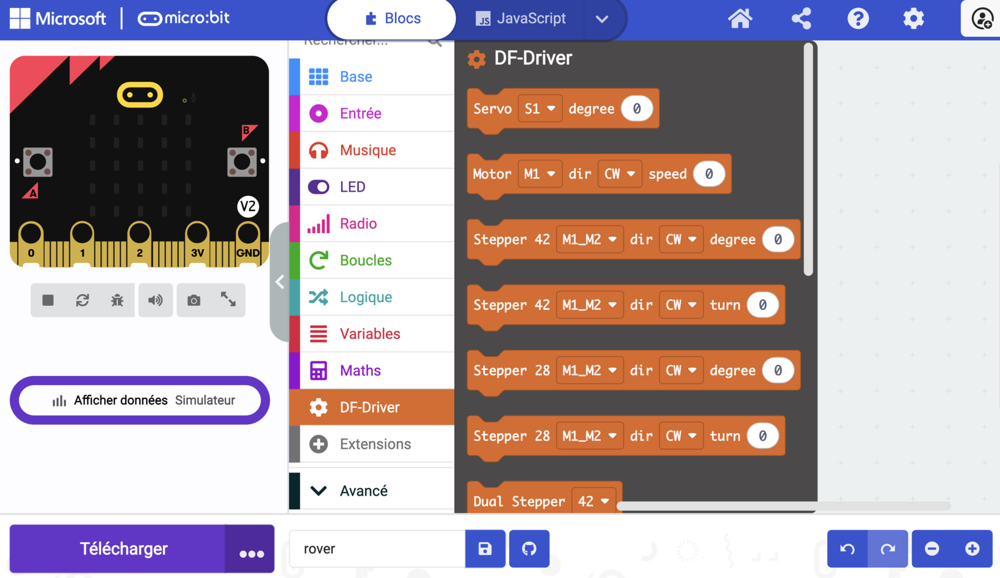

# Séance 1 — Fais tourner tes moteurs

1. **[Câble ton électronique](#1-cable-ton-electronique)** : la carte, le micro:bit, les deux moteurs et les accus sont branchés, et l'animateur a validé.
2. **[Ton premier programme](#2-ton-premier-programme)** : ta carte affiche une icône, joue un son, puis fait clignoter une flèche.
3. **[Fais tourner tes moteurs](#3-fais-tourner-tes-moteurs)** : tes deux moteurs tournent et s'arrêtent ensemble, au rythme de la flèche.

## 1. Câble ton électronique

**Ce que tu vas obtenir :**

<figure markdown>

</figure>

→ [La carte DFR0548 et ses blocs](../../../fiches/carte-dfr0548.md)

Interrupteur de la carte sur **off** pendant tout le câblage.

### Le micro:bit sur la carte

<figure markdown>

</figure>

**Écran vers l'extérieur.** Le connecteur entre aussi à l'envers : vérifie avant d'allumer.

### Les moteurs sur les borniers

<figure markdown>

</figure>

Moteur **gauche** → `M1`, moteur **droit** → `M2`. L'ordre des deux fils n'a pas d'importance pour l'instant.

<figure markdown>

</figure>

Tire sur chaque fil : s'il ressort, resserre.

### Le pack d'accus

> [!CAUTION] La polarité ne se rattrape pas
> Une inversion peut détruire la carte. Vérifie deux fois.

Rouge sur `+`, noir sur `−`, dans le petit bornier marqué `3.5~5.5V`.

> [!IMPORTANT] Point de contrôle
> Fais valider ton câblage avant de mettre sous tension.

## 2. Ton premier programme

**Ce que tu vas obtenir :** au branchement, ta carte affiche un cœur et joue un son. Puis une flèche s'allume et s'éteint, chaque seconde.

### Ouvre MakeCode

[makecode.microbit.org](https://makecode.microbit.org) → **Nouveau projet** → nomme-le `rover`.

<figure class="screenshot" markdown>

</figure>

<figure class="screenshot" markdown>

</figure>

→ [Prendre en main MakeCode](../../../fiches/makecode-prise-en-main.md)

### L'icône et le son

Dans `au démarrage` : une icône (**Base**) et un son (**Musique**).

```blocks
basic.showIcon(IconNames.Heart)
music.play(music.builtinPlayableSoundEffect(soundExpression.giggle), music.PlaybackMode.UntilDone)
basic.forever(function () {
	
})
```

Branche l'USB, clique sur **Télécharger**, suis les instructions.

<figure class="screenshot" markdown>

</figure>

> [!NOTE] Pourquoi une icône et un son
> Ils te prouvent que **ton** programme tourne. Si plus tard rien ne bouge, tu sauras que le problème n'est pas là.

### Fais clignoter l'écran

`toujours` répète son contenu sans fin.

**À toi.** En boucle : flèche vers le haut pendant 1 seconde, écran éteint pendant 1 seconde. Tous les blocs sont dans **Base**.

<details markdown>
<summary>La solution</summary>

```blocks
basic.showIcon(IconNames.Heart)
music.play(music.builtinPlayableSoundEffect(soundExpression.giggle), music.PlaybackMode.UntilDone)
basic.forever(function () {
    basic.showArrow(ArrowNames.North)
    basic.pause(1000)
    basic.clearScreen()
    basic.pause(1000)
})
```

1000 ms = 1 seconde.

</details>

> [!TIP] Ça marche si…
> Le cœur s'affiche et le son joue au branchement, puis la flèche clignote.

## 3. Fais tourner tes moteurs

**Ce que tu vas obtenir :**

<figure markdown>
<video class="portrait" controls playsinline preload="metadata" src="../../../../assets/rover-s01/video-test-moteurs.mp4"></video>
</figure>

### Ajoute l'extension DF-Driver

**Extensions** → colle cette adresse → clique sur « motor ».

```
https://github.com/DFRobot/pxt-motor
```

<figure class="screenshot" markdown>

</figure>

L'avertissement « non approuvée par Microsoft » est normal : l'extension vient du fabricant de la carte.

<figure class="screenshot" markdown>

<figcaption>La catégorie DF-Driver apparaît.</figcaption>
</figure>

→ [La carte DFR0548 et ses blocs](../../../fiches/carte-dfr0548.md#lextension-df-driver)

### Ajoute les blocs moteurs

Ils sont dans **DF-Driver** : `Motor M1 dir CW speed` et `Motor Stop All`.

```blocks
basic.showIcon(IconNames.Heart)
music.play(music.builtinPlayableSoundEffect(soundExpression.giggle), music.PlaybackMode.UntilDone)
basic.forever(function () {
    basic.showArrow(ArrowNames.North)
    motor.MotorRun(motor.Motors.M1, motor.Dir.CW, 100)
    motor.MotorRun(motor.Motors.M2, motor.Dir.CW, 100)
    basic.pause(1000)
    basic.clearScreen()
    motor.motorStopAll()
    basic.pause(1000)
})
```

Téléverse. Les moteurs ne tournent pas encore : ils ont besoin des accus.

> [!CAUTION] Un moteur alimenté part tout seul
> Tout dans la **boîte de test** avant d'allumer, aujourd'hui et à chaque séance. Tiens le câble USB.

Interrupteur sur **on**, puis vérifie :

- [ ] Les deux moteurs tournent, puis s'arrêtent ensemble
- [ ] Tu sais lequel est sur `M1` (sors le bloc `M2` pour voir) : marque-le au ruban
- [ ] Aucun fil ne sort de son bornier

> [!TIP] La flèche s'affiche, mais rien ne tourne ?
> Le problème n'est pas dans le code. Vérifie l'interrupteur, les fils, les accus.

→ [Déboguer](../../../fiches/deboguer.md)

> [!IMPORTANT] Point de contrôle
> Fais valider ton électronique. Puis interrupteur sur **off**, USB débranché.

## Va plus loin

- **Les deux sens.** Ton rover tournera à gauche, à droite, en arrière. Essaie `CCW`, et regarde les LED de sens sur la carte.
- **En Python.** En haut de MakeCode, bascule de **Blocs** à **Python** : c'est le même programme.
