# Séance 3 — Ta plaque, et les mouvements de ton rover

1. **[Dessine ta plaque](#1-dessine-ta-plaque)** : ton nom découpé dans une plaque de 70 × 20 × 2 mm, avec un trou de porte-clés.
2. **[Vérifie et exporte](#2-verifie-et-exporte)** : ta plaque validée part à l'impression.
3. **[Tes quatre autres mouvements](#3-tes-quatre-autres-mouvements)** : ton rover avance, tourne, recule et s'arrête, chaque mouvement annoncé par une flèche.

## 1. Dessine ta plaque

**Ce que tu vas obtenir :**

<figure class="screenshot" markdown>
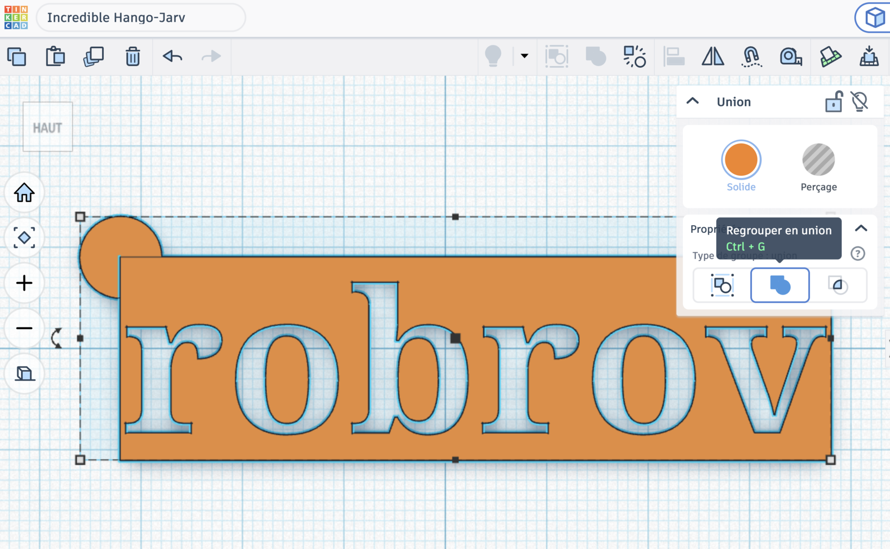
</figure>

### Rejoins la classe Tinkercad

Va sur [tinkercad.com/joinclass](https://www.tinkercad.com/joinclass), entre le **code de classe** que donne l'animateur, puis ton **identifiant d'élève**.

<figure class="screenshot" markdown>
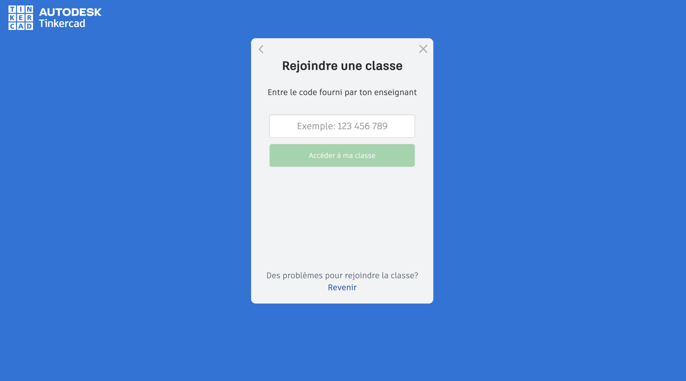
</figure>

### La plaque et ton nom

Pose une **Boîte**, et règle-la à **70 × 20 × 2 mm**.

<figure class="screenshot" markdown>
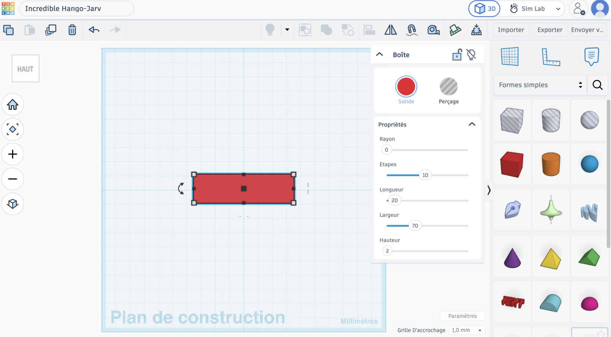
</figure>

> [!CAUTION] Les cotes ne se discutent pas
> Toutes les plaques partent sur **un seul plateau d'imprimante**. Une plaque hors cotes ne part pas à l'impression.

Ajoute une forme **Texte**, tape ton nom, pose-la sur la plaque.

<figure class="screenshot" markdown>
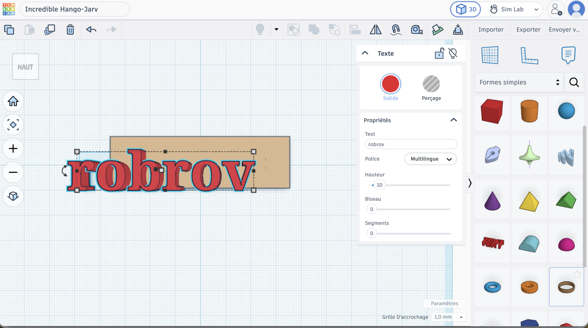
</figure>

Centre-la avec l'outil **Aligner**, pas à l'œil.

<figure class="screenshot" markdown>
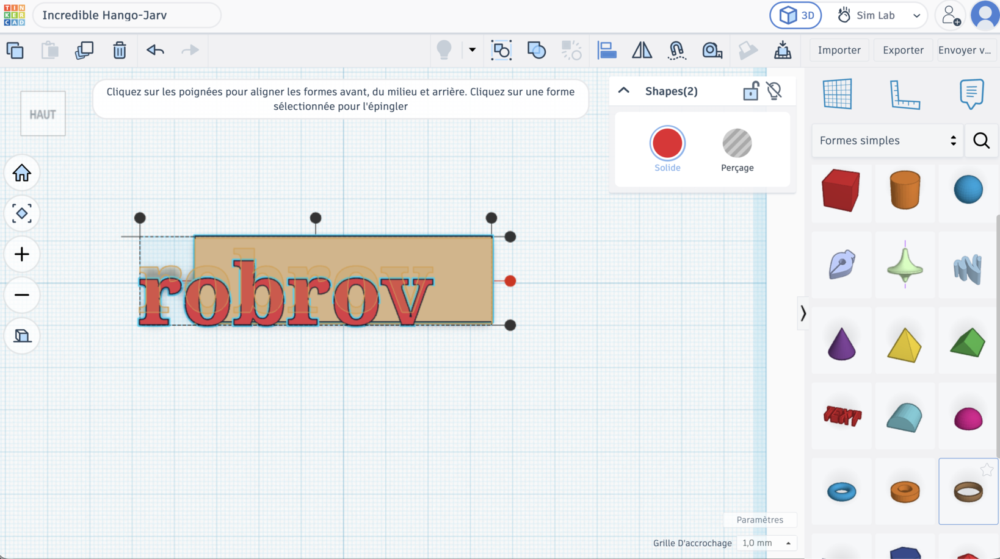
</figure>

Passe en vue **de face** : ton texte est posé **au-dessus** de la plaque. Descends-le avec la poignée d'altitude jusqu'à ce qu'il la traverse de part en part.

<figure class="screenshot" markdown>
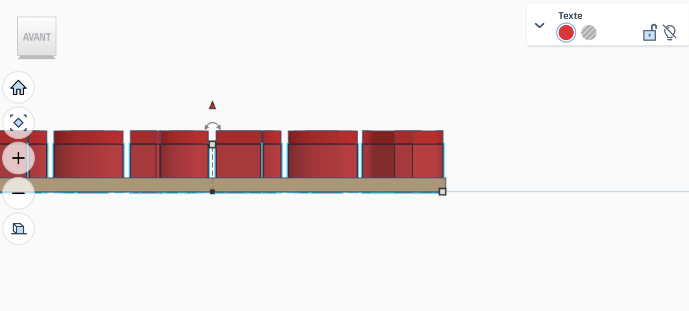
</figure>

Passe le texte en **Perçage** : il ne s'imprimera pas, il creusera.

<figure class="screenshot" markdown>
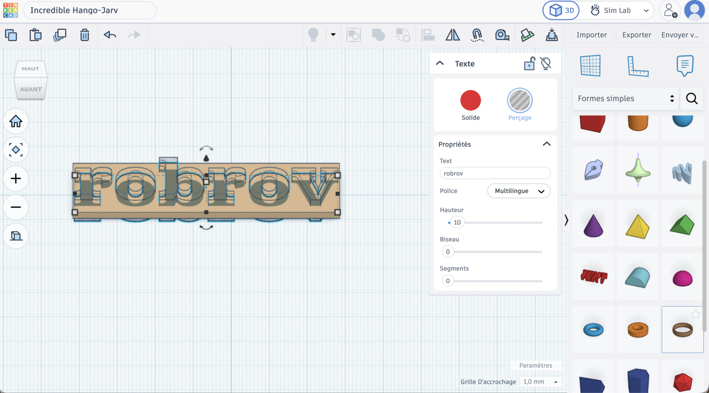
</figure>

Sélectionne la plaque et le texte, puis **Regroupe** (<kbd>Ctrl</kbd> + <kbd>G</kbd>) : l'icône du milieu.

<figure class="screenshot" markdown>
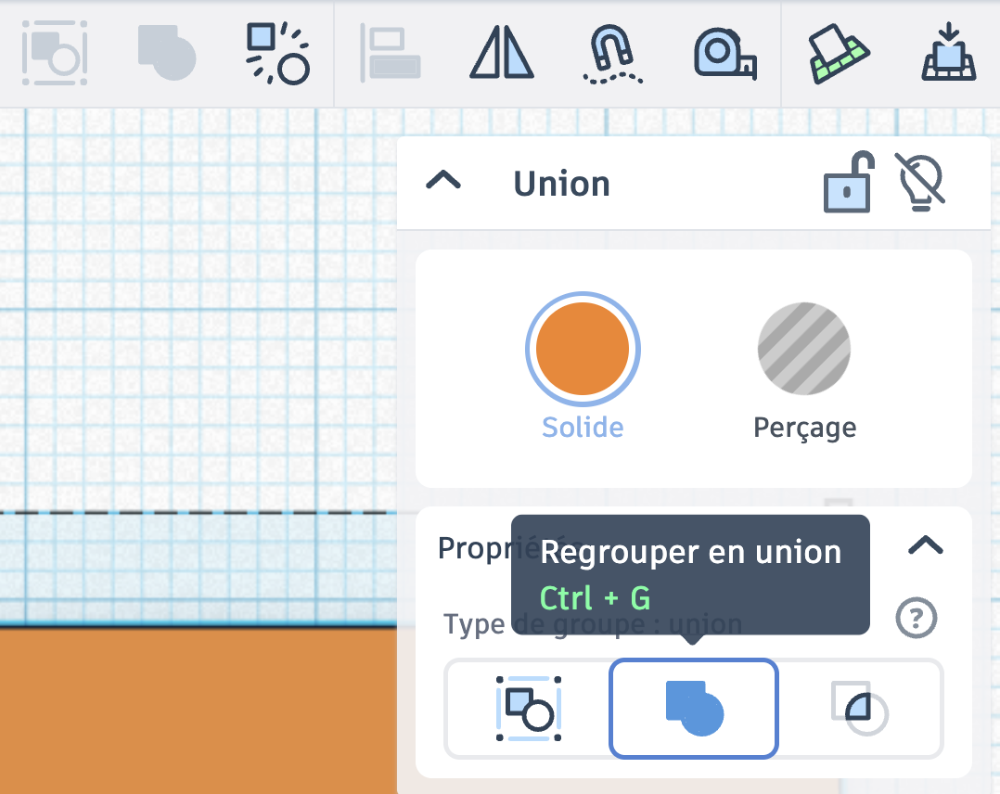
</figure>

### Le trou de porte-clés

Deux cylindres, l'un dans l'autre.

Le premier reste **Solide** : pose-le à l'extrémité de la plaque, débordant du bord. Il fabrique l'oreille arrondie.

<figure class="screenshot" markdown>
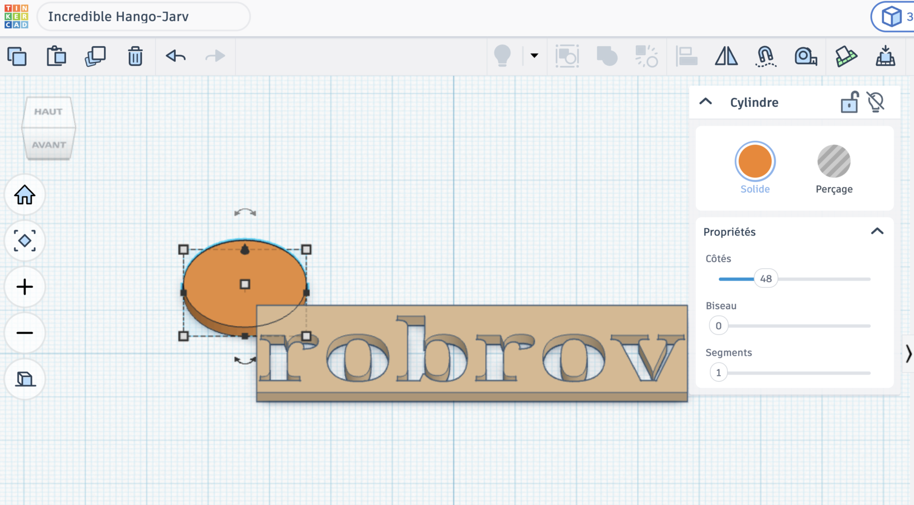
</figure>

Le second, plus petit, passe en **Perçage**, centré dans le premier avec **Aligner**. Il fait le trou. Laisse au moins **3 mm** entre le trou et le bord.

Sélectionne tout et **regroupe** une dernière fois.

## 2. Vérifie et exporte

**Ce que tu vas obtenir :** ta plaque validée, exportée en `.STL`, prête pour l'imprimante.

L'imprimante empile des couches de plastique et ne pose rien dans le vide. Deux questions :

**Est-ce que tout tient ?** L'intérieur des lettres fermées (`o`, `b`, `a`, `d`) n'est relié à rien.

<figure class="screenshot" markdown>
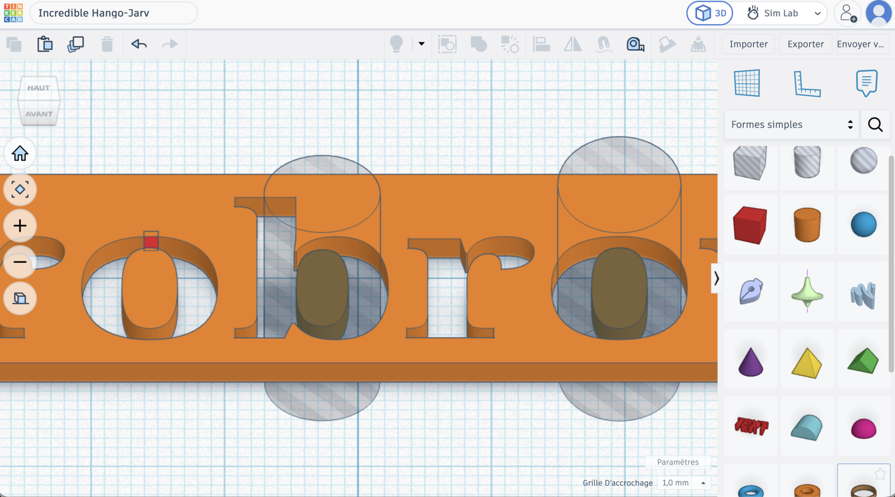
<figcaption>Ils tombent, ou ils s'impriment tout seuls à côté.</figcaption>
</figure>

- **Relie** l'îlot au reste de la plaque par un petit pont de matière
- ou **efface-le** : un cylindre en perçage par-dessus, la lettre devient une boucle ouverte

**Est-ce que tout s'imprime ?** Rien ne doit flotter au-dessus du vide.

> [!IMPORTANT] Point de contrôle
> Fais valider ta plaque avant d'exporter. Après, elle part à l'impression telle quelle.

**Exporter** → **La forme sélectionnée** → **.STL**

<figure class="screenshot" markdown>
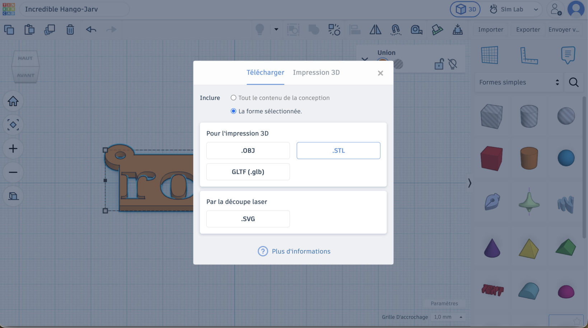
</figure>

Nomme le fichier `prenom-plaque.stl` et dépose-le où l'animateur te l'indique.

→ [Modéliser et imprimer en 3D](../../../fiches/modeliser-imprimer-3d.md)

## 3. Tes quatre autres mouvements

**Ce que tu vas obtenir :** en boucle, ton rover avance, tourne à gauche, tourne à droite, recule, puis s'arrête un moment. Une flèche annonce chaque mouvement.

**À toi.** Fabrique `reculer`, `tournerAGauche`, `tournerADroite` et `arreter`, sur le modèle d'`avancer`.

Pour tourner : **une roue à l'arrêt, l'autre en marche.**

Teste-les dans `toujours` : appelle-les toutes, **toujours dans le même ordre**, une flèche avant chaque appel, une pause après. Les durées ne comptent pas. Termine par une **pause plus longue** : tu sais où la séquence recommence.

<details markdown>
<summary>La solution</summary>

```blocks
function avancer () {
    motor.MotorRun(motor.Motors.M1, motor.Dir.CW, 110)
    motor.MotorRun(motor.Motors.M2, motor.Dir.CW, 110)
}
function tournerAGauche () {
    motor.MotorRun(motor.Motors.M1, motor.Dir.CW, 0)
    motor.MotorRun(motor.Motors.M2, motor.Dir.CW, 110)
}
function tournerADroite () {
    motor.MotorRun(motor.Motors.M1, motor.Dir.CW, 110)
    motor.MotorRun(motor.Motors.M2, motor.Dir.CW, 0)
}
function reculer () {
    motor.MotorRun(motor.Motors.M1, motor.Dir.CCW, 110)
    motor.MotorRun(motor.Motors.M2, motor.Dir.CCW, 110)
}
function arreter () {
    motor.MotorRun(motor.Motors.M1, motor.Dir.CW, 0)
    motor.MotorRun(motor.Motors.M2, motor.Dir.CW, 0)
}
basic.showIcon(IconNames.Heart)
music.play(music.builtinPlayableSoundEffect(soundExpression.giggle), music.PlaybackMode.UntilDone)
basic.forever(function () {
    basic.showArrow(ArrowNames.North)
    avancer()
    basic.pause(1000)
    basic.showArrow(ArrowNames.West)
    tournerAGauche()
    basic.pause(200)
    basic.showArrow(ArrowNames.East)
    tournerADroite()
    basic.pause(200)
    basic.showArrow(ArrowNames.South)
    reculer()
    basic.pause(1000)
    basic.clearScreen()
    arreter()
    basic.pause(5000)
})
```

`arreter` met les deux moteurs à `speed 0`. `Motor Stop All` fait la même chose en un seul bloc.

→ [La carte DFR0548 et ses blocs](../../../fiches/carte-dfr0548.md#lextension-df-driver)

</details>

> [!TIP] Ça marche si…
> Chaque mouvement fait ce que dit sa flèche.

## Va plus loin

### Le retour au garage

<figure markdown>
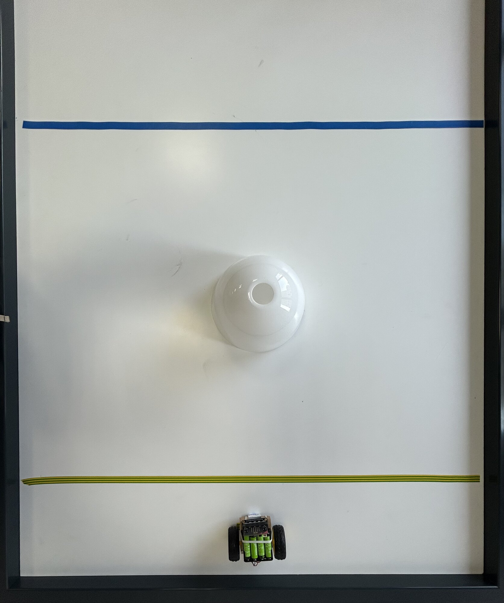
</figure>

Départ derrière la **ligne jaune**. Ton rover dépasse la **ligne bleue** en contournant l'obstacle, puis revient derrière la jaune. Réussi si 2 passages sur 3 reviennent dans la zone, avec le même programme.

1. **Supprime le bloc `toujours`.**
2. Prends `lorsque le bouton A est pressé`, dans **Entrée**, et mets dedans `répéter 3 fois`, dans **Boucles**.
3. Dans la boucle : ta manœuvre, puis une pause pour replacer ton rover au départ.

```blocks
input.onButtonPressed(Button.A, function () {
    for (let index = 0; index < 3; index++) {
        basic.pause(5000)
    }
})
```

Ta manœuvre se place avant la pause.

Rien n'a changé entre deux passages. Pourquoi ton rover ne s'arrête-t-il pas au même endroit ?
