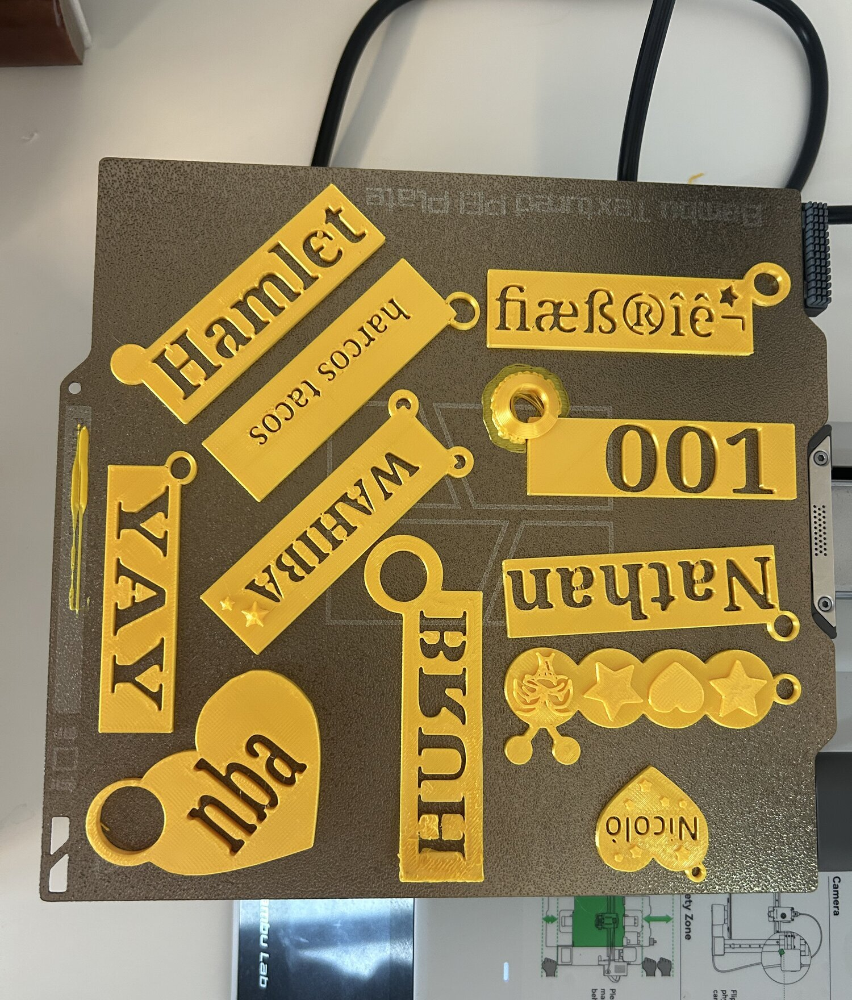
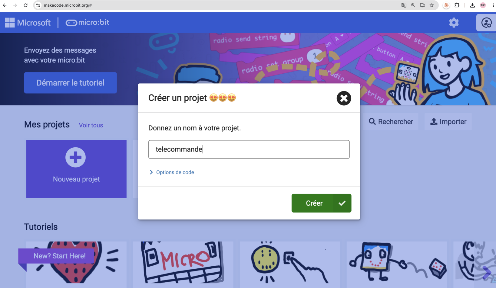

# Séance 4 — Fabrique ta télécommande

1. **[Ta plaque et tes mouvements](#1-ta-plaque-et-tes-mouvements)** : ta plaque est sur ton rover, et tes cinq mouvements marchent.
2. **[Ta télécommande lit l'inclinaison](#2-ta-telecommande-lit-linclinaison)** : un point s'allume du côté où tu inclines la carte.
3. **[Ta télécommande envoie l'ordre](#3-ta-telecommande-envoie-lordre)** : elle envoie par radio un des cinq mots du protocole.

## 1. Ta plaque et tes mouvements

### Récupère ta plaque

<figure markdown>

<figcaption>Les plaques du groupe, sorties ensemble du même plateau.</figcaption>
</figure>

Regarde-la de près avant de la monter : les couches, les lettres, ce qui a bavé. Puis glisse-la sous les élastiques de ton rover.

### Termine tes mouvements

Tes cinq fonctions ne sont pas finies ? → [Tes quatre autres mouvements](s03-ta-plaque-et-tes-mouvements.md#3-tes-quatre-autres-mouvements)

> [!IMPORTANT] Point de contrôle
> Montre tes cinq mouvements à l'animateur : il te donne ta seconde carte.

## 2. Ta télécommande lit l'inclinaison

**Ce que tu vas obtenir :** le point du côté où tu penches la carte s'allume, le centre à plat.

> [!CAUTION] Cette carte ne monte jamais sur le rover
> C'est ta télécommande. Elle reste dans ton bac entre les séances.

### Lis les valeurs du capteur

Nouveau projet MakeCode, nommé `telecommande`.

<figure class="screenshot" markdown>

</figure>

**Regarde les chiffres avant de décider.** Dans `toujours`, écris deux valeurs de l'accéléromètre : `x` (gauche, droite) et `y` (avant, arrière).

`série écrire valeur` est dans **Avancé** → **Communication Série**, `accélération (mg)` dans **Entrée**.

```blocks
basic.forever(function () {
    serial.writeValue("x", input.acceleration(Dimension.X))
    serial.writeValue("y", input.acceleration(Dimension.Y))
})
```

Téléverse, garde le câble branché, puis clique sur **Afficher données Appareil**. Penche la carte et regarde les courbes de `x` et de `y`.

<figure class="screenshot" markdown>

</figure>

Incline la carte dans chaque direction, et remplis ce tableau :

| Tu inclines la carte | Quelle courbe bouge ? | Elle monte ou elle descend ? |
|---|---|---|
| Vers l'avant | | |
| Vers l'arrière | | |
| À gauche | | |
| À droite | | |

Carte à plat, autour de quelle valeur sont `x` et `y` ?

Ce tableau, c'est ton programme : chaque ligne deviendra un `si`.

### Transforme la mesure en décision

→ [Les capteurs, et la décision](../../../fiches/makecode-prise-en-main.md#les-capteurs-et-la-decision)

Le capteur donne un nombre, toi tu veux une direction. Il te faut un **seuil** : la valeur à partir de laquelle la carte est vraiment penchée.

1. Prends `si … alors`, dans **Logique**. Sa condition sera par exemple `accélération (mg) y < -200` : « si la carte penche vers l'avant ».
2. Dans la branche, `allumer x y`, dans **LED**, allume un point de l'écran.
3. Le point s'allume trop tôt ou trop tard ? Change le seuil.

<figure markdown>

<figcaption>`x` vers la droite, `y` vers le bas. Le coin en haut à gauche est `0,0`.</figcaption>
</figure>

Les `x` et `y` de l'écran LED sont la colonne et la ligne du point. Rien à voir avec ceux de l'accéléromètre.

```blocks
basic.forever(function () {
    basic.clearScreen()
    if (input.acceleration(Dimension.Y) < -200) {
        led.plot(2, 0)
    } else if (input.acceleration(Dimension.Y) > 200) {
        led.plot(2, 4)
    }
})
```

−200 et 200 sont les seuils de cette télécommande. Trouve les tiens.

#### À toi : la gauche et la droite

Avec `accélération (mg) x`, ajoute deux `sinon si` pour la gauche et la droite. Termine par un `sinon` qui allume le centre.

<details markdown>
<summary>La solution</summary>

```blocks
basic.forever(function () {
    basic.clearScreen()
    if (input.acceleration(Dimension.Y) < -200) {
        led.plot(2, 0)
    } else if (input.acceleration(Dimension.Y) > 200) {
        led.plot(2, 4)
    } else if (input.acceleration(Dimension.X) < -200) {
        led.plot(0, 2)
    } else if (input.acceleration(Dimension.X) > 200) {
        led.plot(4, 2)
    } else {
        led.plot(2, 2)
    }
})
```

Le premier test vrai gagne, les suivants ne sont même pas lus.

`effacer l'écran` en tête de boucle éteint tout à chaque tour, puis un seul point se rallume. Le centre allumé à plat te montre que ton programme tourne.

</details>

> [!TIP] Ça marche si…
> Chaque inclinaison allume son point, et le centre s'allume carte à plat.

## 3. Ta télécommande envoie l'ordre

**Ce que tu vas obtenir :** à chaque inclinaison, ta télécommande envoie par radio le mot du protocole. Ton rover le recevra en séance 5.

Dans la salle, une douzaine de télécommandes émettent en même temps. Pour ne pas piloter le rover du voisin, chacun prend **sa bande de fréquence** : le numéro de ton poste. Dans `au démarrage`, `radio régler la bande de fréquence`, dans **Radio** :

```blocks
radio.setFrequencyBand(15)
```

Ici, le poste 15. Toi, mets ton numéro.

Dans la première branche de ton programme, ajoute `envoyer la chaîne … par radio`, dans **Radio**, avec le mot `"avancer"` :

```blocks
basic.forever(function () {
    basic.clearScreen()
    if (input.acceleration(Dimension.Y) < -200) {
        radio.sendString("avancer")
        led.plot(2, 0)
    } else if (input.acceleration(Dimension.Y) > 200) {
        led.plot(2, 4)
    } else if (input.acceleration(Dimension.X) < -200) {
        led.plot(0, 2)
    } else if (input.acceleration(Dimension.X) > 200) {
        led.plot(4, 2)
    } else {
        led.plot(2, 2)
    }
})
```

| Quand tu penches | Mot envoyé |
|---|---|
| Vers l'avant | `avancer` |
| Vers l'arrière | `reculer` |
| À gauche | `gauche` |
| À droite | `droite` |
| À plat | `arreter` |

> [!CAUTION] Au caractère près
> `arreter` s'écrit sans accent. Un mot mal écrit arrive, mais le rover ne le reconnaît pas.

#### À toi : tes cinq ordres

Complète les quatre autres branches en suivant le tableau. Puis ajoute une `pause (ms)` de `100` tout en bas du `toujours` : sans elle, ta carte envoie des centaines de messages par seconde et le rover prend du retard. Dix par seconde suffisent.

<details markdown>
<summary>La solution</summary>

```blocks
radio.setFrequencyBand(15)
basic.forever(function () {
    basic.clearScreen()
    if (input.acceleration(Dimension.Y) < -200) {
        radio.sendString("avancer")
        led.plot(2, 0)
    } else if (input.acceleration(Dimension.Y) > 200) {
        radio.sendString("reculer")
        led.plot(2, 4)
    } else if (input.acceleration(Dimension.X) < -200) {
        radio.sendString("gauche")
        led.plot(0, 2)
    } else if (input.acceleration(Dimension.X) > 200) {
        radio.sendString("droite")
        led.plot(4, 2)
    } else {
        radio.sendString("arreter")
        led.plot(2, 2)
    }
    basic.pause(100)
})
```

</details>

> [!IMPORTANT] Point de contrôle
> Montre ton programme à l'animateur : il vérifie ta bande et tes cinq mots.

## Va plus loin

- **Trop sensible, ou pas assez ?** Deux nombres décident de ça dans ta télécommande. Trouve lesquels, et dans quel sens les faire varier.
- **Ta télécommande à ton nom.** À l'allumage, elle fait défiler ton prénom : `afficher texte`, dans **Base**, placé dans `au démarrage`.

→ [Prendre en main MakeCode](../../../fiches/makecode-prise-en-main.md) · [Déboguer](../../../fiches/deboguer.md)
