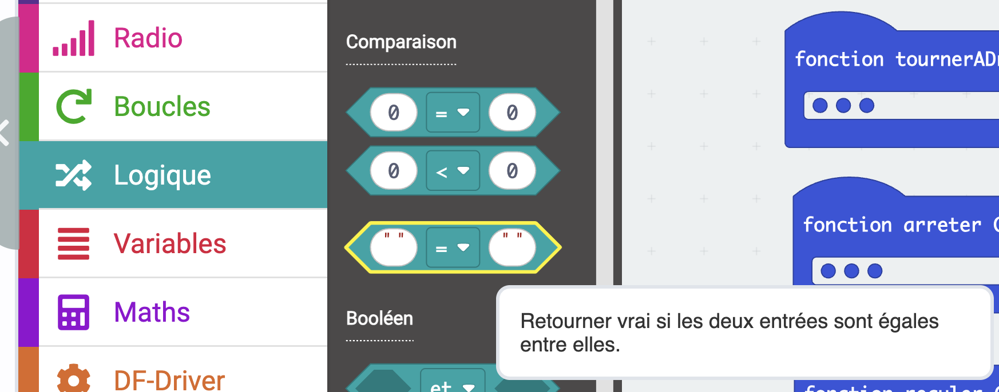
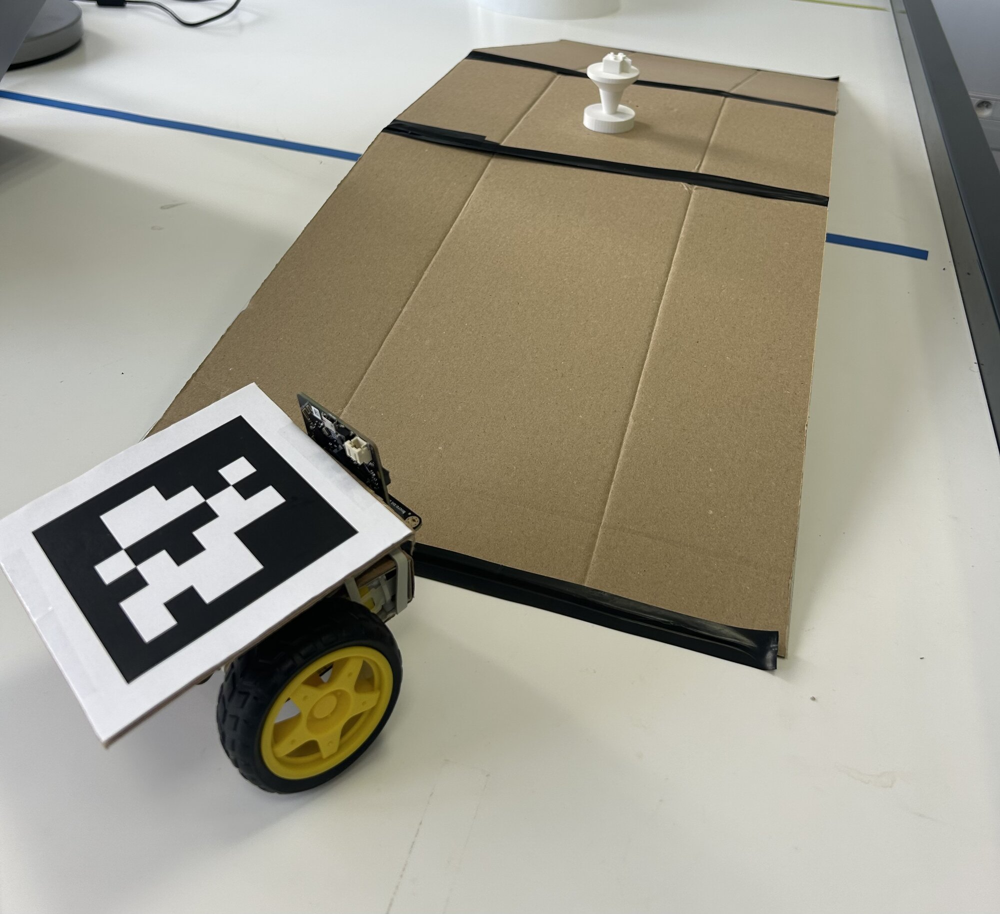

# Séance 5 — Pilote ton rover, formez votre équipe

1. **[Ton rover obéit](#1-ton-rover-obeit)** : tu inclines la télécommande, le rover allume le même point et bouge.
2. **[Découvrez le cahier des charges](#2-decouvrez-le-cahier-des-charges)** : ce que votre rover d'équipe devra faire.
3. **[Formez votre équipe](#3-formez-votre-equipe)** : à deux ou trois, avec votre numéro.

Ta télécommande n'envoie pas encore ses cinq mots ? Termine d'abord la [séance 4](s04-pilote-a-distance.md).

## 1. Ton rover obéit

**Ce que tu vas obtenir :** tu inclines la télécommande, ton rover allume le même point qu'elle et fait le mouvement demandé.

### Ton rover écoute

<figure markdown>

</figure>

Dans MakeCode, ouvre ton projet `rover`.

Dans `au démarrage`, règle la même bande de fréquence que ta télécommande :

```blocks
radio.setFrequencyBand(15)
```

Dans **Radio**, prends `quand une donnée est reçue par radio`, celui qui t'apporte le mot reçu : `receivedString`. Il en existe un autre, avec `nom` et `valeur` : ce n'est pas lui.

```blocks
radio.onReceivedString(function (receivedString) {
	
})
```

`receivedString` est un **texte**. Pour le comparer, prends dans **Logique** le bloc d'égalité à **cases blanches**, pas celui qui compare des nombres.

<figure class="screenshot" markdown>

</figure>

### La première branche

```blocks
function avancer () {
    motor.MotorRun(motor.Motors.M1, motor.Dir.CW, 110)
    motor.MotorRun(motor.Motors.M2, motor.Dir.CW, 110)
}
radio.onReceivedString(function (receivedString) {
    basic.clearScreen()
    if (receivedString == "avancer") {
        avancer()
        led.plot(2, 0)
    }
})
```

`si receivedString = "avancer"` → `appel avancer`. Ta fonction n'a pas bougé d'un bloc.

#### À toi : les quatre autres

Ajoute `reculer`, `gauche`, `droite` et `arreter`. Dans chaque branche, allume **le même point que ta télécommande** : il te dira que le message est arrivé.

Termine par un `sinon` qui **arrête les moteurs** et allume un point libre, par exemple `4,4` : un ordre incompris ne doit pas faire rouler ton rover.

<details markdown>
<summary>La solution</summary>

```blocks
function avancer () {
    motor.MotorRun(motor.Motors.M1, motor.Dir.CW, 110)
    motor.MotorRun(motor.Motors.M2, motor.Dir.CW, 110)
}
function reculer () {
    motor.MotorRun(motor.Motors.M1, motor.Dir.CCW, 110)
    motor.MotorRun(motor.Motors.M2, motor.Dir.CCW, 110)
}
function tournerAGauche () {
    motor.MotorRun(motor.Motors.M1, motor.Dir.CW, 0)
    motor.MotorRun(motor.Motors.M2, motor.Dir.CW, 110)
}
function tournerADroite () {
    motor.MotorRun(motor.Motors.M1, motor.Dir.CW, 110)
    motor.MotorRun(motor.Motors.M2, motor.Dir.CW, 0)
}
function arreter () {
    motor.MotorRun(motor.Motors.M1, motor.Dir.CW, 0)
    motor.MotorRun(motor.Motors.M2, motor.Dir.CW, 0)
}
radio.setFrequencyBand(15)
radio.onReceivedString(function (receivedString) {
    basic.clearScreen()
    if (receivedString == "avancer") {
        avancer()
        led.plot(2, 0)
    } else if (receivedString == "reculer") {
        reculer()
        led.plot(2, 4)
    } else if (receivedString == "gauche") {
        tournerAGauche()
        led.plot(0, 2)
    } else if (receivedString == "droite") {
        tournerADroite()
        led.plot(4, 2)
    } else if (receivedString == "arreter") {
        arreter()
        led.plot(2, 2)
    } else {
        arreter()
        led.plot(4, 4)
    }
})
```

</details>

### Pilote

Téléverse les deux programmes, débranche l'USB, passe sur accus. On pilote sur la table de robotique, nulle part ailleurs.

Penche ta télécommande et regarde **les deux écrans** :

- même point des deux côtés : le message passe
- point allumé seulement sur la télécommande : le rover n'entend pas, vérifie ta bande de fréquence
- point au centre des deux côtés : ce sont tes seuils

> [!IMPORTANT] Point de contrôle
> Montre ton rover à l'animateur : il avance, recule, tourne et s'arrête à la télécommande.

Ton rover roule ? Aide un camarade, sans prendre son clavier.

## 2. Découvrez le cahier des charges

**Ce que tu vas obtenir :** tu sais ce que ton rover ne sait pas encore faire.

<figure markdown>

</figure>

→ [Le cahier des charges](../cahier-des-charges.md)

Pose ton rover sur la pente, puis fais-lui pousser l'échantillon. Réussit-il les deux ?

Pour saisir ou soulever l'échantillon, il existe un moteur qui va à un angle et s'y tient : le **servomoteur**. L'animateur te le montre ; tu apprendras à le programmer en séance 7.

## 3. Formez votre équipe

Formez votre équipe, à deux ou trois. L'animateur donne à chacune son numéro : c'est à la fois l'id de votre tag, votre bande à la télécommande et votre groupe sur la table. Écrivez-le sur votre [feuille d'équipe](../../../assets/rover-cahier-des-charges/feuille-equipe-rover.pdf), avec vos noms.

## Va plus loin

- **Deux vitesses.** Un mot de plus, `vite`, envoyé quand tu penches très fort vers l'avant. Ton rover a besoin d'une fonction de plus.

→ [Prendre en main MakeCode](../../../fiches/makecode-prise-en-main.md) · [Déboguer](../../../fiches/deboguer.md)
