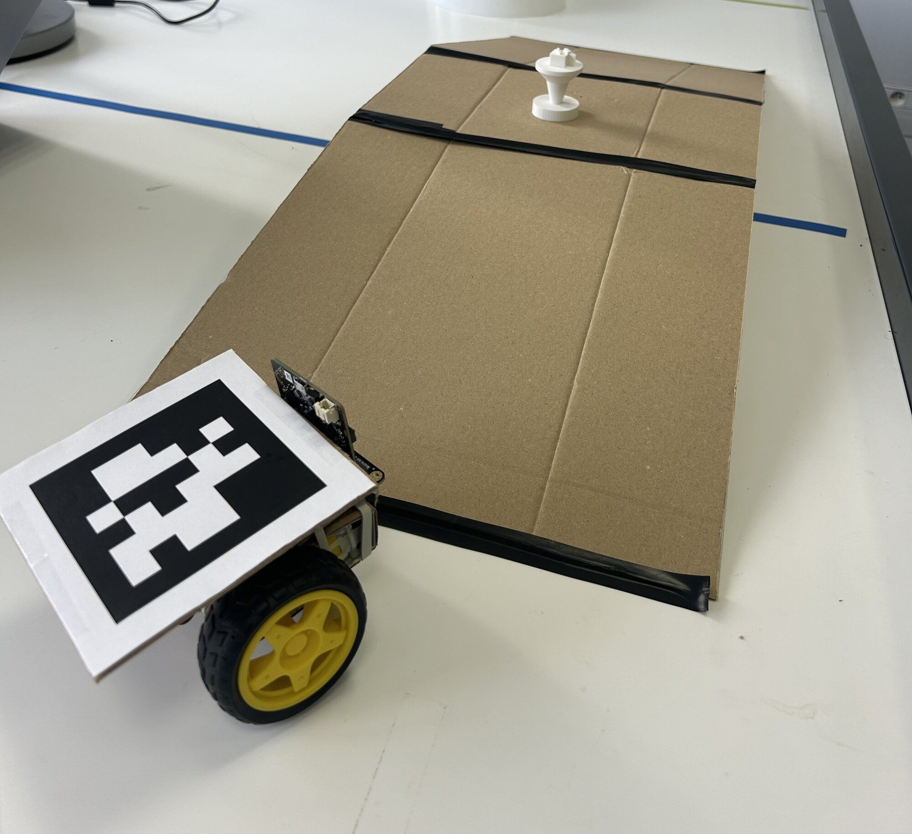

# Séance 6 — Concevez votre rover

> [!NOTE] Nouveau concept : l'esquisse
> Dans Tinkercad, tu dessines un contour à plat, et il devient une pièce : une roue, une fourche, un logo. L'animateur le montre en début de séance.
>
> → [Partir d'une esquisse](../../../fiches/modeliser-imprimer-3d.md#partir-dune-esquisse)

1. **[Découvrez le cahier des charges](#1-decouvrez-le-cahier-des-charges)** : ce que votre rover d'équipe devra faire.
2. **[Formez votre équipe](#2-formez-votre-equipe)** : à deux ou trois, avec votre numéro.
3. **[Votre rover sur le papier](#3-votre-rover-sur-le-papier)** : un croquis d'équipe, qui répond au cahier des charges.
4. **[Qui fait quoi](#4-qui-fait-quoi)** : chacun fabrique sa part, en carton ou en 3D.

## 1. Découvrez le cahier des charges

**Ce que tu vas obtenir :** tu sais ce que ton rover ne sait pas encore faire.

<figure markdown>

</figure>

→ [Le cahier des charges](../cahier-des-charges.md)

Pose ton rover sur la pente, puis fais-lui pousser l'échantillon. Réussit-il les deux ?

Pour saisir ou soulever l'échantillon, il existe un moteur qui va à un angle et s'y tient : le **servomoteur**. L'animateur te le montre ; tu apprendras à le programmer en séance 7.

## 2. Formez votre équipe

Formez votre équipe, à deux ou trois. L'animateur donne à chacune son numéro : c'est à la fois l'id de votre tag, votre bande à la télécommande et votre groupe sur la table. Écrivez-le sur votre [feuille d'équipe](../../../assets/rover-cahier-des-charges/feuille-equipe-rover.pdf), avec vos noms.

## 3. Votre rover sur le papier

**Ce que vous allez obtenir :** un croquis d'équipe, vu de dessus et de côté, avec le tag, les moteurs, les accus, et la façon dont votre rover déplace l'échantillon.

**À vous.** La méthode :

1. Pour chaque point du cahier des charges, cherchez la partie du rover qu'il touche : le châssis, la prise de l'échantillon, le support de tag, le programme.
2. Chacun dessine comment le rover déplace l'échantillon sans le renverser : il le pousse, il le saisit, ou il le soulève. Pour saisir ou soulever, il faut un servomoteur.
3. Choisissez-en une ensemble, et dessinez le rover entier.

## 4. Qui fait quoi

**Ce que vous allez obtenir :** chacun sait ce qu'il fabrique, et s'y met.

Écrivez les rôles sur votre feuille d'équipe : le châssis et la pente, l'échantillon, le programme. Le responsable d'une partie en répond, toute l'équipe y travaille.

Puis, pour chaque pièce du croquis : carton, 3D ou récupération ? Le carton est rapide et ne coûte rien. La 3D sert à ce que le carton fait mal.

Il vous faut un moteur, une roue, une carte ? Prenez-les sur vos rovers individuels.

### En carton

Un seul châssis pour l'équipe. Sur papier quadrillé, compte les carreaux. Partez du plan de la séance 2, ou dessinez le vôtre.

> [!CAUTION] Avant la première découpe
> - Règle métallique **à rebord**, doigts derrière le rebord.
> - Plusieurs passes légères.
> - Protection sur la lame dès que tu poses l'outil.

Le support de tag : un carré de carton, le tag collé dessus, fixé à plat sur le dessus du rover, marge blanche visible.

→ [Tracer, découper, plier le carton](../../../fiches/carton-tracer-decouper-plier.md)

### En 3D

Dessinez la pièce, ou trouvez-en une qui existe dans la galerie de Tinkercad, **Copie autorisée** cochée. Gardez le nom de son auteur : il sera cité sur votre page.

Votre équipe a **3 h d'impression** pour tout le projet. Lisez la durée de chaque pièce dans Kiri:Moto avant de l'envoyer.

> [!IMPORTANT] Avant d'imprimer
> Notez la pièce et sa durée dans le suivi d'impression de votre feuille d'équipe, avec le nouveau total. Puis montrez-le à l'animateur : c'est lui qui lance l'impression.

→ [Modéliser et imprimer en 3D](../../../fiches/modeliser-imprimer-3d.md)

> [!TIP] Le test des proportions
> Posez l'échantillon à côté de votre prototype. Tout tient dans 25 × 25 × 20 cm ?
